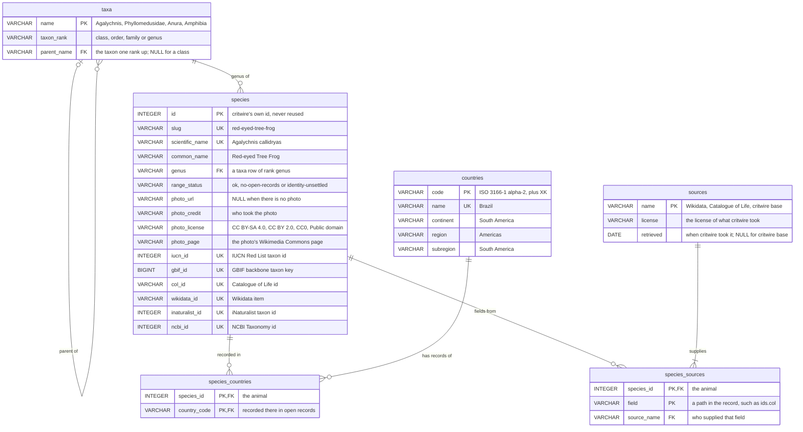

# 002: critwire Learn

critwire Learn is a set of pages on critwire.com where people aged 16 and up who are new to SQL learn relational databases and SQL by asking questions about critwire's animals. The SQL runs in the learner's browser (DuckDB-WASM), on tables the page builds from the public `/v1` files, and the answers come back as animal cards. This document is the design that mission B builds from: the engine, the learners' tables, the ERD, the lessons, a query cookbook, the new countries file, one small demo game, the site, the mission B briefs and the owner's choices. Research and measurements: `plans/2026-10-22-critwire-learn-design.md` (mission A1) and its spike.

Every ```` ```sql ```` block in this file was run in DuckDB-WASM by the spike's `run-queries.ts`, and the ```` ```text ```` block after it is the result it gave (row count, a hash of the whole result, the first rows). Each block's `-- status:` says what it ran against: `ran` (today's data) or `draft-table` (needs the countries file mission B publishes; it ran against the spike's draft of it).

## 1. Engine and interface

**Recommendation: DuckDB-WASM 1.33.1-dev65.0 (DuckDB v1.5.6), `eh` bundle only, in a Web Worker, every file self-hosted from critwire.com, with critwire's own `<textarea>` editor and cards.** It met every budget the design set except one (warm start on a slow laptop), and PGlite, the one real alternative, missed that one too and also missed the memory budget. The fix for the slow warm start is page design (one engine start per visit, below), not another engine.

Key numbers (medians of 5, live Caddy config; time to first result = page open → Brazil cards drawn):

| | DuckDB-WASM eh | PGlite 0.5.10 |
|---|---|---|
| first load on the wire | 9.02 MB (40.28 MB uncompressed) | 6.44 MB (19.39 MB) |
| first result, desktop: first visit / returning | 2.9 / 2.5 s | 4.0 / 2.4 s |
| first result, school Wi-Fi (4× slower CPU): first visit / returning | 27.1 / 15.1 s | 35.7 / 14.0 s |
| first result, slow 4G (6× slower CPU): first visit / returning | 64.2 / 22.0 s | 70.3 / 21.6 s |
| peak memory of the tab (renderer RSS) | 0.50–0.52 GB | 1.07–1.44 GB |
| longest freeze of the page while starting, desktop / 4× | 0 / 0.29 s | 2.8 / 20.3 s |

Sources: `spike/out/duckdb-live/`, `spike/out/pglite-live/`, `spike/out/pglite-live-duckdb-probe/` (DuckDB's freeze at 4×). `spike/` is the mission's scratch folder, `/srv/critter-ai/agent-state/missions/critwire-learn-design/spike/`; each `out/<run>/summary.md` has every median and maximum, and `README.md` has the commands that reproduce it.

### How it was measured

- **Where:** Playwright 1.58.2's Chromium 145 (full browser, headless) on the 2-core ARM VPS, against the spike's copy of the live Caddy block on `127.0.0.1:3102`. The page is the Brazil lesson (lesson 9): boot, run `setup.sql`, run the join, draw 12 cards.
- **Profiles:** desktop (no limits); school Wi-Fi (CPU 4× slower, 5 / 1 Mbps, 100 ms); slow 4G (CPU 6× slower, 1.6 / 0.75 Mbps, 150 ms). Each cell: 5 first visits (new browser profile, empty cache) and 5 returning visits (reload, cache warm).
- **CPU throttling:** Chrome's own throttle (`Emulation.setCPUThrottlingRate`) slows the page 4.1× but the DuckDB worker only 1.01× (`spike/out/throttle-validation/`), so it can't emulate a slow laptop for a worker-based engine. Every throttled run instead ran the whole browser under a Linux CPU quota (`systemd-run --scope -p CPUQuota=25%` for 4×), which slows the worker 4.04×. Every engine was throttled the same way.
- **Network throttling:** Chrome's network emulation does reach the worker: the engine `.wasm` took 12.9 s at school Wi-Fi against 12.9 s expected from its size (ratio 1.00).
- **Bytes** from Caddy's access log (what left the server); **memory** from the renderer process's peak RSS (`VmHWM`, page + worker + WASM), the page's JS heap and the WASM linear memory; **times** from marks in the page.
- **Self-hosting proof:** every run fails any request to a host other than the spike's own and the two Wikimedia photo hosts, and lists it. Every list is empty.

### Q1. Can DuckDB-WASM reliably query critwire's Parquet files?

**Yes, on desktop Chromium and on an emulated low-end Chromebook.** 0 failures in 30 loads per bundle (eh and mvp, 3 profiles × 5 first visits + 5 returning visits) plus 15 extra eh runs (rebuild, Reset, runaway query), and in 30 loads under the proposed Caddy config (`spike/out/duckdb-live/`, `spike/out/duckdb-proposed/`).

What the spike learned on the way:
- **Parquet needs an extension.** duckdb-wasm statically links only `core_functions`; `parquet` is a loadable extension in this build and in 1.32.0 alike. The page loads it from critwire's own extension mirror at start (0.74 MB on the wire), with automatic extension downloads turned off. See Q3.
- **The file is read whole.** For a registered file duckdb-wasm makes one plain `GET` per fresh database (200, no `Range`): `species.parquet` is 32 KB, so that's right for v1. Range reads of large files are A2's question; with full-file reads disabled, duckdb-wasm's probe reached Caddy without a `Range` header and the open failed (`spike/out/boot/`).
- **Use `eh`, drop `mvp`.** `mvp` (for browsers without WebAssembly exception handling) loses every SQL error message: a learner would read `_setThrew is not defined` instead of DuckDB's error. It's also slower (first result 3.4 / 31.3 / 73.1 s against eh's 2.9 / 27.1 / 64.2 s) and 1.08 MB bigger. eh needs Chrome 95, Firefox 100 or Safari 15.2 (2021–2022); an older browser gets a plain "your browser is too old for Learn's database" notice instead (§8).
- **The threaded `coi` bundle doesn't work.** Its parquet extension imports non-shared memory and fails to link (`LinkError`), and its start hung past 60 s in 6 of 10 tries: no database in 10 of 10 (`spike/out/coi/`). It would also have needed `Cross-Origin-Embedder-Policy` on every page. A2 should check again only if DuckDB publishes shared-memory `wasm_threads` extensions.

What a 4 GB Chromebook means for this, in short: a Learn tab peaks at about 0.5 GB, which a 4 GB Chromebook can hold as one heavy tab. With many tabs open, ChromeOS may discard it in the background, and coming back costs a returning-visit start (15–22 s at 4–6×). See "What emulation proves" below.

### Q2. First-load size, start time and memory

All three engines side by side (medians of 5; MB = 10^6 bytes; times to the first result):

| | DuckDB-WASM eh | DuckDB-WASM mvp | PGlite 0.5.10 (PostgreSQL 18.6) | sql.js 1.15.1 (SQLite 3.54.0) |
|---|---|---|---|---|
| first load, wire (live: zstd on the fly) | 9.02 MB | 10.10 MB | 6.44 MB | 0.37 MB (files only) |
| first load, uncompressed | 40.28 MB | 45.58 MB | 19.39 MB | 0.73 MB |
| desktop: first visit / returning | 2.9 / 2.5 s | 3.4 / 2.9 s | 4.0 / 2.4 s | not run |
| school Wi-Fi 4×: first visit / returning | 27.1 / 15.1 s | 31.3 / 16.9 s | 35.7 / 14.0 s | not run |
| slow 4G 6×: first visit / returning | 64.2 / 22.0 s | 73.1 / 25.8 s | 70.3 / 21.6 s | not run |
| peak renderer memory (worst profile) | 518 MB | 529 MB | 1 440 MB | not run |
| WASM linear memory | 50 MB | 50 MB | 198 MB (+ 67 MB initdb) | |
| page JS heap | < 10 MB | < 10 MB | 19–32 MB | |
| where it runs | worker | worker | page's main thread | page's main thread |

Sources: `spike/out/duckdb-live/`, `spike/out/pglite-live/`, `spike/out/sqljs/`, `spike/out/bytes/`. The same 7 tables and view, the same 37 columns, the same row counts and the same 12 Brazil rows were checked in PGlite before it was timed (`spike/out/pglite-check/`).

- **Where DuckDB's time goes.** A returning visit downloads nothing (0 bytes), so its time is all CPU: at 6×, starting the worker and compiling the cached 36 MB module (with `LOAD parquet`) takes 17.8 s, the setup 3.4 s, the query and cards 0.8 s. On desktop the same steps take 2.0 / 0.4 / 0.1 s. Bytes matter only for the first visit.
- **Deploys don't cost returning learners the engine again.** The build gives every vendored engine file a fixed modification time, so Caddy's ETag stays the same across deploys: in 15 of 15 "rebuild, then reload" runs no engine file was downloaded again, only 0.10 MB of page and data files.
- **PGlite's real cost is a frozen page.** Postgres runs on the page's main thread, which froze for up to 2.8 s on desktop and 20.3 s at 4× while it started; the editor and buttons can't respond meanwhile. PGlite has a worker mode, which would stop the freezing but change neither its start time nor its memory.
- **sql.js** is SQLite compiled to WebAssembly, and at 0.37 MB it is about 24 times smaller than DuckDB's first load. It is still the wrong engine for Learn. It can't read Parquet or fetch files, so the page would build every table from the JSON itself and could never read a growing `/v1` file in place. SQLite's typing is loose (an `INTEGER` column accepts `'abc'` unless the table is `STRICT`) and foreign keys are off until `PRAGMA foreign_keys = ON`: the opposite of what the keys and normalization lessons teach. It has no `information_schema` (lesson 6) and no path to spatial queries (A2). A small download doesn't outweigh teaching non-standard behaviour.
- **The threaded `coi` bundle** never gave a database (Q1); its failed starts took 4.8 s on desktop and 37–42 s at 4×, longer than eh's whole start on the same page (2.3 / 14.7 s).

**The engine decision (A1 plan, Architecture §5).** DuckDB-WASM had to meet: 0 failures; a returning visit's first result at slow 4G within 8 s; a first visit's first result at school Wi-Fi within 40 s; peak memory within 700 MB. PGlite would replace it only if DuckDB missed a budget even with the proposed Caddy config, PGlite met every budget, and PGlite was at least 1.5× better on what DuckDB missed.

| budget | DuckDB eh, live | DuckDB eh, proposed Caddy | PGlite, live |
|---|---|---|---|
| 0 failures | met (0 of 30 + 15) | met (0 of 30) | met (0 of 30) |
| returning visit, slow 4G ≤ 8 s | **missed**: 22.0 s | **missed**: 23.9 s | **missed**: 21.6 s |
| first visit, school Wi-Fi ≤ 40 s | met: 27.1 s | met: 23.6 s | met: 35.7 s |
| peak memory ≤ 700 MB | met: 518 MB | met: 516 MB | **missed**: 1 440 MB |

PGlite misses two budgets and is only 1.02× faster (1.11× against the proposed config) on the one DuckDB misses, so DuckDB-WASM stays. Both engines need about 20 s of CPU to start on a 6× slower machine, so the answer is to start the engine rarely:
- **One engine start per Learn visit.** Every lesson has its own static page and URL, but with JavaScript on, moving between lessons, the schema page, the cookbook and the playground swaps the page's content in place and keeps the running database (§8). A learner pays the start once per visit, not once per lesson.
- **Readable before it's ready.** The lesson text and the editable SQL are plain HTML; only Run waits for the database, and it shows how much of the engine has loaded (§8).
- **Restarts only when needed:** Reset, Stop, and recovery from a crashed worker or a failed allocation (Q5). A restart costs a returning visit's start (2.4 s desktop, 14.2 s at 4×, 21.0 s at 6×).

What that leaves, for §10: on a low-end machine a learner waits about 15–24 s for the first result of each visit once the engine is cached, and about 24–64 s on the very first visit, depending on the network and the Caddy config.

### Q3. Can everything be self-hosted?

**Yes: the engine, its worker, its extensions and the application all come from critwire.com, and Caddy works unchanged.** No run in the spike made a request to any host other than critwire's own and the Wikimedia photo hosts.

- **Engine files** are copied from the pinned npm package into `/learn/assets/duckdb-1.33.1-dev65.0/` (`duckdb-eh.wasm`, `duckdb-browser-eh.worker.js`) and loaded by URL, never through duckdb-wasm's jsDelivr helper. Schools often block CDNs, and the brief requires critwire.com to work alone.
- **The application** (page code, duckdb-wasm's JS, Apache Arrow, the card and check code, `setup.sql` as text) is one esbuild bundle with a content hash in its name (§8).
- **The extension mirror works with signatures on.** DuckDB's own layout under critwire's origin, `/learn/assets/duckdb-ext/v1.5.6/wasm_eh/<name>.duckdb_extension.wasm`, with the files byte-identical to `extensions.duckdb.org`. The page sets `custom_extension_repository` to it and turns off automatic installs and loads, so a missing extension fails with an error naming critwire's own URL instead of fetching from DuckDB's servers. `INSTALL` fetches nothing in the browser; `LOAD` makes the one request. `parquet`, `inet` and `spatial` loaded and answered (`POINT (1 2)`, `192.168.1.5`) with `allow_unsigned_extensions` off, and a copy of `inet` with one changed byte was refused ("signature is either missing or invalid"), so self-hosting needs no unsigned mode (`spike/out/ext-mirror/`).
  - v1 needs only `parquet` (3.22 MB file, 0.74 MB on the wire). It isn't an npm package, so mission B's offline build needs the binary in the repo or a pinned download: §10.
  - For A2: `spatial` is 23.63 MB (6.33 MB on the wire live, 4.53 MB precompressed), about 6× the parquet extension, and took 1.5 s to install, load and answer on desktop. Load it in spatial lessons only, never at start.
- **What Caddy needs: nothing, to work.** It already serves `.wasm` (and `.duckdb_extension.wasm`) as `application/wasm`, everything is same-origin (no CORS), and mission B's fixed file times keep ETags stable across deploys (Q2). Two improvements are the control room's change and the owner's choice (§10), measured under `Caddyfile.proposed` (`spike/out/duckdb-proposed/`, `spike/out/bytes/`, `spike/out/classroom/`):

  | | live (zstd on the fly) | proposed (precompressed br + zstd, `immutable`) |
  |---|---|---|
  | first load on the wire | 9.02 MB (engine `.wasm` 7.98 MB) | 6.25 MB (engine `.wasm` 5.47 MB br) |
  | first visit: school Wi-Fi / slow 4G | 27.1 / 64.2 s | 23.6 / 51.4 s |
  | returning visit | unchanged (CPU-bound) | unchanged |
  | a class of 10 loading the engine at once: Caddy CPU (wall) | 3.47 s (1.89 s) | 0.05 s (0.09 s) |

  - **Precompression** (`file_server { precompressed br zstd gzip }`, with `.br` and `.zst` files the build writes next to each engine file) cuts the first load by 31 % and saves Caddy about 0.35 CPU seconds per learner's first load on this 2-core server. Its cost is build time: brotli at level 11 takes about 2 minutes for the shipped eh files, which the build can skip when the versioned file hasn't changed.
  - **`Cache-Control: public, max-age=31536000, immutable` on `/learn/assets/*`** saves the revalidation request on returning visits; safe because every engine and app file name carries its version or hash.
  - Under that config, returning visits made no request for the `/v1` files at all (Chromium's heuristic freshness: `/v1` has no `Cache-Control`), so a learner could see yesterday's data for a while; with the live config they get 304s. If the control room adds headers, `/v1/*` should get `Cache-Control: no-cache` in the same change (§8, §10).
  - `e2e/serving.spec.ts` fails when `e2e/Caddyfile` drifts from the live block, so any change goes into the ops Caddyfile first and the E2E copy after it.

### Q4. The DuckDB shell, or our own editor?

**Our own editor: a plain `<textarea>` with a Run button, everywhere (lessons, cookbook, game, playground).** The shell is cheap to embed but fails learners who most need help (`spike/out/shell/`).

- **It works on critwire's tables.** `@duckdb/duckdb-wasm-shell` (same version, self-hosted) embeds with `embed({ shellModule, container, resolveDatabase: async () => engine.db })` on the database the setup already built: `SELECT count(*) FROM species;` returned 76 at the first prompt, and tables created in the shell are visible to the page. Its URL hash runs queries when it opens, so a cookbook entry could link to it.
- **It costs little to download:** 0.39 MB `shell_bg.wasm` + 0.17 MB of page code on the wire, about 5 % on top of the engine, and 0.2–0.7 s to open after setup on desktop.
- **But it fails screen readers:** results are either pixels on a canvas (WebGL, its default) or hidden from assistive technology (`aria-hidden` rows); its options can't turn on xterm's screen-reader mode, so a screen reader hears only "Terminal input".
- **On-screen keyboards don't type in it:** it reads only raw key presses, so text from Android keyboards, input methods and dictation is dropped (Enter still arrives). Hardware keyboards work, and the layout fits 375 px.
- **Keys typed while a query runs are lost**, and if the GPU is blocklisted (WebGL2 advertised, no context), the shell doesn't open at all.
- **It can't do Learn's job:** a terminal can't draw cards or check exercises.
- **Maintenance:** a second package from Rust/WebAssembly we can't patch without a Rust toolchain, kept in lockstep with duckdb-wasm, and depending on `xterm` 5.3.0, which npm marks deprecated.

So the shell is at most an optional "open in the DuckDB shell" link on the playground for people who already know SQL, never the only way in (§10). Mission B doesn't build it.

### Q5. How query results drive the interface

The spike built this as the lesson 9 page (`spike/out/card-page/`: 20 checks, 0 failures; screenshots `brazil-1280.png`, `brazil-1280-dark.png`, `brazil-375.png`, `no-photo.png`). Mission B ports these modules; each is pure except the engine.

**The engine** (`engine.ts`) is the one way a database comes into being: for the first start, for Reset and for Stop.

```ts
// One fresh database: new worker, instantiate the self-hosted eh bundle, settings, then setup.sql.
async function fresh(bundle: DuckDBBundle): Promise<Live> {
  const worker = new Worker(bundle.mainWorker);
  const db = new AsyncDuckDB(new VoidLogger(), worker);
  // A worker that fails to load only fires `error`; instantiate alone would wait forever.
  await Promise.race([db.instantiate(bundle.mainModule, null, onProgress), workerError(worker)]);
  await db.open({ path: ":memory:" });
  for (const f of ["species.parquet", "countries.parquet"])
    await db.registerFileURL(f, `${location.origin}/v1/${f}`, DuckDBDataProtocol.HTTP, false);
  const conn = await db.connect();
  await runScript(conn, [
    "SET autoinstall_known_extensions = false",   // never fetch from extensions.duckdb.org
    "SET autoload_known_extensions = false",
    "SET memory_limit = '512MB'",                 // a runaway sort fails with DuckDB's own error, not a dead tab
    `SET custom_extension_repository = '${location.origin}/learn/assets/duckdb-ext'`,
    "LOAD parquet",
  ].join(";\n"));
  await runScript(conn, SETUP);                   // §2; esbuild imports setup.sql as text
  return { db, conn };
}
```

- **`runScript(text, params?)`** splits the text into statements (top-level `;`, outside quotes and comments), runs them in order and returns the last one's `{ columns, rows }` as plain values. A whole multi-statement string sent to DuckDB at once returns the *first* statement's result, which is why it splits. An error names its statement ("Error in statement 2 of 3: …") and keeps DuckDB's text. `params` bind to the last statement's `?`.
- **Huge results are capped before they exist.** Running the 21-million-row join `SELECT * FROM species, species_countries, species_sources` the plain way made duckdb-wasm build the whole result: it failed with `malloc of size 2147483648 failed` after a 2.6 GB peak, and the worker kept 2.2 GB until a restart (`spike/out/duckdb-live/`). A 4 GB Chromebook would more likely crash the tab. Instead, the last statement is streamed (`conn.send(sql, true)`) and reading stops after 10 000 rows: the same join then took 0.14 s with a 387 MB peak, and the result kept the query's column names and row order exactly (`spike/out/cap/`). The page keeps at most 10 000 rows and draws at most 200 ("showing 200 of more than 10 000"). Statements before the last run as usual. Wrapping the learner's query in `SELECT * FROM (…) LIMIT …` also bounds memory, but it renames duplicate columns (`a, a` became `a, a_1`) and works only for queries, so it isn't used. A sort over the same join runs inside DuckDB's memory manager and stops at `memory_limit` with DuckDB's "Out of Memory Error"; the page explains that the query needed more memory than a browser tab gets.
- **Start failures are loud.** A worker that can't load fails at once ("DuckDB worker failed to load: <url>"). A missing engine `.wasm` makes duckdb-wasm wait forever without an error (seen in the spike), so mission B's engine first sends a `HEAD` for the `.wasm` and fails with its HTTP status. The page shows "The database couldn't start: <reason>", never an endless spinner.

**Results to cards.**
- **Only when the SQL says so:** a result shows as cards only if the SQL's first line is `-- show: cards`; everything else is a table. Nothing is guessed from columns, so `SELECT count(*) AS id FROM species` is a table and a large count. Lesson 1 explains the line; it travels with the SQL into the cookbook, the playground and copy-paste.
- **The card rule:** the key is the column `species_id` if the result has one, else `id`. Every value must be a whole number, appear once, and be a known species id; otherwise the page shows the table with one line saying why ("Cards need one row per animal, with its id in `id` or `species_id` (`id` 999 is not an animal's id)."). The query runner and mission B's E2E fail a `-- show: cards` query that breaks it.
- **What a card shows:** title, scientific name and photo come from a lookup the page builds after setup (`SELECT id, common_name, scientific_name, photo_url, photo_credit, photo_license, photo_page FROM species`), never from the row, so `SELECT id FROM species` still draws full cards. The row's other columns appear as small "column: value" lines, except columns the card already shows.
- **Credits:** always visible: "Photo: {credit}, {license linked to its deed}, via Wikimedia Commons" (linked to the file page). Deed URLs come from the repo's `LICENSE_URLS` (`scripts/build/sources.ts`), which the browser bundle imports; an unknown license fails the build, and public domain shows unlinked.
- **No photo:** a neutral "No photo yet" box with `role="img"` and a label, and no credit line (ids 19 and 47).
- **Photos** load straight from Wikimedia with `crossorigin="anonymous"`, `referrerpolicy="no-referrer"` and `loading="lazy"`. Wikimedia sends `access-control-allow-origin: *`, so `crossorigin` costs nothing and would keep working if a page ever became cross-origin isolated (checked: 12 of 12 load under COEP; without `crossorigin` they're blocked).
- **The Table tab** always shows the raw result as a real `<table>`; a one-row, one-number result also shows as a large count. A statement that changes data says "N rows changed" rather than "1 row".

**Exercise checks** run in the page against today's data, so they keep working as the data grows; nothing stores expected rows.
- `result`: the learner's result against the reference answer's, by position (column names ignored), as a multiset unless the exercise is ordered. Hints name the difference: column count, row count, row order ("check your ORDER BY"), column order, or "some rows differ".
- `error`: the learner's last statement must fail with a constraint error (lesson 7: two animals can't share an id).
- `schema`: a verify query on `information_schema` or `duckdb_constraints()` against expected rows written in the lesson, run on the learner's own tables (lesson 16).
- **Pristine references:** right after every setup (start, Reset, Stop), before any learner statement, the page runs every reference answer of the whole path inside `BEGIN … ROLLBACK` and keeps the rows in memory. With one engine start per visit, a learner's `DELETE` in lesson 7 can't change lesson 9's expected answer. In the spike, after deleting India's country rows, the India exercise reported "Your result has 0 rows; the answer has 6. Changed the tables? Reset database brings them back."; after Reset it passed again. Mission B measures this step (16 small queries) and keeps it under 10 % of the setup's time; if it can't, it computes a lesson's reference when the lesson opens while no learner statement has changed data, and otherwise asks for Reset.

**Reset and Stop both restart the engine** (terminate the worker, build a fresh database, setup, references), keeping the editor text.
- Reset is how a learner undoes their own tables: DuckDB can't drop a table another table references (§2), so re-running the setup can't reset anything. 2.4 s on desktop, 14.2 s at 4×.
- Stop: while a query runs, Stop is enabled. A single-threaded worker can't be interrupted mid-query, so Stop restarts it ("Stopped. The query couldn't be interrupted, so the database was restarted; your changes are gone."). A late result from the old worker is dropped, because the page counts restarts. In the spike, Stop took 3.2 s on desktop and the next query ran.
- A crashed worker, or a failed allocation (the WASM memory never shrinks), takes the same path and says why.

**Games** read results the same way (§5, §7): each cookbook query is a `.sql` file the bundle imports as text, so the cookbook page, the game and E2E share one source. The game binds its parameters (today's UTC date, a seed) to `?`, turns rows into game state with pure functions, and draws the same card component with each card as a button, passing species ids explicitly (games don't use `-- show: cards`).

### What emulation proves, and what only real devices can

**Proven here** (Chromium 145, ARM server, CPU quota and network emulation): that the engine starts and answers reliably at 4× and 6× slower CPU and on slow networks; how long each step takes there; how many bytes cross the network; and the peak memory Chromium needs for a Learn tab (about 0.5 GB). Screenshots at 375 px check the layout.

**Only real devices can show:**
- **A real Chromebook's memory pressure:** whether ChromeOS discards a 0.5 GB tab in the background at 4 GB, and where a tab is killed. A Chromebook's GPU, thermal throttling and Chrome build are also untested.
- **Phones:** Android Chrome, and how on-screen keyboards behave in the `<textarea>`.
- **iOS Safari:** WebKit's own limits on WASM memory, and whether the eh bundle starts (Safari 15.2 and later support it). Every browser on iOS uses WebKit.
- **Firefox:** not run. Playwright's Firefox for this ARM server needs GTK libraries, which means apt packages, outside this mission (`spike/out/firefox/`). Firefox 100 and later support the eh bundle.

§10 asks the owner for one check of about 15 minutes before mission B2's demo ships: a lesson and the demo on an iPhone, and on a Chromebook if one is at hand.

## 2. The learners' schema, first version

### How it's built

When a Learn page loads, it starts DuckDB-WASM on an empty in-memory database and runs one script, `setup.sql` (the `setup` block below), which builds every learners' table from two public files: `/v1/species.parquet` (exists today) and `/v1/countries.parquet` (new in mission B, §6). That script is the only way a learners' database comes into being. The Learn pages, the playground, the demo, mission B's E2E suite and this document's query runner all run the same text, so a lesson can't depend on a table that some other path built differently.

- **Learners never see the nested file.** `species.parquet` keeps critwire's nested record shape (structs such as `taxonomy` and `photo`, lists such as `range.countriesWithOpenRecords` and `sources`) and camelCase names. The setup flattens it into plain tables with snake_case names, and lessons use only standard SQL on those tables. The DuckDB-specific parts (`read_parquet`, `unnest`, struct access with `.`) appear only in the setup, and in lesson 14, which shows them labelled as DuckDB.
- **Order matters.** DuckDB declares foreign keys only inside `CREATE TABLE` (`ALTER TABLE … ADD FOREIGN KEY` is not implemented) and checks them statement by statement, so every table a key points at is created and filled first:
  1. `taxa`, one `INSERT` per rank, top down (class, order, family, genus): a single multi-row `INSERT` whose rows point at parents inserted by that same statement fails the foreign key check;
  2. `species` (its `genus` points at `taxa`);
  3. `sources`, then `species_sources`;
  4. `countries`, then `species_countries` (both keys);
  5. the view `species_taxonomy`.
- **Nothing is ever dropped.** DuckDB refuses to drop a table another table still references (`CASCADE` doesn't help), so re-running the setup can't reset a database. A fresh database comes only from restarting the engine (a new worker and a new in-memory database, then the setup again). That is what the page's Reset button does (§1, §8).
- **It fails loudly.** Bad data breaks a constraint instead of slipping through: a species country code missing from `countries` (foreign key), a source with two licenses or two dates (primary key of `sources`), a taxon name used at two ranks (primary key of `taxa`), a class with a parent or a genus without one (check). The page then shows DuckDB's error, and mission B's E2E suite runs this same setup, so a deploy can't ship a setup that fails.
- **What it costs.** The setup is 16 statements. The page loads DuckDB's `parquet` extension from critwire.com's own mirror before running it (§1). Each data file is fetched once per fresh database (about 32 KB for `species.parquet`).

### Tables

Names: entity tables are plural snake_case (`species`, `taxa`, `countries`, `sources`); a junction table is named after the two tables it joins (`species_countries`, `species_sources`); a foreign key column is named after what it points at (`species_id`, `country_code`, `source_name`, `parent_name`; `species.genus` keeps its everyday name). Scalar columns use the names the repo's own `db/schema.sql` already gives them (`scientific_name`, `common_name`, `range_status`, `photo_url`, `iucn_id`, …), and no column needs quoting in SQL: `order` and `range` are reserved words, so the view says `order_name` and `species` says `range_status`.

| Table | Columns and keys | Built from |
|---|---|---|
| `taxa` | `name` VARCHAR, primary key; `taxon_rank` VARCHAR NOT NULL, one of `class`, `order`, `family`, `genus`; `parent_name` VARCHAR, foreign key → `taxa.name`, NULL exactly for classes (a check) | the distinct `taxonomy.class`, `.order`, `.family` and `.genus` values, each with the rank above it as parent |
| `species` | `id` INTEGER, primary key; `slug` VARCHAR NOT NULL, unique; `scientific_name` VARCHAR NOT NULL, unique; `common_name` VARCHAR NOT NULL; `genus` VARCHAR NOT NULL, foreign key → `taxa.name`; `range_status` VARCHAR NOT NULL, one of `ok`, `no-open-records`, `identity-unsettled`; `photo_url`, `photo_credit`, `photo_license`, `photo_page` VARCHAR; `iucn_id` INTEGER, `gbif_id` BIGINT, `col_id` VARCHAR, `wikidata_id` VARCHAR, `inaturalist_id` INTEGER, `ncbi_id` INTEGER, each unique and nullable | one row per record: `id`, `slug`, `scientificName`, `commonName`, `taxonomy.genus`, `range.status`, the `photo` fields, the `ids` fields |
| `sources` | `name` VARCHAR, primary key; `license` VARCHAR NOT NULL; `retrieved` DATE (NULL for `critwire base`, critwire's own fields) | the distinct (`source`, `license`, `retrieved`) of every record's `sources` list |
| `species_sources` | `species_id` INTEGER NOT NULL, foreign key → `species.id`; `field` VARCHAR NOT NULL (a path in the record, such as `ids.col` or `taxonomy`); `source_name` VARCHAR NOT NULL, foreign key → `sources.name`; primary key (`species_id`, `field`) | each record's `sources` list, then each entry's `fields` list: which source supplied which field of which animal |
| `countries` | `code` VARCHAR, primary key (ISO 3166-1 alpha-2, plus `XK` for Kosovo, as GBIF uses it); `name` VARCHAR NOT NULL, unique; `continent`, `region`, `subregion` VARCHAR NOT NULL | `/v1/countries.parquet` (§6): Natural Earth admin-0 attributes, 250 rows |
| `species_countries` | `species_id` INTEGER NOT NULL, foreign key → `species.id`; `country_code` VARCHAR NOT NULL, foreign key → `countries.code`; primary key (`species_id`, `country_code`) | each record's `range.countriesWithOpenRecords` list, one row per code |
| view `species_taxonomy` | `species_id`, `class`, `order_name`, `family`, `genus` | `species` joined to `taxa` four times, genus up to class |

**What `species_countries` means.** A row says the animal has been *recorded in that country in open (CC0 or CC BY) occurrence records on GBIF*, after critwire's filters (§6 and the docs page). It is not the native range: open records include zoos, introductions and the odd stray. Every lesson that uses it says so, and the table keeps that one meaning for good; a native range, if critwire ever has one, would be a new table (for example `species_native_countries`), never a new meaning for this one. Four animals have no rows: three whose GBIF identity isn't settled yet (`range_status` `identity-unsettled`) and one with no open records left after filtering (`no-open-records`). Lessons 4 and 11 use them.

**Relationships** (§3 draws them):
- `taxa` → `taxa`: each taxon except a class has one parent; a taxon can have many children (one-to-many, the hierarchy).
- `taxa` → `species`: a genus has many species; each species has one genus (one-to-many).
- `species` ↔ `countries` through `species_countries`: many-to-many.
- `species` ↔ `sources` through `species_sources`: many-to-many; every species cites at least one source.

### The setup

The `setup` block must equal the spike's `src/setup.sql` byte for byte; `run-queries` refuses a plan where they differ. It has no result block, because it is what builds the database the other blocks run on.

```sql
-- q: setup
-- status: ran
-- critwire Learn: the learners' tables (schema v1), built on a fresh in-memory database
-- from /v1/species.parquet and /v1/countries.parquet. Every table a foreign key points at is
-- created first, and taxa go in one rank per INSERT, top down: DuckDB declares foreign keys
-- only in CREATE TABLE and checks them statement by statement. Nothing is ever dropped;
-- a fresh database comes from a restart.

CREATE TABLE taxa (
  name        VARCHAR PRIMARY KEY,
  taxon_rank  VARCHAR NOT NULL CHECK (taxon_rank IN ('class', 'order', 'family', 'genus')),
  parent_name VARCHAR REFERENCES taxa (name),
  CHECK ((taxon_rank = 'class') = (parent_name IS NULL))
);

INSERT INTO taxa
SELECT DISTINCT taxonomy.class, 'class', NULL FROM read_parquet('species.parquet');

INSERT INTO taxa
SELECT DISTINCT taxonomy."order", 'order', taxonomy.class FROM read_parquet('species.parquet');

INSERT INTO taxa
SELECT DISTINCT taxonomy.family, 'family', taxonomy."order" FROM read_parquet('species.parquet');

INSERT INTO taxa
SELECT DISTINCT taxonomy.genus, 'genus', taxonomy.family FROM read_parquet('species.parquet');

CREATE TABLE species (
  id              INTEGER PRIMARY KEY,
  slug            VARCHAR NOT NULL UNIQUE,
  scientific_name VARCHAR NOT NULL UNIQUE,
  common_name     VARCHAR NOT NULL,
  genus           VARCHAR NOT NULL REFERENCES taxa (name),
  range_status    VARCHAR NOT NULL CHECK (range_status IN ('ok', 'no-open-records', 'identity-unsettled')),
  photo_url       VARCHAR,
  photo_credit    VARCHAR,
  photo_license   VARCHAR,
  photo_page      VARCHAR,
  iucn_id         INTEGER UNIQUE,
  gbif_id         BIGINT UNIQUE,
  col_id          VARCHAR UNIQUE,
  wikidata_id     VARCHAR UNIQUE,
  inaturalist_id  INTEGER UNIQUE,
  ncbi_id         INTEGER UNIQUE
);

INSERT INTO species
SELECT id, slug, scientificName, commonName, taxonomy.genus, "range".status,
       photo.url, photo.credit, photo.license, photo.page,
       ids.iucn, ids.gbif, ids.col, ids.wikidata, ids.inaturalist, ids.ncbi
FROM read_parquet('species.parquet');

CREATE TABLE sources (
  name      VARCHAR PRIMARY KEY,
  license   VARCHAR NOT NULL,
  retrieved DATE
);

INSERT INTO sources
SELECT DISTINCT s.source, s.license, CAST(s.retrieved AS DATE)
FROM (SELECT unnest(sources) AS s FROM read_parquet('species.parquet'));

CREATE TABLE species_sources (
  species_id  INTEGER NOT NULL REFERENCES species (id),
  field       VARCHAR NOT NULL,
  source_name VARCHAR NOT NULL REFERENCES sources (name),
  PRIMARY KEY (species_id, field)
);

INSERT INTO species_sources
SELECT id, unnest(s.fields), s.source
FROM (SELECT id, unnest(sources) AS s FROM read_parquet('species.parquet'));

CREATE TABLE countries (
  code      VARCHAR PRIMARY KEY,
  name      VARCHAR NOT NULL UNIQUE,
  continent VARCHAR NOT NULL,
  region    VARCHAR NOT NULL,
  subregion VARCHAR NOT NULL
);

INSERT INTO countries
SELECT code, name, continent, region, subregion FROM read_parquet('countries.parquet');

-- Countries with open (CC0 / CC BY) occurrence records, not the native range.
CREATE TABLE species_countries (
  species_id   INTEGER NOT NULL REFERENCES species (id),
  country_code VARCHAR NOT NULL REFERENCES countries (code),
  PRIMARY KEY (species_id, country_code)
);

INSERT INTO species_countries
SELECT id, unnest("range".countriesWithOpenRecords) FROM read_parquet('species.parquet');

CREATE VIEW species_taxonomy AS
SELECT s.id AS species_id, c.name AS class, o.name AS order_name, f.name AS family, g.name AS genus
FROM species AS s
JOIN taxa AS g ON g.name = s.genus
JOIN taxa AS f ON f.name = g.parent_name
JOIN taxa AS o ON o.name = f.parent_name
JOIN taxa AS c ON c.name = o.parent_name;
```

The row count of every table and of the view, today (`countries` is the spike's draft, so this block is `draft-table`):

```sql
-- q: setup-counts
-- status: draft-table
SELECT (SELECT count(*) FROM taxa)              AS taxa,
       (SELECT count(*) FROM species)           AS species,
       (SELECT count(*) FROM sources)           AS sources,
       (SELECT count(*) FROM species_sources)   AS species_sources,
       (SELECT count(*) FROM countries)         AS countries,
       (SELECT count(*) FROM species_countries) AS species_countries,
       (SELECT count(*) FROM species_taxonomy)  AS species_taxonomy;
```

```text
-- result: setup-counts · 1 row · sha256 a46604343811
taxa | species | sources | species_sources | countries | species_countries | species_taxonomy
143 | 76 | 5 | 591 | 250 | 472 | 76
```

### Limits the lessons state

- **A foreign key checks existence, nothing more.** `species.genus` points at `taxa.name`, but no constraint can make sure the row it points at is a *genus*: a check constraint sees only its own row. Lesson 12 says so, and that enforcing it would take a trigger (DuckDB has none) or one table per rank. Learners shouldn't assume a foreign key checks more than it does.
- **Taxon names are a natural key because of today's data, not a rule of nature.** No name is used at two ranks or under two parents today, so `taxa.name` can be the primary key. Nomenclature allows the same genus name in animals and plants, though. Mission B's `pnpm derive` refuses (as a blocking mismatch) a taxon name at two ranks or under two parents, so a collision stops the data build instead of breaking learners' browsers. Fixing one for real would be a schema change (a surrogate `taxa.id`), decided then.
- **No `DROP`, no `ALTER … ADD FOREIGN KEY`.** These are DuckDB limits (above). A learner who creates tables does it inside the page's database, and Reset (a restart) is how to start over.
- **Everything is in memory.** A learner's tables last until the page reloads or Reset; nothing is saved.

### Left out of v1

- `replacedBy`: null for every record today. When an id is first retired, a `species_replacements (species_id, replaced_by)` table joins on.
- Each source's query URL (`sources[].url`) and release details (`doi`, `release`): they describe how critwire fetched a field, not the animals, and they would turn `species_sources` into a wide table nobody queries in a lesson. The `/v1` files keep them.

### Room to grow (A2)

New data joins on with new tables and no renames:
- traits: `traits (name, unit, description)` + `species_traits (species_id, trait_name, value, unit, source_name)`; lesson 16 has learners design this one;
- habitats: `habitats` + `species_habitats`;
- regions: `regions` + `country_regions`;
- occurrences: `occurrences (id, species_id, country_code, …)`;
- new taxonomic ranks: new `taxa` rows, with the rank check widened.

Each new table is created after the tables it points at, in the same `setup.sql`.

## 3. Entity relationship diagram

The ERD is the map of the learners' tables: every table is a box, every column a row in it, and every foreign key a line between two boxes. Lesson 6 teaches learners to read it, and every lesson can open it. Its source is plain text in the repo, `plans/002-learn-erd.mmd` (mission B moves it to `site/learn/schema.mmd`); the block below is the same text, and the spike's `run-queries --erd` fails if they differ.



GitHub draws the block above in the PR. The spike's offline render of it is `<spike>/erd/schema.svg` and `schema.png` (mission A1's state folder, `scripts/erd.ts`).

**The view, beside the diagram.** `species_taxonomy (species_id, class, order_name, family, genus)` is a view, not a table: it stores nothing, it's the query that joins `species` to `taxa` four times (genus up to class). The ERD draws tables only, so the view appears in the legend under the picture and in the data dictionary, marked "view".

**How to read it.**
- A box is a table (an entity); each row is a column (an attribute) with its type, its key marks and a short note.
- `PK` primary key: the column (or columns, as in both junction tables) that names exactly one row. `FK` foreign key: a value that must exist as a key in another table. `UK` unique: no two rows share it (the natural and outside ids).
- A line is a foreign key, drawn from the table it points at to the table that holds it. Its ends say how many: `||` exactly one, `|o` zero or one, `o{` zero or more, `|{` one or more. So `taxa ||--o{ species` reads "each species has exactly one genus in `taxa`; a genus has zero or more species", and `taxa |o--o{ taxa` reads "each taxon has zero or one parent (classes have none)".
- Many-to-many is two one-to-many lines into a junction table: `species ||--o{ species_countries` and `countries ||--o{ species_countries`.

**What the check holds.** `run-queries --erd` (failure modes RQE1–RQE5) builds the database exactly as a Learn page does, reads its catalog (`information_schema.tables`, `information_schema.columns`, `duckdb_constraints()`) and fails on any drift: a table on one side only (the view drawn as a table counts), a column missing, extra or of another type, a `PK`/`FK`/`UK` mark the constraints don't back (or a constraint with no mark), a line with no foreign key behind it (or a foreign key with no line), and a `||` end on a nullable foreign key or a `|o` end on a NOT NULL one. The "one or more" ends (`|{`) are facts about the data, not constraints: every source is cited at least once because `sources` is built from the citations. The parser accepts only this subset of Mermaid and names the line of anything else, so no line is skipped unchecked.

### Why Mermaid

| Format | Crow's feet and keys | Renders offline here | Owner reviews it in a PR | Cost |
|---|---|---|---|---|
| **Mermaid `erDiagram`** | yes: cardinality ends, `PK`/`FK`/`UK`, a note per column | yes: `mermaid`'s browser bundle in Playwright's Chromium, which the E2E suite already runs | yes: GitHub draws `mermaid` blocks in Markdown | one pinned devDependency (`mermaid` 12.2.0), no install script |
| DBML | keys and refs, yes | no renderer in the DBML project: `@dbml/core` parses and converts to SQL; pictures come from dbdiagram.io (hosted) or community renderers outside the project | no, shown as text | a hosted tool or an unofficial renderer |
| PlantUML | IE notation, yes | needs Java (and Graphviz for some layouts) on the build machine | no, shown as text | a JVM on the VPS |
| D2 | `sql_table` shape with constraints, crow's-foot arrowheads | a Go binary to pin and download for arm64 | no, shown as text | a binary outside npm |
| DOT (Graphviz) | `crow` arrowheads, but tables and keys are hand-built HTML labels with no meaning a check can read | needs the `graphviz` apt package (out of scope) or a WASM port | no, shown as text | apt, and a drift check on free-form labels |

Mermaid is the only one that is text with ER meaning, renders with what the VPS already has, and shows as a picture where the owner reviews. Rendering it in the learner's browser instead was rejected: `mermaid.min.js` is 5.5 MB (1.6 MB gzipped) to draw one static picture.

### How the site shows it

- **From every lesson:** a "Schema" button opens a `<dialog>` holding the SVG as an `` (with alt text naming the six tables) and a link to `/learn/schema/`. A dialog keeps the learner's SQL in the editor; Escape closes it and focus returns to the button.
- **`/learn/schema/`:** the same SVG, a link to open it alone (pinch-zoom on a phone: it is 1901 × 1166 px), and the **data dictionary**: one table per entity (column, type, keys, note), the view, and each relationship in words ("each species has exactly one genus; a genus has zero or more species"). The dictionary is the accessible equivalent of the picture, generated at build time from the same `.mmd` with the parser above, so the two can't disagree.
- The SVG is drawn with `htmlLabels` off, so every label is SVG `<text>` and it renders inside `` (HTML labels need `<foreignObject>`, which `` won't draw). It is 142,522 bytes, 21,640 gzipped.

### How mission B builds it (offline, no mermaid-cli)

- **`pnpm erd`** (run by a person or agent after editing the `.mmd`, like `pnpm derive`): the spike's `scripts/erd.ts`, ported. It loads `mermaid`'s browser bundle into Playwright's Chromium with the route guard (any network request fails), runs Mermaid's parser (a syntax error fails with its message), renders, refuses `<foreignObject>` or a missing entity, sets the root `<svg>`'s `width`/`height` from its `viewBox` (so `` needs no CSS) and `data-source-sha256` to the sha256 of the `.mmd`, and writes `site/learn/schema.svg` through a temp file and a rename (a failed run leaves the old SVG). The SVG is committed next to its source.
- **`pnpm build`** stays offline and browserless: it hashes `site/learn/schema.mmd`, compares with the SVG's `data-source-sha256`, and refuses a mismatch with `site/learn/schema.svg is stale: run pnpm erd`, as derive refuses stale data. It copies the SVG and writes `/learn/schema/` with the data dictionary.
- **E2E** `schema.spec.ts` runs the `--erd` drift check against the database the browser builds from the deployed files, and screenshots the dialog.
- **Why not `@mermaid-js/mermaid-cli`:** it drives Puppeteer, whose install script downloads Chrome; the repo's `allowBuilds` only lets esbuild's script run, and Chrome for Testing has no linux-arm64 build for this VPS (F9). `mermaid` itself has no install script, and Playwright's Chromium is already here.
- **Labels are measured where the SVG is made.** Mermaid sizes each box from the font in the rendering browser, so `pnpm erd` sets `Verdana, "DejaVu Sans", sans-serif`: DejaVu Sans (this VPS) and Verdana (most learners' machines) have close widths, so text fits on both.

## 4. Lessons: the core path

Written in steps S15 and S16.

## 5. Cookbook

Written in steps S17 and S18.

## 6. The countries file

Written in step S19.

## 7. Demo

Written in step S20.

## 8. Site

Written in step S20.

## 9. Mission B

Written in step S21.

## 10. For the owner

Written in step S22.
