# 003: critwire Learn, growing the data and the spatial track

This extends [`002-learn.md`](002-learn.md) (engine, learners' schema, ERD and core lessons, all kept as they are) with what data critwire could add next and an advanced spatial track on PostGIS and the worldwide habitat map. It designs and measures; it builds nothing public. Every SQL block here was run by the spike or says why not (`-- status:`), and the build missions C and D start from the briefs in §7.

## 1. Growing the data

## 2. The grown schema and its ERD

The grown schema adds tables to 002's first version without renaming or changing any of it. Its setup runs after 002's `setup`, copied here byte for byte. Every block in this file runs on the database both setups build, so the row counts below already include the grown setup's new `sources` rows:

```sql
-- q: setup
-- status: ran
-- critwire Learn: the learners' tables (schema v1), built on a fresh in-memory database
-- from /v1/species.parquet and /v1/countries.parquet. Every table a foreign key points at is
-- created first, and taxa go in one rank per INSERT, top down: DuckDB declares foreign keys
-- only in CREATE TABLE and checks them statement by statement. Nothing is ever dropped;
-- a fresh database comes from a restart.

CREATE TABLE taxa (
  name        VARCHAR PRIMARY KEY,
  taxon_rank  VARCHAR NOT NULL CHECK (taxon_rank IN ('class', 'order', 'family', 'genus')),
  parent_name VARCHAR REFERENCES taxa (name),
  CHECK ((taxon_rank = 'class') = (parent_name IS NULL))
);

INSERT INTO taxa
SELECT DISTINCT taxonomy.class, 'class', NULL FROM read_parquet('species.parquet');

INSERT INTO taxa
SELECT DISTINCT taxonomy."order", 'order', taxonomy.class FROM read_parquet('species.parquet');

INSERT INTO taxa
SELECT DISTINCT taxonomy.family, 'family', taxonomy."order" FROM read_parquet('species.parquet');

INSERT INTO taxa
SELECT DISTINCT taxonomy.genus, 'genus', taxonomy.family FROM read_parquet('species.parquet');

CREATE TABLE species (
  id              INTEGER PRIMARY KEY,
  slug            VARCHAR NOT NULL UNIQUE,
  scientific_name VARCHAR NOT NULL UNIQUE,
  common_name     VARCHAR NOT NULL,
  genus           VARCHAR NOT NULL REFERENCES taxa (name),
  range_status    VARCHAR NOT NULL CHECK (range_status IN ('ok', 'no-open-records', 'identity-unsettled')),
  photo_url       VARCHAR,
  photo_credit    VARCHAR,
  photo_license   VARCHAR,
  photo_page      VARCHAR,
  iucn_id         INTEGER UNIQUE,
  gbif_id         BIGINT UNIQUE,
  col_id          VARCHAR UNIQUE,
  wikidata_id     VARCHAR UNIQUE,
  inaturalist_id  INTEGER UNIQUE,
  ncbi_id         INTEGER UNIQUE
);

INSERT INTO species
SELECT id, slug, scientificName, commonName, taxonomy.genus, "range".status,
       photo.url, photo.credit, photo.license, photo.page,
       ids.iucn, ids.gbif, ids.col, ids.wikidata, ids.inaturalist, ids.ncbi
FROM read_parquet('species.parquet');

CREATE TABLE sources (
  name      VARCHAR PRIMARY KEY,
  license   VARCHAR NOT NULL,
  retrieved DATE
);

INSERT INTO sources
SELECT DISTINCT s.source, s.license, CAST(s.retrieved AS DATE)
FROM (SELECT unnest(sources) AS s FROM read_parquet('species.parquet'));

CREATE TABLE species_sources (
  species_id  INTEGER NOT NULL REFERENCES species (id),
  field       VARCHAR NOT NULL,
  source_name VARCHAR NOT NULL REFERENCES sources (name),
  PRIMARY KEY (species_id, field)
);

INSERT INTO species_sources
SELECT id, unnest(s.fields), s.source
FROM (SELECT id, unnest(sources) AS s FROM read_parquet('species.parquet'));

CREATE TABLE countries (
  code      VARCHAR PRIMARY KEY,
  name      VARCHAR NOT NULL UNIQUE,
  continent VARCHAR NOT NULL,
  region    VARCHAR NOT NULL,
  subregion VARCHAR NOT NULL
);

INSERT INTO countries
SELECT code, name, continent, region, subregion FROM read_parquet('countries.parquet');

-- Countries with open (CC0 / CC BY) occurrence records, not the native range.
CREATE TABLE species_countries (
  species_id   INTEGER NOT NULL REFERENCES species (id),
  country_code VARCHAR NOT NULL REFERENCES countries (code),
  PRIMARY KEY (species_id, country_code)
);

INSERT INTO species_countries
SELECT id, unnest("range".countriesWithOpenRecords) FROM read_parquet('species.parquet');

CREATE VIEW species_taxonomy AS
SELECT s.id AS species_id, c.name AS class, o.name AS order_name, f.name AS family, g.name AS genus
FROM species AS s
JOIN taxa AS g ON g.name = s.genus
JOIN taxa AS f ON f.name = g.parent_name
JOIN taxa AS o ON o.name = f.parent_name
JOIN taxa AS c ON c.name = o.parent_name;
```

The row count of every table and of the view, today (`countries` is the spike's draft, so this block is `spike-table`):

```sql
-- q: setup-counts
-- status: spike-table
SELECT (SELECT count(*) FROM taxa)              AS taxa,
       (SELECT count(*) FROM species)           AS species,
       (SELECT count(*) FROM sources)           AS sources,
       (SELECT count(*) FROM species_sources)   AS species_sources,
       (SELECT count(*) FROM countries)         AS countries,
       (SELECT count(*) FROM species_countries) AS species_countries,
       (SELECT count(*) FROM species_taxonomy)  AS species_taxonomy;
```

```text
-- result: setup-counts · 1 row · sha256 95651e075a7c
taxa | species | sources | species_sources | countries | species_countries | species_taxonomy
143 | 76 | 7 | 591 | 250 | 472 | 76
```

### The grown tables

Each new table joins 002's schema through keys it already has (`species.id`, `countries.code`, `sources.name`); nothing in 002 is renamed or changed. `traits` and `species_traits` keep exactly the shapes 002 §2 "Room to grow" gave them (so lesson 16's exercise moves to its own names; see Disagreements with 002).

| Table | Columns | Keys | Cardinality | Fed by (mission) | Credit |
|---|---|---|---|---|---|
| `traits` | `name`, `unit`, `description` | `name` PK | one row per trait; one source per trait | critwire's trait list over AnAge, AmphiBIO, the Amniote db (C) | critwire (the descriptions are its own words) |
| `species_traits` | `species_id`, `trait_name`, `value` (text), `source_name` | (`species_id`, `trait_name`) PK; FKs → `species`, `traits`, `sources` | a species has 0..n traits, a trait 0..n species: `species_traits` is the many-to-many | AnAge, AmphiBIO, the Amniote db (C) | per row: its dataset → `value` |
| `species_names` | `species_id`, `language`, `name` | (`species_id`, `language`) PK; FK → `species` | a species has 0..n names, at most one per language | Wikidata labels (C) | Wikidata (CC0) → `name` |
| `habitat_classes` | `code`, `level1_code`, `name` | `code` PK; `level1_code` FK → `habitat_classes` (NULL for level 1) | a level-1 class has 1..n level-2 classes | Jung et al. 2020 v004 legend (D) | Jung v004 → `name` |
| `country_habitats` | `country_code`, `habitat_code`, `est_area_km2` | (`country_code`, `habitat_code`) PK; FKs → `countries`, `habitat_classes` | many-to-many: a country has 0..n classes, a class 0..n countries | `pnpm ingest habitat` (D): v004 1 km fractions × each cell's area on the ellipsoid, inside Natural Earth's outline | Jung v004 + Natural Earth → `est_area_km2`, with the method; always "estimated" |
| `country_shapes` | `country_code`, `geom` | `country_code` PK and FK → `countries` | a country has 0 or 1 outline | Natural Earth admin-0, version pinned (D) | Natural Earth → `geom` |
| `occurrences` | `id` (GBIF's), `species_id`, `country_code`, `longitude`, `latitude`, `year`, `license`, `dataset_key`, `habitat_code` | `id` PK; FKs → `species`, `countries` (nullable), `habitat_classes` (nullable) | a species has 0..n records; a record has at most one country and one habitat class | a capped CC0 / CC BY sample in `pnpm ingest gbif` (D); `habitat_code` from `ingest habitat` | GBIF.org + the derived-dataset DOI → the row (`license`, `dataset_key` per row); Jung v004 → `habitat_code` |

- **New `sources` rows** come from the file that cites them, before the table that points at them, as `species.parquet` brings its own: `species_traits.parquet` carries each row's source name, license and retrieval date, and the setup inserts the distinct ones. Wikidata is already a source.
- **`occurrences.habitat_code`** is the most common level-2 class in the record's 1 km cell of v004's fractional layers: it claims no 100 m precision for a point record. It's NULL in the spike, where `ingest habitat` doesn't exist yet.
- **A country's share of a class** is computed in SQL from `est_area_km2` (a window function, §3), never stored.
- **No species–habitat table.** Which habitats a species uses comes from IUCN's assessments, which are Red List data (§6). critwire's honest version is "the habitat class at open-record points", `occurrences.habitat_code`.
- **Designed, not built in the spike:** `tree_nodes (id PK, parent_id FK → tree_nodes, name, species_id UNIQUE FK → species)` from Open Tree (C, if its id match works) and `ecoregions`, `biomes` from RESOLVE (D, after the habitat track). DuckDB checks a self-referencing foreign key statement by statement, as `taxa` shows, so a real tree loads one depth level per `INSERT`: mission C ships a `depth` column and inserts by depth. Until then the self-join lesson uses `taxa` (§3).

**What the spike loads** (the stand-ins; each file's source and license are in the spike's registry, `data/spike-tables.json`). Every row is real open data, matched by exact scientific name and never guessed:
- `traits`, `species_traits`: AnAge Build 15 (CC BY 3.0) for adult mass, clutch size, female maturity and maximum longevity; AmphiBIO v1 (CC BY 4.0) for the amphibians' body length. Animals AnAge doesn't list under the same name have no rows here; mission C matches through Catalogue of Life synonyms and fills reptile gaps from the Amniote db.
- `species_names`: every Wikidata label (`rdfs:label`) of every species.
- `habitat_classes`: the classes v004's legend marks as mapped.
- `country_habitats`: two countries only, Trinidad and Tobago and Åland, the polygons the spike's area experiment measured with v004's fractions (§5).
- `country_shapes`, `occurrences`: the spike's Natural Earth shapes and GBIF sample (§4).

The setup that builds them runs after `setup`, in the same database:

```sql
-- q: setup-grown
-- status: spike-table
-- critwire Learn: the grown tables (A2's design), run after setup.sql on the same database, from
-- /v1/<table>.parquet. Same rules as setup.sql: each table after the tables it points at, foreign
-- keys only in CREATE TABLE, nothing dropped. New sources rows come from the file that cites them,
-- before the table that points at them. Needs the spatial extension (country_shapes.geom).

INSERT INTO sources
SELECT DISTINCT source_name, source_license, source_retrieved
FROM read_parquet('species_traits.parquet');

CREATE TABLE traits (
  name        VARCHAR PRIMARY KEY,
  unit        VARCHAR,
  description VARCHAR NOT NULL
);

INSERT INTO traits
SELECT name, unit, description FROM read_parquet('traits.parquet');

-- One value per animal and trait, as text: CAST it to compare numbers. The unit is the trait's.
CREATE TABLE species_traits (
  species_id  INTEGER REFERENCES species (id),
  trait_name  VARCHAR REFERENCES traits (name),
  value       VARCHAR NOT NULL,
  source_name VARCHAR NOT NULL REFERENCES sources (name),
  PRIMARY KEY (species_id, trait_name)
);

INSERT INTO species_traits
SELECT species_id, trait_name, value, source_name FROM read_parquet('species_traits.parquet');

-- Names in other languages: Wikidata labels, one per language code.
CREATE TABLE species_names (
  species_id INTEGER NOT NULL REFERENCES species (id),
  language   VARCHAR NOT NULL,
  name       VARCHAR NOT NULL,
  PRIMARY KEY (species_id, language)
);

INSERT INTO species_names
SELECT species_id, language, name FROM read_parquet('species_names.parquet');

-- The habitat map's classes (Jung et al. 2020, version 004): level 1 first, then level 2.
CREATE TABLE habitat_classes (
  code        INTEGER PRIMARY KEY,
  level1_code INTEGER REFERENCES habitat_classes (code),
  name        VARCHAR NOT NULL,
  CHECK ((code % 100 = 0) = (level1_code IS NULL))
);

INSERT INTO habitat_classes
SELECT code, level1_code, name FROM read_parquet('habitat_classes.parquet') WHERE level1_code IS NULL;

INSERT INTO habitat_classes
SELECT code, level1_code, name FROM read_parquet('habitat_classes.parquet') WHERE level1_code IS NOT NULL;

-- Estimated area of each habitat class in a country, computed from the map: never a measured area.
CREATE TABLE country_habitats (
  country_code VARCHAR NOT NULL REFERENCES countries (code),
  habitat_code INTEGER NOT NULL REFERENCES habitat_classes (code),
  est_area_km2 DECIMAL(12, 2) NOT NULL CHECK (est_area_km2 >= 0),
  PRIMARY KEY (country_code, habitat_code)
);

INSERT INTO country_habitats
SELECT country_code, habitat_code, est_area_km2 FROM read_parquet('country_habitats.parquet');

-- One outline per country (Natural Earth), longitude and latitude in degrees (WGS 84).
CREATE TABLE country_shapes (
  country_code VARCHAR PRIMARY KEY REFERENCES countries (code),
  geom         GEOMETRY NOT NULL
);

-- DuckDB-WASM 1.33.1 can't store GeoParquet's GEOMETRY('OGC:CRS84') type, so the file's
-- geometry is read as plain WKB (for the rest of the session) and turned into GEOMETRY here.
SET enable_geoparquet_conversion = false;

INSERT INTO country_shapes
SELECT country_code, ST_GeomFromWKB(geom) FROM read_parquet('country_shapes.parquet');

-- Open (CC0 / CC BY) occurrence records: where someone recorded the animal, not its native range.
CREATE TABLE occurrences (
  id           BIGINT PRIMARY KEY,
  species_id   INTEGER NOT NULL REFERENCES species (id),
  country_code VARCHAR REFERENCES countries (code),
  longitude    DOUBLE NOT NULL CHECK (longitude BETWEEN -180 AND 180),
  latitude     DOUBLE NOT NULL CHECK (latitude BETWEEN -90 AND 90),
  year         INTEGER,
  license      VARCHAR NOT NULL CHECK (license IN ('CC0 1.0', 'CC BY 4.0')),
  dataset_key  VARCHAR NOT NULL,
  habitat_code INTEGER REFERENCES habitat_classes (code)
);

INSERT INTO occurrences
SELECT id, species_id, country_code, longitude, latitude, year, license, dataset_key, NULL
FROM read_parquet('occurrences.parquet');
```

Row counts it gives, with 002's tables beside them where the grown setup adds rows:

```sql
-- q: setup-grown-counts
-- status: spike-table
SELECT (SELECT count(*) FROM sources)          AS sources,
       (SELECT count(*) FROM traits)           AS traits,
       (SELECT count(*) FROM species_traits)   AS species_traits,
       (SELECT count(*) FROM species_names)    AS species_names,
       (SELECT count(*) FROM habitat_classes)  AS habitat_classes,
       (SELECT count(*) FROM country_habitats) AS country_habitats,
       (SELECT count(*) FROM country_shapes)   AS country_shapes,
       (SELECT count(*) FROM occurrences)      AS occurrences;
```

```text
-- result: setup-grown-counts · 1 row · sha256 e690c0c6dc46
sources | traits | species_traits | species_names | habitat_classes | country_habitats | country_shapes | occurrences
7 | 5 | 179 | 5274 | 75 | 35 | 250 | 528
```

### The grown ERD

The grown schema's entity relationship diagram, in 002 §3's notation and format. Its source is [`003-learn-erd.mmd`](003-learn-erd.mmd), and this block is the same text. 002's six tables and their lines appear in it unchanged: the source names 002's diagram on its `%% extends:` line, and the spike's runner fails if any of 002's entities or lines differ, or if the diagram and the database the two setups build disagree on a table, column, type, key or line. The spike renders it offline to SVG and PNG (`erd/grown.svg`, `erd/grown.png`), as 002's is rendered.

One kind of line is new: `countries ||--o| country_shapes` says a country has zero or one outline, because the outline's foreign key, `country_code`, is also its primary key. The runner accepts `||--o|` only where the child's foreign key is its primary key or unique, and it refuses a "many" line on such a key. DuckDB's `DECIMAL(12, 2)` is drawn as `DECIMAL`, since Mermaid's types are single words.

```mermaid
%% critwire Learn: the grown schema (plans/003-learn-data-spatial.md §2): 002's schema v1, unchanged, plus the grown tables.
%% extends: 002-learn-erd.mmd
%% Tables only; the view species_taxonomy is listed beside it, and PostGIS-only learner objects are listed in §2's text.
%% Keys: PK primary key, FK foreign key, UK unique. Lines: || exactly one, |o or o| zero or one, |{ one or more, o{ zero or more.
erDiagram
    taxa {
        VARCHAR name PK "Agalychnis, Phyllomedusidae, Anura, Amphibia"
        VARCHAR taxon_rank "class, order, family or genus"
        VARCHAR parent_name FK "the taxon one rank up; NULL for a class"
    }
    species {
        INTEGER id PK "critwire's own id, never reused"
        VARCHAR slug UK "red-eyed-tree-frog"
        VARCHAR scientific_name UK "Agalychnis callidryas"
        VARCHAR common_name "Red-eyed Tree Frog"
        VARCHAR genus FK "a taxa row of rank genus"
        VARCHAR range_status "ok, no-open-records or identity-unsettled"
        VARCHAR photo_url "NULL when there is no photo"
        VARCHAR photo_credit "who took the photo"
        VARCHAR photo_license "CC BY-SA 4.0, CC BY 2.0, CC0, Public domain"
        VARCHAR photo_page "the photo's Wikimedia Commons page"
        INTEGER iucn_id UK "IUCN Red List taxon id"
        BIGINT gbif_id UK "GBIF backbone taxon key"
        VARCHAR col_id UK "Catalogue of Life id"
        VARCHAR wikidata_id UK "Wikidata item"
        INTEGER inaturalist_id UK "iNaturalist taxon id"
        INTEGER ncbi_id UK "NCBI Taxonomy id"
    }
    countries {
        VARCHAR code PK "ISO 3166-1 alpha-2, plus XK"
        VARCHAR name UK "Brazil"
        VARCHAR continent "South America"
        VARCHAR region "Americas"
        VARCHAR subregion "South America"
    }
    species_countries {
        INTEGER species_id PK, FK "the animal"
        VARCHAR country_code PK, FK "recorded there in open records"
    }
    sources {
        VARCHAR name PK "Wikidata, Catalogue of Life, critwire base"
        VARCHAR license "the license of what critwire took"
        DATE retrieved "when critwire took it; NULL for critwire base"
    }
    species_sources {
        INTEGER species_id PK, FK "the animal"
        VARCHAR field PK "a path in the record, such as ids.col"
        VARCHAR source_name FK "who supplied that field"
    }
    traits {
        VARCHAR name PK "adult_mass, clutch_size, body_length"
        VARCHAR unit "g, young, days, years, mm; NULL when it has none"
        VARCHAR description "what the trait measures, in critwire's words"
    }
    species_traits {
        INTEGER species_id PK, FK "the animal"
        VARCHAR trait_name PK, FK "the trait"
        VARCHAR value "text: CAST it to compare numbers"
        VARCHAR source_name FK "the dataset that gave the value"
    }
    species_names {
        INTEGER species_id PK, FK "the animal"
        VARCHAR language PK "a Wikidata language code, such as de"
        VARCHAR name "Amerikanische Sumpfschildkröte"
    }
    habitat_classes {
        INTEGER code PK "Jung v004 class, such as 105"
        INTEGER level1_code FK "its level-1 class, such as 100; NULL for level 1"
        VARCHAR name "Forest – Subtropical/tropical dry"
    }
    country_habitats {
        VARCHAR country_code PK, FK "the country"
        INTEGER habitat_code PK, FK "the habitat class"
        DECIMAL est_area_km2 "estimated from the map, never measured"
    }
    country_shapes {
        VARCHAR country_code PK, FK "the country"
        GEOMETRY geom "Natural Earth outline, lon/lat degrees (WGS 84)"
    }
    occurrences {
        BIGINT id PK "GBIF's record id"
        INTEGER species_id FK "the animal recorded"
        VARCHAR country_code FK "where the record is; NULL when unknown"
        DOUBLE longitude "degrees east"
        DOUBLE latitude "degrees north"
        INTEGER year "NULL when the record has none"
        VARCHAR license "CC0 1.0 or CC BY 4.0"
        VARCHAR dataset_key "the GBIF dataset to credit"
        INTEGER habitat_code FK "most common class in its 1 km cell; NULL if none"
    }

    taxa |o--o{ taxa : "parent of"
    taxa ||--o{ species : "genus of"
    species ||--o{ species_countries : "recorded in"
    countries ||--o{ species_countries : "has records of"
    species ||--o{ species_sources : "fields from"
    sources ||--|{ species_sources : "supplies"
    traits ||--o{ species_traits : "values of"
    species ||--o{ species_traits : "has traits"
    sources ||--o{ species_traits : "supplies"
    species ||--o{ species_names : "named in"
    habitat_classes |o--o{ habitat_classes : "level 1 of"
    countries ||--o{ country_habitats : "estimated to hold"
    habitat_classes ||--o{ country_habitats : "estimated in"
    countries ||--o| country_shapes : "outlined by"
    species ||--o{ occurrences : "recorded as"
    countries |o--o{ occurrences : "contains"
    habitat_classes |o--o{ occurrences : "class at"
```



**Outside the ERD.** These live only in your own PostGIS (§4, §6), not in critwire's schema, so the diagram leaves them out:
- `learn_spatial.country_shapes` and `learn_spatial.occurrences`: the same rows as the grown tables, loaded by `pg-setup` from the same files, with PostGIS `geometry(Geometry, 4326)` and a spatial (GiST) index.
- `learn_spatial.habitat_clips`: small clips of the habitat map stored in the database (§5), and the out-db raster windows a raster lesson builds inside a query over the full file.
- your own IUCN range polygons, imported from your own download (§6), and `learn_spatial.example_ranges`, the hand-drawn synthetic stand-in the lessons are tested on.
- 002's view `species_taxonomy`, unchanged, which 002's diagram also lists beside it rather than in it.

## 3. Lessons for the grown data

## 4. The advanced spatial track

The spatial lessons run in one of two places, and each lesson says which: in the browser (DuckDB's `spatial` extension, self-hosted as in 002, or geotiff.js reading a COG by HTTP ranges), or in your own PostgreSQL with PostGIS, where critwire supplies the data files and the setup below. SQL is written PostGIS-style (`ST_` functions); where DuckDB spells something differently, the lesson shows both.

### Your own PostGIS: the session and the tables

Raster lessons read the habitat map with PostGIS's out-db rasters: the database keeps only the raster's grid and a path, and GDAL fetches the pixels it needs from the file when a query asks for them. That is powerful, so PostgreSQL guards the two settings that allow it. `postgis.enable_outdb_rasters` lets GDAL open files outside the database, and `postgis.gdal_enabled_drivers` says which file formats it may read; with both on, a query can make the server read its own files or fetch any URL. Only a superuser may change them, unless a superuser allows your role once (PostgreSQL 15 or later):

```sh
# Once, as your server's superuser. Narrower than making your role a superuser, or ALTER DATABASE … SET for everyone.
psql -d <your database> -c "GRANT SET ON PARAMETER postgis.enable_outdb_rasters, postgis.gdal_enabled_drivers TO <your role>"
psql -d <your database> -c "CREATE EXTENSION IF NOT EXISTS postgis_raster" -c "CREATE SCHEMA IF NOT EXISTS learn_spatial"
```

Then start every session like this. The first line loads the raster library: a setting changed before it loads is quietly forgotten. The last line shows both settings, because a refused or misspelt `SET` can also fail without an error. If you don't see `on` and a list with `COG`, the raster lessons won't work in this session.

```sql
-- q: pg-session
-- status: ran
-- engine: postgis
SELECT postgis_raster_lib_version();
SET postgis.enable_outdb_rasters = on;
SET postgis.gdal_enabled_drivers = 'GTiff COG';
SET search_path = learn_spatial, public;
SELECT current_setting('postgis.enable_outdb_rasters') AS enable_outdb_rasters,
       current_setting('postgis.gdal_enabled_drivers') AS gdal_enabled_drivers;
```

```text
-- result: pg-session · 1 row · sha256 f9b08121f403
enable_outdb_rasters | gdal_enabled_drivers
on | GTiff COG
```

The lessons' tables live in their own schema, `learn_spatial`, built from the same files the browser lessons read: country shapes (Natural Earth, public domain), a sample of GBIF occurrence records (CC0 and CC BY only; records, not native range) and a clip of the habitat map around Costa Rica (Jung et al. 2020, CC BY 4.0), stored in the database so the lessons that use it don't touch the full file. The block below is how critwire builds them; in your own PostGIS, the lesson pages give import commands for the same files instead.

```sql
-- q: pg-setup
-- status: spike-table
-- engine: postgis
-- learn_spatial: the spatial lessons' tables, rebuilt from critwire's files. Each `-- rows:` or `-- bytes:` line names
-- the file passed as $1: a Parquet file's rows as JSON (geometry as WKB hex), or a file's bytes. Only learn_spatial is
-- touched, nothing in it refers to another schema's tables, and running it again gives the same tables.
DROP TABLE IF EXISTS learn_spatial.habitat_clips;
DROP TABLE IF EXISTS learn_spatial.occurrences;
DROP TABLE IF EXISTS learn_spatial.country_shapes;

CREATE TABLE learn_spatial.country_shapes (
  country_code text PRIMARY KEY,
  geom geometry(Geometry, 4326) NOT NULL
);

-- rows: country_shapes.parquet
INSERT INTO learn_spatial.country_shapes (country_code, geom)
SELECT r.country_code, ST_GeomFromWKB(decode(r.geom, 'hex'), 4326)
FROM jsonb_to_recordset($1::jsonb) AS r(country_code text, geom text);

CREATE INDEX country_shapes_geom ON learn_spatial.country_shapes USING gist (geom);

CREATE TABLE learn_spatial.occurrences (
  id bigint PRIMARY KEY,
  species_id integer NOT NULL,
  dataset_key text NOT NULL,
  license text NOT NULL,
  longitude double precision NOT NULL,
  latitude double precision NOT NULL,
  country_code text,
  year integer
);

-- rows: occurrences.parquet
INSERT INTO learn_spatial.occurrences (id, species_id, dataset_key, license, longitude, latitude, country_code, year)
SELECT r.id, r.species_id, r.dataset_key, r.license, r.longitude, r.latitude, r.country_code, r.year
FROM jsonb_to_recordset($1::jsonb) AS r(id bigint, species_id integer, dataset_key text, license text,
                                        longitude double precision, latitude double precision, country_code text, year integer);

-- The habitat map cut to Costa Rica, stored in the database: lessons that read it don't touch the full file.
CREATE TABLE learn_spatial.habitat_clips (
  clip text PRIMARY KEY,
  rast raster NOT NULL
);

-- bytes: clips/cr.cog.tif
INSERT INTO learn_spatial.habitat_clips (clip, rast)
VALUES ('cr', ST_FromGDALRaster($1));

ANALYZE learn_spatial.country_shapes;
ANALYZE learn_spatial.occurrences;
ANALYZE learn_spatial.habitat_clips;
```

What the setup built, today:

```sql
-- q: pg-setup-counts
-- status: spike-table
-- engine: postgis
SELECT (SELECT count(*) FROM country_shapes)              AS country_shapes,
       (SELECT sum(ST_NPoints(geom)) FROM country_shapes) AS shape_vertices,
       (SELECT count(*) FROM occurrences)                 AS occurrences,
       (SELECT count(*) FROM habitat_clips)               AS habitat_clips,
       (SELECT ST_Width(rast) || ' × ' || ST_Height(rast) || ' cells, SRID ' || ST_SRID(rast)
          FROM habitat_clips WHERE clip = 'cr')           AS cr_clip;
```

```text
-- result: pg-setup-counts · 1 row · sha256 ce70d0ac6e97
country_shapes | shape_vertices | occurrences | habitat_clips | cr_clip
250 | 551273 | 528 | 1 | 4923 × 6223 cells, SRID 3857
```

## 5. The habitat raster

## 6. IUCN

The owner has IUCN's range polygons and asked whether critwire could host some for teaching. It can't, and critwire's rule stays as `AGENTS.md` and `001-mvp.md` set it: critwire never stores, caches, proxies or serves IUCN data (ranges, categories, assessments), and keeps only each species' SIS taxon id, `ids.iucn`. This section quotes IUCN's terms, answers four cases from them, and drafts a request for a waiver that the owner may send. The lessons that use IUCN ranges run only in the learner's own PostGIS, on the learner's own download; critwire supplies the text, the SQL and the import commands, never the data.

### The terms, quoted

**Verified against the Internet Archive's copy of 2026-10-15** (snapshot `20261015190206`, saved 2026-10-22T21:56:05Z as `evidence/licenses/iucn/20261022T215605Z-terms-of-use-wayback-20261015190206.html`, sha256 `6271c8b6ceeb…`). The live page, `https://www.iucnredlist.org/terms/terms-of-use`, refuses this server (403 from Cloudflare, 2026-10-22T21:55:59Z), and the owner saved no copy. The capture is version 3.1 (June 2024). The spatial-data page is quoted from its newest readable capture, `20260516165500` (live page also 403). `licenses.ts --verify` checks every quote below against those saved pages.

What counts as Red List data (§1):

> For the purposes of this Agreement, IUCN Red List Data comprise all tabular, and all spatial and associated attribute data, contained within The IUCN Red List.

Who the license is for (§1):

> The rights and obligations concerning use of The IUCN Red List in accordance with this User Agreement are personal to you or to members of your household and are not transferable to any other person or entity.

No commercial use (§3), and §15's definition of it:

> Neither (a) IUCN Red List Data nor (b) any work derived from or based upon IUCN Red List Data (i.e., “Derivative Works”) may be put to Commercial Use without the prior written permission of IUCN.

> Commercial Use means a) any use by, on behalf of, or to inform or assist the activities of, a commercial entity (an entity that operates 'for profit') or b) use by any individual or non-profit entity for the purposes of revenue generation.

No reposting or redistribution (§4):

> All forms of reposting, and any sub-licensing, reselling, or other forms of redistribution of IUCN Red List Data in their original format, either whole or in part, alone or combined with other data, including within Derivative Works, are strictly prohibited without the prior written permission of IUCN.

> You may not repost, or redistribute to any third party, IUCN Red List Data in whole, or in part, by any means, including (but not limited to) electronic formats such as internet postings, web downloads, through web services including utilization of The IUCN Red List APIs, through interactive web maps that grant users download access, KML files or through file transfer protocols, electronic mailing, faxing, archiving in a public data, redistributing via a computer network, digital storage, memory stick or other electronic media or device, except as may otherwise be expressly permitted by IUCN in writing through a formal Waiver.

What you may do (§5):

> you are hereby granted a non-transferable license to use, download and print IUCN Red List, without requesting prior permission, solely for conservation or education purposes, scientific analyses, and research.

> Either an electronic copy or two paper copies of all reports, publications or other products published using IUCN Red List Data must be sent, free of charge, to IUCN

Citation (§6) and versions (§7):

> The recipient of the data will provide full acknowledgement and citation (which includes reference to the version of the IUCN Red List Data used) in any materials or publications derived in part or in whole from the data

> Unless required to do so for specific analyses, you should not use any version of the IUCN Red List Data after it has been superseded by a subsequent version.

Definitions (§15):

> Reposting involves publishing IUCN Red List Data in a largely unmodified form, in whole or in part, alone or combined with other data, by any means including (but not limited to) electronic formats such as a website or internet posting.

> Redistribution involves distributing or transmitting IUCN Red List Data to any third party, in whole or in part, by any means including (but not limited to) electronic formats such as web downloads, through web services such as APIs, through interactive web maps that grant users download access, KML files or file transfer protocols

> A Derivative Work is a new work that is based upon all, or part, of the IUCN Red List Data. To be considered a Derivative Work, the new work must be transformative and include originality on the part of the creator, otherwise it may simply be considered Reposting or Redistribution, depending on the way the new work is made available.

Since version 3 (May 2017), every derivative needs a waiver (§17):

> Section 4. Modified to indicate that permission Waivers must must now be sought for all Derivatives.

Contact (§16). The capture hides the e-mail address behind Cloudflare's obfuscation; the page's `data-cfemail` decodes to `redlist@iucn.org`.

> please contact the IUCN Red List Unit at: Red List Unit Biodiversity Assessment and Knowledge Team Centre for Science and Knowledge IUCN David Attenborough Building, Pembroke Street Cambridge CB2 3QZ, United Kingdom

The spatial-data page (capture `20260516165500`):

> The data are made freely available for non-commercial use, to help inform conservation planning and other non-commercial decision-making processes (see Terms and Conditions of Use).

> Polygons in Esri shapefile format, containing the known range of each species. Note that sometimes the range is incomplete.

One clause loosens the rule for categories (§3):

> IUCN warrants that you are free to view and query The IUCN Red List, and places no restrictions on use of the IUCN Red List Categories associated with each named taxonomic entity.

critwire still doesn't store categories. The rule is the owner's (the brief: "That rule stays"), and it is also the simpler one: a category changes with each Red List update, §7 asks users not to keep superseded versions, and a static file would go stale between builds. A learner who wants a category reads it at iucnredlist.org.

### Hosting the files

**Not allowed without a written waiver.** The range polygons and their attribute tables are Red List data (§1), and §4 forbids reposting or redistributing them "in whole, or in part, by any means", naming "web downloads", "web services" and "interactive web maps that grant users download access", "except as may otherwise be expressly permitted by IUCN in writing through a formal Waiver". A browser lesson that reads a range file from critwire.com fetches it to the learner's machine, so even a lesson-only file is a web download. A simplified or clipped polygon is still the data "in part". critwire's published files are CC0 and CC BY besides, and IUCN's terms can't sit inside either.

### Serving derived products

**Not allowed without a written waiver, either.** Anything critwire would compute from the ranges and publish (a species' countries inside its range, range area, the habitat mix inside a range, a map tile, a "records outside the range" count) is a work "based upon all, or part, of the IUCN Red List Data" (§15). If it is transformative it is a Derivative Work, which §4 covers by name ("including within Derivative Works") and which needs a waiver since version 3 (§17). If it isn't transformative, §15 counts it as reposting or redistribution. Either way, critwire can't publish it on its own say.

### Classroom use

**Education is a permitted use, but each learner needs their own copy.** §5 grants a license "solely for conservation or education purposes, scientific analyses, and research", so a class may use the data. The license is personal and not transferable (§1), and §4 forbids passing the data to "any third party" by e-mail, a computer network, "digital storage, memory stick" or any other medium. A teacher therefore can't hand out the files, put them on a shared drive or load them into a class database; each learner signs up and downloads them for themselves. The terms say nothing about showing a result on a screen in class. Publishing a map or table made from the data (on a class website, say) needs the citation with the version (§6), a copy sent to IUCN (§5), and, as a derivative, a waiver (§4).

### A learner's own download

**Allowed, on the learner's machine, for learning.** With their own free account, a learner may "use, download and print" the data for education (§5); the spatial page says the data are "freely available for non-commercial use". The conditions:
- non-commercial only (§3; "Commercial Use" includes any use "for the purposes of revenue generation");
- the files and anything made from them stay on the learner's machine: no sharing, posting or uploading (§4);
- cite the data with its version (§6), and use the current version (§7);
- anything the learner publishes from the data goes to IUCN as a copy (§5), and needs a waiver if it is a derivative (§4).

That is the only way critwire's IUCN lessons run: critwire's lesson text, SQL and import commands, the learner's own download, the learner's own PostGIS. critwire's side of the join is `species.iucn_id`, the SIS taxon id it already publishes.

### Draft permission request

For the owner to send if they choose (§8); sending it changes nothing until IUCN answers in writing. It asks for the narrowest waiver that would let Learn show ranges in the browser. Before sending, check that the facts in it are still true (free, no advertising, no fees) and that the live terms are still version 3.1; it goes to the §16 address.

```text
To: IUCN Red List Unit <redlist@iucn.org>
Subject: Request for a formal Waiver (Terms of Use, section 4): simplified ranges for free SQL lessons

Dear Red List Unit,

critwire (https://critwire.com) publishes open data on 76 animal species (mammals, amphibians and
turtles) for students aged 16 and over. Its Learn section teaches SQL and spatial analysis in the
browser. The site is free, carries no advertising, charges no fees and is not run for profit. It
keeps only each species' SIS taxon id and no Red List data.

Under section 4 of the Terms and Conditions of Use (version 3.1), we ask whether IUCN would grant a
formal Waiver for the following, and on what conditions:

1. Range polygons of those of our 76 species that IUCN maps, simplified to a tolerance you choose,
   served from critwire.com as a file that the lesson page loads into the learner's browser. We
   would not offer a separate download link, but a browser that loads a file holds a copy of it, so
   we are asking about that copy too.
2. Lesson results computed from those polygons and shown on the lesson page, for example the
   habitat mix inside a range or the countries with open occurrence records that lie outside it.

The files would carry the citation and the Red List version (section 6), be replaced at each Red
List update (section 7), and be kept apart from critwire's CC0 and CC BY files, under IUCN's terms.
We would send IUCN a copy of the lessons (section 5).

If a waiver isn't possible, our lessons will keep asking each learner to download the data with
their own account and use it locally, as section 5 allows.

Kind regards,
<the owner's name>, critwire
```

### The habitat map is not Red List data

Jung et al. 2020 (Zenodo 4058819, version 004) maps the classes of IUCN's Habitats Classification Scheme across the world from land-cover and climate layers. It uses IUCN's class names and codes but contains no Red List data: no species, ranges, categories or assessments. Its license is CC BY 4.0, quoted in §1 from its Zenodo record (`evidence/licenses/jung/`), and its class labels come from version 004's own legend, never from iucnredlist.org. So critwire may host clips and summaries of it, within §5's provenance gate for the owner's COG, and IUCN's terms above don't apply to it. The two only meet in the learner's own PostGIS, when a lesson asks for the habitat mix inside the learner's own range polygon.

## 7. The build missions

## 8. For the owner

## Disagreements with 002

003 changes nothing in `002-learn.md`; where its design and 002's differ, the build missions follow this section.

- **Lesson 16's exercise moves to its own names.** 002's lesson 16 has learners create `traits` and `species_traits`, and 002 §2 "Room to grow" gives critwire's real trait tables the same names and shapes. Once mission C adds the real tables to the one setup every page runs, lesson 16's blocks fail with `Table with name "traits" already exists!` (and `"species_traits"`): the spike ran both after the grown setup and saw exactly that. The real tables keep 002's names, since nothing in 002's schema is renamed. Mission C moves the lesson and its exercise to `my_traits` and `my_species_traits`, and `l16-check` reads `table_name = 'my_species_traits'`. Its expected rows stay the same but one: `FOREIGN KEY (trait_name) REFERENCES my_traits("name")` instead of `… REFERENCES traits("name")` (the spike ran the renamed lesson, exercise and check). A grown-data lesson (§3) then sets the learner's design beside critwire's real tables.
- **Habitats: map classes, not species preferences.** 002 §2 "Room to grow" lists `habitats` + `species_habitats`. 003 has `habitat_classes` and `country_habitats` instead, and no species–habitat table: which habitats a species uses comes from IUCN's assessments, which are Red List data critwire never stores (§6). The honest version is `occurrences.habitat_code`, the habitat class at an open record's location.
- **Regions wait.** 002's `regions` + `country_regions` aren't in the grown schema. The candidates are ranked in §1 (Natural Earth's admin-1 regions, RESOLVE's ecoregions); `ecoregions` and `biomes` are designed in §2 but not built, and come after the habitat track.
- **The grown tables have their own setup for now.** 002 puts every new table in the same `setup.sql`. 003 keeps them in `setup-grown`, run after 002's `setup`, so 002's setup stays byte for byte as A1 left it while the grown tables are stand-ins; mission C merges `setup-grown` into `setup.sql` when it publishes the files.
- **One more kind of ERD line.** 002 §3's check ("What the check holds") accepts one-to-many lines only. The grown diagram adds `||--o|` for `country_shapes`, whose foreign key is also its primary key, and the check accepts it only on such a key and refuses a "many" line there (§2). Mission C's port of the check needs the same rule, and the rule that 002's entities and lines stay unchanged.
