# 003: critwire Learn, growing the data and the spatial track

This extends [`002-learn.md`](002-learn.md) (engine, learners' schema, ERD and core lessons, all kept as they are) with what data critwire could add next and an advanced spatial track on PostGIS and the worldwide habitat map. It designs and measures; it builds nothing public. Every SQL block here was run by the spike or says why not (`-- status:`), and the build missions C and D start from the briefs in §7.

## 1. Growing the data

Every dataset the brief names, plus a trait source for the turtles and tortoises, ranked by what the lessons gain for the ingest work, with license risk first: a dataset whose terms block hosting can't rank above one that doesn't. Each license is quoted word for word from a page the spike saved (`evidence/licenses/<dir>/` in the spike folder, with its URL, time and sha256 in `evidence/licenses/SOURCES.md`); `licenses.ts --verify` checks every quote below against that page. Mission C ingests the non-spatial data, mission D the spatial (§7). Tables are §2's.

| # | Dataset | License | Hostable | Feeds (§2) | Mission |
|---|---|---|---|---|---|
| D1 | AnAge | CC BY 3.0 | yes | `traits`, `species_traits` | C |
| D2 | Natural Earth admin-0 (v5.1.2) | public domain | yes | `country_shapes` | D |
| D3 | GBIF occurrence sample | per record; CC0 1.0 and CC BY 4.0 only | yes, open records only | `occurrences` | D |
| D4 | Jung et al. 2020 habitat map, v004 | CC BY 4.0 | yes, v004 only | `habitat_classes`, `country_habitats`, `occurrences.habitat_code` | D |
| D5 | Wikidata labels | CC0 | yes | `species_names` | C |
| D6 | AmphiBIO v1 | CC BY 4.0 | yes | `species_traits` | C |
| D7 | Amniote life-history database | CC BY 4.0 (ESA) / CC0 (Wiley's copy) | yes | `species_traits` | C |
| D8 | Open Tree of Life 16.1 | CC0 | yes | `tree_nodes` | C |
| D9 | RESOLVE Ecoregions 2017 | CC BY 4.0 | yes | `ecoregions`, `biomes` | D |
| D10 | Natural Earth admin-1 and physical layers | public domain | yes | none yet (a later `region_shapes`) | D, optional |
| D11 | EltonTraits 1.0 | CC BY 4.0 (ESA) / CC0 (Wiley's copy) | yes | `species_traits` | C, optional |
| D12 | COMBINE | CC BY 4.0 | yes, minus its IUCN-sourced columns | `species_traits` | C, optional |
| D13 | ReptTraits | CC BY 4.0 | yes, minus its IUCN columns | `species_traits` | not yet |
| D14 | PanTHERIA | CC BY 4.0 (ESA) / CC0 (Wiley's copy) | yes | `species_traits` | not yet |
| D15 | CHELSA 2.1 | CC0 | yes | none yet (a later `country_climate`) | after D |
| D16 | WorldClim 2.1 | non-commercial, no redistribution | **no: blocks hosting** | none | never |
| D17 | WDPA | no redistribution, no commercial use | **learner download only** | none | D, one learner-own lesson at most |

**Add first: AnAge, Natural Earth admin-0 and the GBIF occurrence sample.**
- **AnAge** gives mission C its whole first lesson set (a traits table, units, comparing classes) from one small file that covers mammals, reptiles and amphibians.
- **Natural Earth admin-0** and **the GBIF sample** are what every spatial lesson stands on: E1's point-in-polygon ran on exactly these two (§4), and the habitat track (D4) joins through both.
- All three are open (CC BY 3.0, public domain, CC0 or CC BY per record), small, and fit pipelines critwire already has (A1's country matcher, `ingest gbif` and its license filter). Where AnAge leaves a class thin (`d01` below), AmphiBIO (D6) and the Amniote database (D7) fill the same `species_traits` table, so the top three don't change.

**Licenses that block hosting:** WorldClim (D16: no redistribution, non-commercial) and WDPA (D17: no redistribution, no commercial use). A learner may download either for their own use; critwire serves neither, nor anything computed from them. **Conditional:** COMBINE (D12) and ReptTraits (D13) only without the columns they took from IUCN's Red List (critwire never stores IUCN data, §6); Jung only version 004 (versions 001 and 002 were CC BY-NC); GBIF only CC0 1.0 and CC BY 4.0 records. IUCN's own range files are §6.

### D1 · AnAge

**Enables:** the traits table and its units (§3), comparing classes on the same trait, NULLs where a species has no value; a "who lives longest" card game.

**License:** CC BY 3.0 Unported · https://genomics.senescence.info/legal.html · retrieved 2026-10-22T21:18:46Z · evidence/licenses/anage/

> This work is licensed under a Creative Commons Attribution 3.0 Unported License. In brief, HAGR is free for all purposes, including commercial, educational, and research purposes, provided you mention the use of HAGR in subsequent presentations, publications, etc.

The same page says the observations themselves are copyrighted, so the license is what lets critwire publish them:

> the data sheets in its databases, including the observations in AnAge and descriptions in GenAge, and the HAGR interface are copyrighted.

**Hostable:** yes, credited (HAGR and the AnAge paper; CC BY 3.0's URL added to `LICENSE_URLS`).

**Size:** `species/dataset.zip`, 169,150 bytes (HEAD, Last-Modified 2023-07-03): one tab-separated file.

**Joins on:** genus and species name → `species.scientific_name`; names that differ are matched through Catalogue of Life synonyms and listed in `mismatches.json`, never guessed.

**Ingest work:** small. A new `ingest anage`: pick named columns (adult body mass, maximum longevity, female maturity, clutch size), each with its unit, into `traits` and `species_traits`.

How far exact names reach today (the spike's stand-in rows, AnAge plus AmphiBIO's body length; mission C's synonym match adds to it):

```sql
-- q: d01
-- status: spike-table
SELECT t.class,
       count(DISTINCT t.species_id)  AS species,
       count(DISTINCT st.species_id) AS with_traits
FROM species_taxonomy AS t
LEFT JOIN species_traits AS st ON st.species_id = t.species_id
GROUP BY t.class
ORDER BY t.class;
```

```text
-- result: d01 · 3 rows · sha256 7df873d2ab7f
class | species | with_traits
Amphibia | 15 | 15
Mammalia | 50 | 35
Reptilia | 11 | 8
```

### D2 · Natural Earth admin-0 (country outlines)

**Enables:** `country_shapes`: every point-in-polygon and spatial-join lesson (§4), the habitat area per country (D4); a "which country is this point in" map game.

**License:** public domain · https://www.naturalearthdata.com/about/terms-of-use/ · retrieved 2026-10-22T21:18:40Z · evidence/licenses/naturalearth/

> All versions of Natural Earth raster + vector map data found on this website are in the public domain. You may use the maps in any manner, including modifying the content and design, electronic dissemination, and offset printing.

The repository's LICENSE.md at the pinned commit (v5.1.2) says the same:

> # Everything here is public domain.

> No permission is needed to use Natural Earth. Crediting the authors is unnecessary.

**Hostable:** yes. critwire credits it anyway, with the version.

**Size:** admin-0 as GeoParquet (the spike's files): 1:10m 7.35 MB, 1:50m 1.21 MB.

**Joins on:** `countries.code` (ISO alpha-2) by A1's matcher (`scripts/countries-draft.ts`), one outline per code.

**Ingest work:** small. Pin the commit; GeoJSON → GeoParquet with WKB geometry, as the spike's `e1-data.ts` does; 1:50m for the browser, 1:10m for PostGIS.

Countries that critwire lists for some species and that have an outline to test points against:

```sql
-- q: d02
-- status: spike-table
SELECT count(DISTINCT sc.country_code) AS listed_countries,
       count(DISTINCT cs.country_code) AS with_outline
FROM species_countries AS sc
LEFT JOIN country_shapes AS cs ON cs.country_code = sc.country_code;
```

```text
-- result: d02 · 1 row · sha256 08e89e7c46e4
listed_countries | with_outline
107 | 107
```

### D3 · GBIF occurrence sample

**Enables:** `occurrences`: points for spatial joins, distance, the habitat value at a point (§4), and the honest lesson that records are not a native range; a "where was it seen" map game.

**License:** per record: CC0, CC BY or CC BY-NC; critwire takes CC0 1.0 and CC BY 4.0 only · https://web.archive.org/web/20260831053310id_/https://www.gbif.org/terms · retrieved 2026-10-22T21:34:17Z · evidence/licenses/gbif/

> the GBIF Governing Board established a general policy to "ensure that all species occurrence datasets within the network are associated with digital licenses equivalent to one of…three choices supplied by Creative Commons":

> CC0, under which data are made available for any use without restriction or particular requirements on the part of users

> CC BY, under which data are made available for any use provided that attribution is appropriately given for the sources of data used, in the manner specified by the owner

> CC BY-NC, under which data are made available for any use provided that attribution is appropriately given and provided the use is not for commercial purposes

The data user agreement (Wayback 20260724235545):

> Users must comply with the terms and conditions included in the licence selected by each Data Publisher, and the licensing information included with each data download.

**Hostable:** yes, CC0 1.0 and CC BY 4.0 records only (the filter critwire's countries already use, `assertOpenLicenses`); never CC BY-NC. Each row keeps its `license` and `dataset_key`, and the derived-dataset DOI credits the datasets.

**Size:** a capped sample per species (the spike's: one page of up to 300 records per species, 12 KB of Parquet for three species), not every open record.

**Joins on:** `species.gbif_id` (GBIF's taxonKey) → `occurrences.species_id`; the record's country → `countries.code`; `habitat_code` → `habitat_classes.code` (D4).

**Ingest work:** medium. The sample is drawn inside `ingest gbif`, with the same filters and in the same run, so the dataset counts and the DOI don't change; derive checks every sampled record's dataset is counted.

The spike's sample by license, and how many of its records fall in a country critwire already lists for that species:

```sql
-- q: d03
-- status: spike-table
SELECT o.license,
       count(*)                                         AS records,
       count(DISTINCT o.species_id)                     AS species,
       count(*) FILTER (WHERE sc.species_id IS NOT NULL) AS in_listed_country
FROM occurrences AS o
LEFT JOIN species_countries AS sc
  ON sc.species_id = o.species_id AND sc.country_code = o.country_code
GROUP BY o.license
ORDER BY o.license;
```

```text
-- result: d03 · 2 rows · sha256 092d7f7b2773
license | records | species | in_listed_country
CC BY 4.0 | 377 | 3 | 373
CC0 1.0 | 151 | 3 | 150
```

### D4 · Jung et al. 2020 habitat map, v004

**Enables:** the raster lessons (§4), habitat composition per country (`country_habitats`, a many-to-many lesson in §3), the habitat class at open-record points; a "guess the habitat" game from a map tile.

**License:** CC BY 4.0 · https://zenodo.org/records/4058819 · retrieved 2026-10-22T21:18:43Z · evidence/licenses/jung/

> Rights License Creative Commons Attribution 4.0 International

> Please cite the published paper and state the used version of the habitat map

The API record names the version:

> "license": {"id": "cc-by-4.0"}

> "version": "004"

**Hostable:** yes for version 004, and anything computed from it, credited with the paper and the version. Versions 001 and 002 were CC BY-NC 4.0; the owner's COG names no version, so its provenance is §5's gate.

**Size** (Zenodo API): level-2 fractions at 1 km, `lvl2_frac_1km_ver004.zip`, 695,484,415 bytes (79 layers); level-2 composite at 100 m, 2,454,999,319 bytes; the legend's code zip, 2,149,859 bytes.

**Joins on:** class `code` → `habitat_classes` (from the legend); `country_habitats (country_code, habitat_code)` and `occurrences.habitat_code` are computed by `ingest habitat` (§2, §5).

**Ingest work:** large (mission D): `pnpm ingest habitat`, measured in the spike as 695 MB from Zenodo in 223 s and about 37 minutes of single-threaded decoding for all 79 layers (§5).

### D5 · Wikidata labels

**Enables:** `species_names`: a one-to-many lesson (names per language), `GROUP BY language`, a `LEFT JOIN` for names that are missing; a name-matching game in the learner's own language.

**License:** CC0 · https://www.wikidata.org/wiki/Wikidata:Licensing · retrieved 2026-10-22T21:34:14Z · evidence/licenses/wikidata/

> All structured data (i.e. the main, Property, Lexeme, and EntitySchema namespaces) is released into the public domain under Creative Commons Zero.

> All data in Wikidata has a CC0 license.

**Hostable:** yes. Wikidata is already a cited source; labels are structured data. Text in other namespaces (CC BY-SA) is never used.

**Size:** a few hundred KB as JSON (the spike's `species_names.parquet`: 70 KB).

**Joins on:** `species.wikidata_id` → `species_names (species_id, language)`.

**Ingest work:** small. `ingest wikidata` already fetches named properties; it adds `rdfs:label` per language. Never whole entities, and never property P141, which is a Red List category.

Languages per species in the stand-in:

```sql
-- q: d04
-- status: spike-table
SELECT count(*)    AS species,
       min(n)      AS fewest_languages,
       median(n)   AS median_languages,
       max(n)      AS most_languages
FROM (SELECT species_id, count(*) AS n FROM species_names GROUP BY species_id);
```

```text
-- result: d04 · 1 row · sha256 2c42f01843c0
species | fewest_languages | median_languages | most_languages
76 | 32 | 58.5 | 224
```

### D6 · AmphiBIO v1

**Enables:** the amphibians' traits in more depth than AnAge (body size, age at maturity, clutch size, habitat flags), so comparing classes isn't mammals against nothing.

**License:** CC BY 4.0 · https://api.figshare.com/v2/articles/4644424 · retrieved 2026-10-22T21:18:47Z · evidence/licenses/amphibio/

> "license": {"value": 1, "name": "CC BY 4.0", "url": "https://creativecommons.org/licenses/by/4.0/"}

> "doi": "10.6084/m9.figshare.4644424.v5"

**Hostable:** yes, credited.

**Size:** `AmphiBIO_v1.zip`, 1,437,220 bytes (API).

**Joins on:** species name → `species.scientific_name`, the amphibians only.

**Ingest work:** small: one CSV in a zip; named columns, each with its unit.

### D7 · Amniote life-history database (Testudines)

**Enables:** one set of columns and units (body mass, longevity, clutch size, maturity) across mammals and reptiles, the turtles and tortoises included: the cleanest "comparing classes" lesson, and the reptile rows AnAge lacks.

**License:** CC BY 4.0 archive-wide at ESA; CC0 on the publisher's figshare copy · https://esapubs.org/archive/copyright.htm · retrieved 2026-10-22T21:19:11Z · evidence/licenses/amniote/

> Except where otherwise noted, Ecological Archives are covered under the Creative Commons Attribution (CC BY 4.0) license.

> Copyright restrictions: None.

Wiley's figshare copy (record 3563457):

> "license": {"value": 2, "name": "CC0", "url": "https://creativecommons.org/publicdomain/zero/1.0/"}

> "title": "An amniote life-history database to perform comparative analyses with birds, mammals, and reptiles"

**Hostable:** yes, credited as CC BY 4.0 (the stricter of the publisher's two open statements).

**Size:** `ECOL_96_269.zip`, 6,539,535 bytes (API).

**Joins on:** genus and species → `species.scientific_name`.

**Ingest work:** small: one CSV in a zip; `-999` means missing and becomes NULL. Simpler than ReptTraits (D13): smaller, CC0 at the source, and no IUCN columns.

### D8 · Open Tree of Life 16.1

**Enables:** `tree_nodes`: the self-join lesson (parent and child), a recursive CTE ("all the ancestors of …"), "closest relative" questions; a tree-building game.

**License:** CC0 · https://tree.opentreeoflife.org/about/licenses · retrieved 2026-10-22T21:34:15Z · evidence/licenses/opentree/

> Where not limited by pre-existing terms of use, all data are published with a CC0 public domain dedication (copyright waiver).

> Open Tree of Life version 16.1

**Hostable:** yes, credited with the synthesis release and the Open Tree paper. The tree is Open Tree's own output; the source studies stay in Open Tree's phylesystem, which critwire never copies.

**Size:** the whole release is a 38 MB archive; the induced subtree of critwire's species, from the API, is a few KB of Newick.

**Joins on:** Open Tree's taxon id, matched from `species.ncbi_id` or `species.gbif_id` through Open Tree's taxonomy sources, else by name; unmatched species listed, never guessed → `tree_nodes.species_id`.

**Ingest work:** small to medium: a new `ingest opentree` (match names, one `induced_subtree` call), Newick parsed into `tree_nodes` with a `depth` column so DuckDB can load the self-reference level by level (§2).

### D9 · RESOLVE Ecoregions 2017

**Enables:** `ecoregions` and `biomes`: a many-to-many through records (species ↔ ecoregions where they were recorded, never a native range), biomes as a `GROUP BY`, "which biome is this point in".

**License:** CC BY 4.0 · https://ecoregions.appspot.com/ · retrieved 2026-10-22T21:18:42Z · evidence/licenses/resolve/

> Download data: • Shapefile (150mb zip) Licensed under CC-BY 4.0

**Hostable:** yes, credited.

**Size:** `Ecoregions2017.zip`, 149,248,653 bytes (HEAD, Last-Modified 2019-05-07): one shapefile.

**Joins on:** no species keys: its own ecoregion and biome ids, then spatial joins (occurrence points → ecoregion; ecoregion ∩ `country_shapes`).

**Ingest work:** medium. Read the shapefile with DuckDB `spatial`'s `ST_Read` in Node (the VPS has no GDAL command-line tools), split biomes out, simplify for the browser, commit GeoParquet.

### D10 · Natural Earth admin-1 and physical layers

**Enables:** "which state or province" questions, deserts, mountain ranges, rivers and lakes for map games.

**License:** public domain · https://www.naturalearthdata.com/about/terms-of-use/ · retrieved 2026-10-22T21:18:40Z · evidence/licenses/naturalearth/

> All versions of Natural Earth raster + vector map data found on this website are in the public domain.

**Hostable:** yes.

**Size** (GeoJSON at the pinned commit, HEAD): admin-1 1:10m 40,726,851 bytes, 1:50m 2,325,694; geography regions 1:50m 4,305,815; rivers 1:50m 827,318; lakes 1:50m 876,018.

**Joins on:** admin-1 by its ISO 3166-2 code and its country's alpha-2 (A1's matcher); physical layers have no keys, spatial joins only.

**Ingest work:** small, as D2. Admin-1 at 1:10m is too big for a browser page: 1:50m only there, or a PostGIS lesson.

### D11 · EltonTraits 1.0

**Enables:** a diet lesson: ten diet categories per mammal, in percent, that should sum to 100 (a `GROUP BY … HAVING sum(…) <> 100` check).

**License:** CC BY 4.0 archive-wide at ESA; CC0 on the publisher's figshare copy · https://esapubs.org/archive/copyright.htm · retrieved 2026-10-22T21:18:53Z · evidence/licenses/eltontraits/

> Except where otherwise noted, Ecological Archives are covered under the Creative Commons Attribution (CC BY 4.0) license.

> Copyright restrictions: None.

> Ecological Archives are also hosted on FigShare.

> "license": {"value": 2, "name": "CC0", "url": "https://creativecommons.org/publicdomain/zero/1.0/"}

**Hostable:** yes, credited as CC BY 4.0. The ESA data-paper page shows only "Copyright Authors", a holder rather than a license; the archive's own page and the publisher's copy are the two open statements, and critwire follows the stricter.

**Size:** `MamFuncDat.txt`, 579,107 bytes (API).

**Joins on:** scientific name (an older mammal taxonomy, MSW3), through Catalogue of Life synonyms; mismatches listed.

**Ingest work:** small: one tab-separated file. Its metadata asks that the body-mass sources be cited too, so mission C cites them or leaves body mass to AnAge.

### D12 · COMBINE

**Enables:** the widest mammal trait set, and a lesson on reported against imputed values (two files: what was measured, and what was estimated to fill gaps).

**License:** CC BY 4.0 · https://api.figshare.com/v2/articles/13028255 · retrieved 2026-10-22T21:19:04Z · evidence/licenses/combine/

> "license": {"value": 1, "name": "CC BY 4.0", "url": "https://creativecommons.org/licenses/by/4.0/"}

> COMBINE contains information on 54 traits for 6,234 extant and recently extinct mammal species

**Hostable:** yes, credited, **without the columns it sourced from IUCN** (its own source list names the Red List for the elevation limits, generation length and life-habit method). Each ingest names its columns; any other is refused.

**Size:** `trait_data_reported.csv` 1,612,538 bytes, `trait_data_imputed.csv` 1,891,897 bytes (API).

**Joins on:** binomial (the Red List 2020-2 and PHYLACINE 1.2 taxonomy, names only) → `species.scientific_name`, the mammals.

**Ingest work:** small to medium: one CSV, an explicit column allow-list, reported values first and imputed ones labelled.

### D13 · ReptTraits (Testudines)

**Enables:** reptile traits beyond the Amniote database (D7): more columns for the turtles and tortoises.

**License:** CC BY 4.0 · https://api.figshare.com/v2/articles/24572683 · retrieved 2026-10-22T21:19:05Z · evidence/licenses/repttraits/

> "license": {"value": 1, "name": "CC BY 4.0", "url": "https://creativecommons.org/licenses/by/4.0/"}

> 40 traits from 12060 species of reptile (Amphisbaenia, Crocodylia, Rhynchocephalia, Sauria, Serpentes and Testudines)

> along with availability of genetic data, IUCN red list assessments, and population trends.

**Hostable:** yes, credited, **without its IUCN columns** (the Red List assessments the description names).

**Size:** `ReptTraits dataset v1-2.xlsx`, 18,545,434 bytes (API).

**Joins on:** species name (Reptile Database taxonomy) → `species.scientific_name`.

**Ingest work:** medium: an xlsx (read as the spike reads v004's legend) and a column allow-list. Only if D7 leaves gaps.

### D14 · PanTHERIA

**Enables:** the same mammal trait lessons, and a NULL lesson: its missing values are coded `-999`.

**License:** CC BY 4.0 archive-wide at ESA; CC0 on the publisher's figshare copy · https://esapubs.org/archive/copyright.htm · retrieved 2026-10-22T21:19:00Z · evidence/licenses/pantheria/

> Except where otherwise noted, Ecological Archives are covered under the Creative Commons Attribution (CC BY 4.0) license.

> Copyright restrictions: None.

> "license": {"value": 2, "name": "CC0", "url": "https://creativecommons.org/publicdomain/zero/1.0/"}

**Hostable:** yes, credited as CC BY 4.0, as EltonTraits.

**Size:** `ECOL_90_184.zip`, 2,950,934 bytes (API).

**Joins on:** binomial (MSW05 taxonomy), as EltonTraits; mammals only.

**Ingest work:** small, but COMBINE (D12) already includes it: not yet.

### D15 · CHELSA 2.1 climatologies

**Enables:** climate at open-record points (mean temperature, rainfall), comparing species' records by climate, and a raster lesson with continuous values (`AVG`, not class counts).

**License:** CC0 1.0 · https://www.envidat.ch/api/action/package_show?id=chelsa-climatologies · retrieved 2026-10-22T21:34:22Z · evidence/licenses/chelsa/

> "license_id": "CC0-1.0", "license_title": "Creative Commons Zero - No Rights Reserved (CC0 1.0)"

> "version": "2.1"

**Hostable:** yes. EnviDat holds the dataset of record (chelsa-climate.org renders its pages in JavaScript, with no license text in the HTML). critwire cites Karger et al. 2017 anyway.

**Size:** one variable at 30 arc-seconds, worldwide: `CHELSA_bio1_1981-2010_V.2.1.tif`, 115,490,323 bytes (HEAD); the 19 bioclimatic variables about 2 GB.

**Joins on:** no keys: raster values inside `country_shapes` or at `occurrences` points, as the habitat raster.

**Ingest work:** medium to large: an `ingest climate` modelled on `ingest habitat` (one or two variables, per-country summaries and point values, with the method and version). After mission D.

### D16 · WorldClim 2.1

**Enables:** nothing critwire hosts. CHELSA (D15) covers the same need under CC0.

**License:** non-commercial, no redistribution without permission · https://www.worldclim.org/about.html · retrieved 2026-10-22T21:34:21Z · evidence/licenses/worldclim/

> The data are freely available for academic use and other non-commercial use. Redistribution or commercial use is not allowed without prior permission.

**Hostable:** no: blocks hosting. Values computed from it are treated as not hostable too: the terms don't say they're allowed, and unclear terms mean no (decision rules). A learner may download it for their own use.

**Size:** `wc2.1_10m_bio.zip` 49,869,449 bytes; `wc2.1_30s_bio.zip` 10,401,038,857 bytes (HEAD).

**Joins on:** as CHELSA.

**Ingest work:** none.

### D17 · WDPA (Protected Planet)

**Enables:** at most one "your own PostGIS, your own download" lesson (records inside protected areas), like the IUCN lessons in §6: critwire supplies the SQL and setup steps, never the data.

**License:** UNEP-WCMC terms: no commercial use, no redistribution · https://www.protectedplanet.net/en/legal · retrieved 2026-10-22T21:34:22Z · evidence/licenses/wdpa/

> may be put to Commercial Use without the prior written permission of UNEP-WCMC.

> You may not redistribute the WDPCA and GD-PAME Data contained in the WDPCA and GD-PAME in whole or in part by any means including (but not limited to) electronic formats such as web downloads, through web services, through interactive web maps (including mobile applications) that grant users download access, KML Files or through file transfer protocols.

> You may publish the WDPCA and GD-PAME Materials in whole or in part, including on-line, providing (a) the WDPCA and GD-PAME Data are not downloadable and (b) the proper attribution is clearly visible

**Hostable:** learner download only. critwire is static files, and every file it serves can be downloaded.

**Size:** not measured: the download sits behind the terms, and critwire never downloads it.

**Joins on:** none on critwire's side; in a learner's own PostGIS, spatial joins to `country_shapes` and `occurrences`.

**Ingest work:** none.

## 2. The grown schema and its ERD

The grown schema adds tables to 002's first version without renaming or changing any of it. Its setup runs after 002's `setup`, copied here byte for byte. Every block in this file runs on the database both setups build, so the row counts below already include the grown setup's new `sources` rows:

```sql
-- q: setup
-- status: ran
-- critwire Learn: the learners' tables (schema v1), built on a fresh in-memory database
-- from /v1/species.parquet and /v1/countries.parquet. Every table a foreign key points at is
-- created first, and taxa go in one rank per INSERT, top down: DuckDB declares foreign keys
-- only in CREATE TABLE and checks them statement by statement. Nothing is ever dropped;
-- a fresh database comes from a restart.

CREATE TABLE taxa (
  name        VARCHAR PRIMARY KEY,
  taxon_rank  VARCHAR NOT NULL CHECK (taxon_rank IN ('class', 'order', 'family', 'genus')),
  parent_name VARCHAR REFERENCES taxa (name),
  CHECK ((taxon_rank = 'class') = (parent_name IS NULL))
);

INSERT INTO taxa
SELECT DISTINCT taxonomy.class, 'class', NULL FROM read_parquet('species.parquet');

INSERT INTO taxa
SELECT DISTINCT taxonomy."order", 'order', taxonomy.class FROM read_parquet('species.parquet');

INSERT INTO taxa
SELECT DISTINCT taxonomy.family, 'family', taxonomy."order" FROM read_parquet('species.parquet');

INSERT INTO taxa
SELECT DISTINCT taxonomy.genus, 'genus', taxonomy.family FROM read_parquet('species.parquet');

CREATE TABLE species (
  id              INTEGER PRIMARY KEY,
  slug            VARCHAR NOT NULL UNIQUE,
  scientific_name VARCHAR NOT NULL UNIQUE,
  common_name     VARCHAR NOT NULL,
  genus           VARCHAR NOT NULL REFERENCES taxa (name),
  range_status    VARCHAR NOT NULL CHECK (range_status IN ('ok', 'no-open-records', 'identity-unsettled')),
  photo_url       VARCHAR,
  photo_credit    VARCHAR,
  photo_license   VARCHAR,
  photo_page      VARCHAR,
  iucn_id         INTEGER UNIQUE,
  gbif_id         BIGINT UNIQUE,
  col_id          VARCHAR UNIQUE,
  wikidata_id     VARCHAR UNIQUE,
  inaturalist_id  INTEGER UNIQUE,
  ncbi_id         INTEGER UNIQUE
);

INSERT INTO species
SELECT id, slug, scientificName, commonName, taxonomy.genus, "range".status,
       photo.url, photo.credit, photo.license, photo.page,
       ids.iucn, ids.gbif, ids.col, ids.wikidata, ids.inaturalist, ids.ncbi
FROM read_parquet('species.parquet');

CREATE TABLE sources (
  name      VARCHAR PRIMARY KEY,
  license   VARCHAR NOT NULL,
  retrieved DATE
);

INSERT INTO sources
SELECT DISTINCT s.source, s.license, CAST(s.retrieved AS DATE)
FROM (SELECT unnest(sources) AS s FROM read_parquet('species.parquet'));

CREATE TABLE species_sources (
  species_id  INTEGER NOT NULL REFERENCES species (id),
  field       VARCHAR NOT NULL,
  source_name VARCHAR NOT NULL REFERENCES sources (name),
  PRIMARY KEY (species_id, field)
);

INSERT INTO species_sources
SELECT id, unnest(s.fields), s.source
FROM (SELECT id, unnest(sources) AS s FROM read_parquet('species.parquet'));

CREATE TABLE countries (
  code      VARCHAR PRIMARY KEY,
  name      VARCHAR NOT NULL UNIQUE,
  continent VARCHAR NOT NULL,
  region    VARCHAR NOT NULL,
  subregion VARCHAR NOT NULL
);

INSERT INTO countries
SELECT code, name, continent, region, subregion FROM read_parquet('countries.parquet');

-- Countries with open (CC0 / CC BY) occurrence records, not the native range.
CREATE TABLE species_countries (
  species_id   INTEGER NOT NULL REFERENCES species (id),
  country_code VARCHAR NOT NULL REFERENCES countries (code),
  PRIMARY KEY (species_id, country_code)
);

INSERT INTO species_countries
SELECT id, unnest("range".countriesWithOpenRecords) FROM read_parquet('species.parquet');

CREATE VIEW species_taxonomy AS
SELECT s.id AS species_id, c.name AS class, o.name AS order_name, f.name AS family, g.name AS genus
FROM species AS s
JOIN taxa AS g ON g.name = s.genus
JOIN taxa AS f ON f.name = g.parent_name
JOIN taxa AS o ON o.name = f.parent_name
JOIN taxa AS c ON c.name = o.parent_name;
```

The row count of every table and of the view, today (`countries` is the spike's draft, so this block is `spike-table`):

```sql
-- q: setup-counts
-- status: spike-table
SELECT (SELECT count(*) FROM taxa)              AS taxa,
       (SELECT count(*) FROM species)           AS species,
       (SELECT count(*) FROM sources)           AS sources,
       (SELECT count(*) FROM species_sources)   AS species_sources,
       (SELECT count(*) FROM countries)         AS countries,
       (SELECT count(*) FROM species_countries) AS species_countries,
       (SELECT count(*) FROM species_taxonomy)  AS species_taxonomy;
```

```text
-- result: setup-counts · 1 row · sha256 95651e075a7c
taxa | species | sources | species_sources | countries | species_countries | species_taxonomy
143 | 76 | 7 | 591 | 250 | 472 | 76
```

### The grown tables

Each new table joins 002's schema through keys it already has (`species.id`, `countries.code`, `sources.name`); nothing in 002 is renamed or changed. `traits` and `species_traits` keep exactly the shapes 002 §2 "Room to grow" gave them (so lesson 16's exercise moves to its own names; see Disagreements with 002).

| Table | Columns | Keys | Cardinality | Fed by (mission) | Credit |
|---|---|---|---|---|---|
| `traits` | `name`, `unit`, `description` | `name` PK | one row per trait; one source per trait | critwire's trait list over AnAge, AmphiBIO, the Amniote db (C) | critwire (the descriptions are its own words) |
| `species_traits` | `species_id`, `trait_name`, `value` (text), `source_name` | (`species_id`, `trait_name`) PK; FKs → `species`, `traits`, `sources` | a species has 0..n traits, a trait 0..n species: `species_traits` is the many-to-many | AnAge, AmphiBIO, the Amniote db (C) | per row: its dataset → `value` |
| `species_names` | `species_id`, `language`, `name` | (`species_id`, `language`) PK; FK → `species` | a species has 0..n names, at most one per language | Wikidata labels (C) | Wikidata (CC0) → `name` |
| `habitat_classes` | `code`, `level1_code`, `name` | `code` PK; `level1_code` FK → `habitat_classes` (NULL for level 1) | a level-1 class has 1..n level-2 classes | Jung et al. 2020 v004 legend (D) | Jung v004 → `name` |
| `country_habitats` | `country_code`, `habitat_code`, `est_area_km2` | (`country_code`, `habitat_code`) PK; FKs → `countries`, `habitat_classes` | many-to-many: a country has 0..n classes, a class 0..n countries | `pnpm ingest habitat` (D): v004 1 km fractions × each cell's area on the ellipsoid, inside Natural Earth's outline | Jung v004 + Natural Earth → `est_area_km2`, with the method; always "estimated" |
| `country_shapes` | `country_code`, `geom` | `country_code` PK and FK → `countries` | a country has 0 or 1 outline | Natural Earth admin-0, version pinned (D) | Natural Earth → `geom` |
| `occurrences` | `id` (GBIF's), `species_id`, `country_code`, `longitude`, `latitude`, `year`, `license`, `dataset_key`, `habitat_code` | `id` PK; FKs → `species`, `countries` (nullable), `habitat_classes` (nullable) | a species has 0..n records; a record has at most one country and one habitat class | a capped CC0 / CC BY sample in `pnpm ingest gbif` (D); `habitat_code` from `ingest habitat` | GBIF.org + the derived-dataset DOI → the row (`license`, `dataset_key` per row); Jung v004 → `habitat_code` |

- **New `sources` rows** come from the file that cites them, before the table that points at them, as `species.parquet` brings its own: `species_traits.parquet` carries each row's source name, license and retrieval date, and the setup inserts the distinct ones. Wikidata is already a source.
- **`occurrences.habitat_code`** is the most common level-2 class in the record's 1 km cell of v004's fractional layers: it claims no 100 m precision for a point record. It's NULL in the spike, where `ingest habitat` doesn't exist yet.
- **A country's share of a class** is computed in SQL from `est_area_km2` (a window function, §3), never stored.
- **No species–habitat table.** Which habitats a species uses comes from IUCN's assessments, which are Red List data (§6). critwire's honest version is "the habitat class at open-record points", `occurrences.habitat_code`.
- **Designed, not built in the spike:** `tree_nodes (id PK, parent_id FK → tree_nodes, name, species_id UNIQUE FK → species)` from Open Tree (C, if its id match works) and `ecoregions`, `biomes` from RESOLVE (D, after the habitat track). DuckDB checks a self-referencing foreign key statement by statement, as `taxa` shows, so a real tree loads one depth level per `INSERT`: mission C ships a `depth` column and inserts by depth. Until then the self-join lesson uses `taxa` (§3).

**What the spike loads** (the stand-ins; each file's source and license are in the spike's registry, `data/spike-tables.json`). Every row is real open data, matched by exact scientific name and never guessed:
- `traits`, `species_traits`: AnAge Build 15 (CC BY 3.0) for adult mass, clutch size, female maturity and maximum longevity; AmphiBIO v1 (CC BY 4.0) for the amphibians' body length. Animals AnAge doesn't list under the same name have no rows here; mission C matches through Catalogue of Life synonyms and fills reptile gaps from the Amniote db.
- `species_names`: every Wikidata label (`rdfs:label`) of every species.
- `habitat_classes`: the classes v004's legend marks as mapped.
- `country_habitats`: two countries only, Trinidad and Tobago and Åland, the polygons the spike's area experiment measured with v004's fractions (§5).
- `country_shapes`, `occurrences`: the spike's Natural Earth shapes and GBIF sample (§4).

The setup that builds them runs after `setup`, in the same database:

```sql
-- q: setup-grown
-- status: spike-table
-- critwire Learn: the grown tables (A2's design), run after setup.sql on the same database, from
-- /v1/<table>.parquet. Same rules as setup.sql: each table after the tables it points at, foreign
-- keys only in CREATE TABLE, nothing dropped. New sources rows come from the file that cites them,
-- before the table that points at them. Needs the spatial extension (country_shapes.geom).

INSERT INTO sources
SELECT DISTINCT source_name, source_license, source_retrieved
FROM read_parquet('species_traits.parquet');

CREATE TABLE traits (
  name        VARCHAR PRIMARY KEY,
  unit        VARCHAR,
  description VARCHAR NOT NULL
);

INSERT INTO traits
SELECT name, unit, description FROM read_parquet('traits.parquet');

-- One value per animal and trait, as text: CAST it to compare numbers. The unit is the trait's.
CREATE TABLE species_traits (
  species_id  INTEGER REFERENCES species (id),
  trait_name  VARCHAR REFERENCES traits (name),
  value       VARCHAR NOT NULL,
  source_name VARCHAR NOT NULL REFERENCES sources (name),
  PRIMARY KEY (species_id, trait_name)
);

INSERT INTO species_traits
SELECT species_id, trait_name, value, source_name FROM read_parquet('species_traits.parquet');

-- Names in other languages: Wikidata labels, one per language code.
CREATE TABLE species_names (
  species_id INTEGER NOT NULL REFERENCES species (id),
  language   VARCHAR NOT NULL,
  name       VARCHAR NOT NULL,
  PRIMARY KEY (species_id, language)
);

INSERT INTO species_names
SELECT species_id, language, name FROM read_parquet('species_names.parquet');

-- The habitat map's classes (Jung et al. 2020, version 004): level 1 first, then level 2.
CREATE TABLE habitat_classes (
  code        INTEGER PRIMARY KEY,
  level1_code INTEGER REFERENCES habitat_classes (code),
  name        VARCHAR NOT NULL,
  CHECK ((code % 100 = 0) = (level1_code IS NULL))
);

INSERT INTO habitat_classes
SELECT code, level1_code, name FROM read_parquet('habitat_classes.parquet') WHERE level1_code IS NULL;

INSERT INTO habitat_classes
SELECT code, level1_code, name FROM read_parquet('habitat_classes.parquet') WHERE level1_code IS NOT NULL;

-- Estimated area of each habitat class in a country, computed from the map: never a measured area.
CREATE TABLE country_habitats (
  country_code VARCHAR NOT NULL REFERENCES countries (code),
  habitat_code INTEGER NOT NULL REFERENCES habitat_classes (code),
  est_area_km2 DECIMAL(12, 2) NOT NULL CHECK (est_area_km2 >= 0),
  PRIMARY KEY (country_code, habitat_code)
);

INSERT INTO country_habitats
SELECT country_code, habitat_code, est_area_km2 FROM read_parquet('country_habitats.parquet');

-- One outline per country (Natural Earth), longitude and latitude in degrees (WGS 84).
CREATE TABLE country_shapes (
  country_code VARCHAR PRIMARY KEY REFERENCES countries (code),
  geom         GEOMETRY NOT NULL
);

-- DuckDB-WASM 1.33.1 can't store GeoParquet's GEOMETRY('OGC:CRS84') type, so the file's
-- geometry is read as plain WKB (for the rest of the session) and turned into GEOMETRY here.
SET enable_geoparquet_conversion = false;

INSERT INTO country_shapes
SELECT country_code, ST_GeomFromWKB(geom) FROM read_parquet('country_shapes.parquet');

-- Open (CC0 / CC BY) occurrence records: where someone recorded the animal, not its native range.
CREATE TABLE occurrences (
  id           BIGINT PRIMARY KEY,
  species_id   INTEGER NOT NULL REFERENCES species (id),
  country_code VARCHAR REFERENCES countries (code),
  longitude    DOUBLE NOT NULL CHECK (longitude BETWEEN -180 AND 180),
  latitude     DOUBLE NOT NULL CHECK (latitude BETWEEN -90 AND 90),
  year         INTEGER,
  license      VARCHAR NOT NULL CHECK (license IN ('CC0 1.0', 'CC BY 4.0')),
  dataset_key  VARCHAR NOT NULL,
  habitat_code INTEGER REFERENCES habitat_classes (code)
);

INSERT INTO occurrences
SELECT id, species_id, country_code, longitude, latitude, year, license, dataset_key, NULL
FROM read_parquet('occurrences.parquet');
```

Row counts it gives, with 002's tables beside them where the grown setup adds rows:

```sql
-- q: setup-grown-counts
-- status: spike-table
SELECT (SELECT count(*) FROM sources)          AS sources,
       (SELECT count(*) FROM traits)           AS traits,
       (SELECT count(*) FROM species_traits)   AS species_traits,
       (SELECT count(*) FROM species_names)    AS species_names,
       (SELECT count(*) FROM habitat_classes)  AS habitat_classes,
       (SELECT count(*) FROM country_habitats) AS country_habitats,
       (SELECT count(*) FROM country_shapes)   AS country_shapes,
       (SELECT count(*) FROM occurrences)      AS occurrences;
```

```text
-- result: setup-grown-counts · 1 row · sha256 e690c0c6dc46
sources | traits | species_traits | species_names | habitat_classes | country_habitats | country_shapes | occurrences
7 | 5 | 179 | 5274 | 75 | 35 | 250 | 528
```

### The grown ERD

The grown schema's entity relationship diagram, in 002 §3's notation and format. Its source is [`003-learn-erd.mmd`](003-learn-erd.mmd), and this block is the same text. 002's six tables and their lines appear in it unchanged: the source names 002's diagram on its `%% extends:` line, and the spike's runner fails if any of 002's entities or lines differ, or if the diagram and the database the two setups build disagree on a table, column, type, key or line. The spike renders it offline to SVG and PNG (`erd/grown.svg`, `erd/grown.png`), as 002's is rendered.

One kind of line is new: `countries ||--o| country_shapes` says a country has zero or one outline, because the outline's foreign key, `country_code`, is also its primary key. The runner accepts `||--o|` only where the child's foreign key is its primary key or unique, and it refuses a "many" line on such a key. DuckDB's `DECIMAL(12, 2)` is drawn as `DECIMAL`, since Mermaid's types are single words.

```mermaid
%% critwire Learn: the grown schema (plans/003-learn-data-spatial.md §2): 002's schema v1, unchanged, plus the grown tables.
%% extends: 002-learn-erd.mmd
%% Tables only; the view species_taxonomy is listed beside it, and PostGIS-only learner objects are listed in §2's text.
%% Keys: PK primary key, FK foreign key, UK unique. Lines: || exactly one, |o or o| zero or one, |{ one or more, o{ zero or more.
erDiagram
    taxa {
        VARCHAR name PK "Agalychnis, Phyllomedusidae, Anura, Amphibia"
        VARCHAR taxon_rank "class, order, family or genus"
        VARCHAR parent_name FK "the taxon one rank up; NULL for a class"
    }
    species {
        INTEGER id PK "critwire's own id, never reused"
        VARCHAR slug UK "red-eyed-tree-frog"
        VARCHAR scientific_name UK "Agalychnis callidryas"
        VARCHAR common_name "Red-eyed Tree Frog"
        VARCHAR genus FK "a taxa row of rank genus"
        VARCHAR range_status "ok, no-open-records or identity-unsettled"
        VARCHAR photo_url "NULL when there is no photo"
        VARCHAR photo_credit "who took the photo"
        VARCHAR photo_license "CC BY-SA 4.0, CC BY 2.0, CC0, Public domain"
        VARCHAR photo_page "the photo's Wikimedia Commons page"
        INTEGER iucn_id UK "IUCN Red List taxon id"
        BIGINT gbif_id UK "GBIF backbone taxon key"
        VARCHAR col_id UK "Catalogue of Life id"
        VARCHAR wikidata_id UK "Wikidata item"
        INTEGER inaturalist_id UK "iNaturalist taxon id"
        INTEGER ncbi_id UK "NCBI Taxonomy id"
    }
    countries {
        VARCHAR code PK "ISO 3166-1 alpha-2, plus XK"
        VARCHAR name UK "Brazil"
        VARCHAR continent "South America"
        VARCHAR region "Americas"
        VARCHAR subregion "South America"
    }
    species_countries {
        INTEGER species_id PK, FK "the animal"
        VARCHAR country_code PK, FK "recorded there in open records"
    }
    sources {
        VARCHAR name PK "Wikidata, Catalogue of Life, critwire base"
        VARCHAR license "the license of what critwire took"
        DATE retrieved "when critwire took it; NULL for critwire base"
    }
    species_sources {
        INTEGER species_id PK, FK "the animal"
        VARCHAR field PK "a path in the record, such as ids.col"
        VARCHAR source_name FK "who supplied that field"
    }
    traits {
        VARCHAR name PK "adult_mass, clutch_size, body_length"
        VARCHAR unit "g, young, days, years, mm; NULL when it has none"
        VARCHAR description "what the trait measures, in critwire's words"
    }
    species_traits {
        INTEGER species_id PK, FK "the animal"
        VARCHAR trait_name PK, FK "the trait"
        VARCHAR value "text: CAST it to compare numbers"
        VARCHAR source_name FK "the dataset that gave the value"
    }
    species_names {
        INTEGER species_id PK, FK "the animal"
        VARCHAR language PK "a Wikidata language code, such as de"
        VARCHAR name "Amerikanische Sumpfschildkröte"
    }
    habitat_classes {
        INTEGER code PK "Jung v004 class, such as 105"
        INTEGER level1_code FK "its level-1 class, such as 100; NULL for level 1"
        VARCHAR name "Forest – Subtropical/tropical dry"
    }
    country_habitats {
        VARCHAR country_code PK, FK "the country"
        INTEGER habitat_code PK, FK "the habitat class"
        DECIMAL est_area_km2 "estimated from the map, never measured"
    }
    country_shapes {
        VARCHAR country_code PK, FK "the country"
        GEOMETRY geom "Natural Earth outline, lon/lat degrees (WGS 84)"
    }
    occurrences {
        BIGINT id PK "GBIF's record id"
        INTEGER species_id FK "the animal recorded"
        VARCHAR country_code FK "where the record is; NULL when unknown"
        DOUBLE longitude "degrees east"
        DOUBLE latitude "degrees north"
        INTEGER year "NULL when the record has none"
        VARCHAR license "CC0 1.0 or CC BY 4.0"
        VARCHAR dataset_key "the GBIF dataset to credit"
        INTEGER habitat_code FK "most common class in its 1 km cell; NULL if none"
    }

    taxa |o--o{ taxa : "parent of"
    taxa ||--o{ species : "genus of"
    species ||--o{ species_countries : "recorded in"
    countries ||--o{ species_countries : "has records of"
    species ||--o{ species_sources : "fields from"
    sources ||--|{ species_sources : "supplies"
    traits ||--o{ species_traits : "values of"
    species ||--o{ species_traits : "has traits"
    sources ||--o{ species_traits : "supplies"
    species ||--o{ species_names : "named in"
    habitat_classes |o--o{ habitat_classes : "level 1 of"
    countries ||--o{ country_habitats : "estimated to hold"
    habitat_classes ||--o{ country_habitats : "estimated in"
    countries ||--o| country_shapes : "outlined by"
    species ||--o{ occurrences : "recorded as"
    countries |o--o{ occurrences : "contains"
    habitat_classes |o--o{ occurrences : "class at"
```



**Outside the ERD.** These live only in your own PostGIS (§4, §6), not in critwire's schema, so the diagram leaves them out:
- `learn_spatial.country_shapes` and `learn_spatial.occurrences`: the same rows as the grown tables, loaded by `pg-setup` from the same files, with PostGIS `geometry(Geometry, 4326)` and a spatial (GiST) index.
- `learn_spatial.habitat_clips`: small clips of the habitat map stored in the database (§5), and the out-db raster windows a raster lesson builds inside a query over the full file.
- your own IUCN range polygons, imported from your own download (§6), and `learn_spatial.example_ranges`, the hand-drawn synthetic stand-in the lessons are tested on.
- 002's view `species_taxonomy`, unchanged, which 002's diagram also lists beside it rather than in it.

## 3. Lessons for the grown data

**Where they go.** After 002's lesson 16, numbered on from 17, in 002 §4's format: concept and question, a plain explanation, the SQL with the result it gave, **Shown as**, "Your turn" with its answer, **Check** (the same kinds as 002: `result, any row order`, `result, in order`, `error`). A page runs `setup` and then `setup-grown` (§2), so every table below is there from the start, and "Reset database" rebuilds both.

**What they run on.** Each lesson's **Data** line says so. A lesson that waits for a build mission ran here against the spike's stand-ins (§2, "What the spike loads"): real rows from the real datasets, but not all of them, so its results change when the mission publishes the full files. Lessons 17–21 ship with mission C (traits, names); lessons 22–23 with mission D, which computes `country_habitats` for every country. The rules of 002 hold: a trait value is what one dataset recorded, a habitat area is an estimate from a map, and an occurrence is a record, not a range.

### Lesson 17 · units

**Concept:** numbers stored as text; `CAST`; a unit that belongs to the trait. **Question:** Which animals are heaviest?

`species_traits.value` is text, because one column holds every trait (lesson 16). Text sorts character by character, so `'950'` sorts after `'92500'`: both start with `9`, and `5` comes after `2`. Sorting heaviest first on the text puts a small turtle near the top:

```sql
-- q: l17-text
-- status: spike-table
SELECT s.id, s.common_name, st.value
FROM species_traits AS st
JOIN species AS s ON s.id = st.species_id
WHERE st.trait_name = 'adult_mass'
ORDER BY st.value DESC, s.id
LIMIT 5;
```

```text
-- result: l17-text · 5 rows · sha256 d0be670212d7
id | common_name | value
12 | Spiny Hill Turtle | 950
50 | Addax | 92500
51 | Jaguar | 81150
43 | Goodfellow's Tree-kangaroo | 7400
69 | Dama Gazelle | 73000
```

A number without its unit isn't an answer either: is `92500` grams or kilograms? The unit is a fact about the trait, not about the animal, so it's stored once, in `traits` (lesson 14):

```sql
-- q: l17-units
-- status: spike-table
SELECT name, unit, description FROM traits ORDER BY name;
```

```text
-- result: l17-units · 5 rows · sha256 20ccf3ea7528
name | unit | description
adult_mass | g | typical body mass of a grown animal
body_length | mm | largest adult body length recorded
clutch_size | young | young born, or eggs laid, at one time
female_maturity | days | age at which females can first breed
max_longevity | years | longest lifespan recorded for one animal
```

`adult_mass` is in grams. `CAST(st.value AS DOUBLE)` turns the text into a number, so it sorts as one, and dividing by 1000 gives kilograms. If a value weren't a number, `CAST` would stop the query with an error, which is what you want: a wrong answer without an error is worse.

```sql
-- q: l17
-- status: spike-table
-- show: cards
SELECT s.id, s.common_name, CAST(st.value AS DOUBLE) / 1000 AS adult_mass_kg
FROM species_traits AS st
JOIN species AS s ON s.id = st.species_id
WHERE st.trait_name = 'adult_mass'
ORDER BY adult_mass_kg DESC, s.id
LIMIT 5;
```

```text
-- result: l17 · 5 rows · sha256 07078e835f1c
id | common_name | adult_mass_kg
64 | African Savanna Elephant | 4800
28 | Asian Elephant | 3178
44 | Javan Rhinoceros | 1750
66 | Black Rhinoceros | 1100
39 | Grévy's Zebra | 384
```

**Shown as:** cards for the heaviest, with `adult_mass_kg` on each; the other results as tables.

**Your turn:** Which animals have the longest recorded lifespans? Show `id`, `common_name`, the value as a number named `max_longevity`, and the trait's `unit` from `traits` (join it, don't type it), longest first, ties by `id`, the top five.

```sql
-- q: l17-ex
-- status: spike-table
SELECT s.id, s.common_name, CAST(st.value AS DOUBLE) AS max_longevity, t.unit
FROM species_traits AS st
JOIN species AS s ON s.id = st.species_id
JOIN traits AS t ON t.name = st.trait_name
WHERE st.trait_name = 'max_longevity'
ORDER BY max_longevity DESC, s.id
LIMIT 5;
```

```text
-- result: l17-ex · 5 rows · sha256 a1f442d7a82c
id | common_name | max_longevity | unit
28 | Asian Elephant | 79.6 | years
1 | Blanding's Turtle | 77 | years
56 | Chimpanzee | 68 | years
64 | African Savanna Elephant | 65 | years
66 | Black Rhinoceros | 57 | years
```

**Check:** `result, in order` (the order is the question).

**Data:** spike stand-in; waits for mission C

### Lesson 18 · compare-classes

**Concept:** comparing groups fairly; the median; a `LEFT JOIN` whose condition belongs in `ON`. **Question:** Do reptiles live longer than mammals?

`species_taxonomy` (002's view) gives each animal's class, so the traits can be grouped by it. `max_longevity` is the longest any single animal is known to have lived, often in a zoo, not a typical lifespan. The median (the middle value) is less pulled by one record-breaker than the average. `percentile_cont(0.5) WITHIN GROUP (ORDER BY …)` is the standard way to write it, and works in PostgreSQL and DuckDB alike:

```sql
-- q: l18
-- status: spike-table
SELECT t.class,
       count(*) AS with_value,
       percentile_cont(0.5) WITHIN GROUP (ORDER BY CAST(st.value AS DOUBLE)) AS median_years,
       max(CAST(st.value AS DOUBLE)) AS max_years
FROM species_traits AS st
JOIN species_taxonomy AS t ON t.species_id = st.species_id
WHERE st.trait_name = 'max_longevity'
GROUP BY t.class
ORDER BY t.class;
```

```text
-- result: l18 · 3 rows · sha256 da6175a4078c
class | with_value | median_years | max_years
Amphibia | 5 | 14 | 29
Mammalia | 32 | 27.15 | 79.6
Reptilia | 8 | 29.9 | 77
```

Before trusting the comparison, ask how many animals each median stands for. A dataset doesn't cover every animal, and the gaps are uneven: AnAge, the source of `max_longevity`, lists far more mammals than amphibians. To count the animals *without* a value, the class list must keep every animal, so it goes on the left of a `LEFT JOIN` (lesson 11). The trait's name goes in the `ON` condition: in `WHERE`, it would throw away the rows the left join kept for animals without a value, and the query would quietly become a plain join again.

```sql
-- q: l18-cover
-- status: spike-table
SELECT t.class, count(*) AS animals, count(st.value) AS with_value
FROM species_taxonomy AS t
LEFT JOIN species_traits AS st
  ON st.species_id = t.species_id AND st.trait_name = 'max_longevity'
GROUP BY t.class
ORDER BY t.class;
```

```text
-- result: l18-cover · 3 rows · sha256 a7aef34e880c
class | animals | with_value
Amphibia | 15 | 5
Mammalia | 50 | 32
Reptilia | 11 | 8
```

A median over a few animals of a class is a small sample, not a fact about the class. Say how many animals stand behind any number you compare.

**Shown as:** a table.

**Your turn:** At what age do females first breed, by class? For `female_maturity` (in days), show `class`, the number of animals with a value as `with_value`, and the median in years (days ÷ 365.25) rounded to one decimal as `median_years`.

```sql
-- q: l18-ex
-- status: spike-table
SELECT t.class,
       count(*) AS with_value,
       round(percentile_cont(0.5) WITHIN GROUP (ORDER BY CAST(st.value AS DOUBLE)) / 365.25, 1) AS median_years
FROM species_traits AS st
JOIN species_taxonomy AS t ON t.species_id = st.species_id
WHERE st.trait_name = 'female_maturity'
GROUP BY t.class
ORDER BY t.class;
```

```text
-- result: l18-ex · 3 rows · sha256 2f7317209c31
class | with_value | median_years
Amphibia | 2 | 3.2
Mammalia | 33 | 2.1
Reptilia | 2 | 13.4
```

**Check:** `result, any row order`.

**Data:** spike stand-in; waits for mission C

### Lesson 19 · languages

**Concept:** a key of two columns; one row per animal and language. **Question:** What is the axolotl called in other languages, and which animals have no Swahili name yet?

`species_names` holds an animal's name in other languages, from Wikidata's labels (CC0). Its primary key is (`species_id`, `language`): an animal has at most one label per language, and many languages per animal. The language is a code: `de` German, `es` Spanish, `fr` French, `ja` Japanese, `sw` Swahili, `zh` Chinese.

```sql
-- q: l19
-- status: spike-table
SELECT language, name
FROM species_names
WHERE species_id = 74 AND language IN ('de', 'es', 'fr', 'ja', 'sw', 'zh')
ORDER BY language;
```

```text
-- result: l19 · 6 rows · sha256 99c5508c7c67
language | name
de | Axolotl
es | Ambystoma mexicanum
fr | Axolotl
ja | メキシコサンショウウオ
sw | Axolotl
… 1 more row
```

A label is what Wikidata's volunteers have entered so far, so some languages have names for few of critwire's animals, and some labels are just the scientific name, copied because nobody has added a common name yet:

```sql
-- q: l19-sci
-- status: spike-table
SELECT n.language, count(*) AS labels, count(*) FILTER (WHERE n.name = s.scientific_name) AS scientific_name_only
FROM species_names AS n
JOIN species AS s ON s.id = n.species_id
WHERE n.language IN ('de', 'en', 'es', 'fr', 'ja', 'sw', 'zh')
GROUP BY n.language
ORDER BY n.language;
```

```text
-- result: l19-sci · 7 rows · sha256 c2a4bc2275ea
language | labels | scientific_name_only
de | 76 | 7
en | 76 | 16
es | 76 | 66
fr | 76 | 31
ja | 71 | 0
… 2 more rows
```

`count(*) FILTER (WHERE …)` counts only the rows the condition keeps, inside the same group.

**Shown as:** a table.

**Your turn:** Which animals have no Swahili (`sw`) label? Show `id` and `common_name`. (Every animal on the left; the language goes in `ON`, as in lesson 18.)

```sql
-- q: l19-ex
-- status: spike-table
-- show: cards
SELECT s.id, s.common_name
FROM species AS s
LEFT JOIN species_names AS n ON n.species_id = s.id AND n.language = 'sw'
WHERE n.species_id IS NULL
ORDER BY s.id;
```

```text
-- result: l19-ex · 65 rows · sha256 5ee581b27f39
id | common_name
1 | Blanding's Turtle
2 | Spiny Softshell Turtle
3 | Darwin Frog
4 | Big-headed Turtle
5 | Wallace's Flying Frog
… 60 more rows
```

**Check:** `result, any row order`.

**Data:** spike stand-in; waits for mission C

### Lesson 20 · relatives

**Concept:** a self-join that makes pairs; `<` so each pair appears once; how close two animals are on the tree. **Question:** Which of critwire's animals are close relatives?

Joining `species_taxonomy` to itself on `family` pairs every animal with every animal of its family. `b.species_id > a.species_id` keeps each pair once, and never pairs an animal with itself; with `<>` instead, every pair would appear twice, once each way round.

```sql
-- q: l20
-- status: ran
SELECT a.family, sa.common_name AS animal, sb.common_name AS relative
FROM species_taxonomy AS a
JOIN species_taxonomy AS b ON b.family = a.family AND b.species_id > a.species_id
JOIN species AS sa ON sa.id = a.species_id
JOIN species AS sb ON sb.id = b.species_id
ORDER BY a.family, a.species_id, b.species_id;
```

```text
-- result: l20 · 41 rows · sha256 169ce8174849
family | animal | relative
Bovidae | Saola | Addax
Bovidae | Saola | Hirola
Bovidae | Saola | Dama Gazelle
Bovidae | Addax | Hirola
Bovidae | Addax | Dama Gazelle
… 36 more rows
```

How close are two animals? Climb the tree from both until the ranks meet: the same genus is one step up, the same family two, the same order three. A `CASE` reads the closest match first. The tiger's relatives in its order, Carnivora, closest first:

```sql
-- q: l20-steps
-- status: ran
-- show: cards
SELECT s.id, s.common_name,
       CASE WHEN b.genus = a.genus THEN 1
            WHEN b.family = a.family THEN 2
            ELSE 3 END AS steps_up
FROM species_taxonomy AS a
JOIN species_taxonomy AS b ON b.order_name = a.order_name AND b.species_id <> a.species_id
JOIN species AS s ON s.id = b.species_id
WHERE a.species_id = 25
ORDER BY steps_up, s.id;
```

```text
-- result: l20-steps · 10 rows · sha256 61e8af71f0f7
id | common_name | steps_up
51 | Jaguar | 1
58 | Cheetah | 2
26 | Black-footed Ferret | 3
33 | Ethiopian Wolf | 3
35 | Red Panda | 3
… 5 more rows
```

Four ranks make a coarse tree: every animal in a family is equally close here, though some split from each other far longer ago than others. A real phylogeny such as the Open Tree of Life (§1) has a branch for each split, and would be `tree_nodes`, a table that points at itself as `taxa` does (§2); until mission C loads it, `taxa` is the tree.

**Shown as:** a table for the pairs; cards for the tiger's relatives, with `steps_up` on each.

**Your turn:** How close is every other amphibian to the Chinese giant salamander (id 62)? Show `id`, `common_name` and `steps_up` (genus 1, family 2, order 3, class 4), closest first, ties by `id`.

```sql
-- q: l20-ex
-- status: ran
SELECT s.id, s.common_name,
       CASE WHEN b.genus = a.genus THEN 1
            WHEN b.family = a.family THEN 2
            WHEN b.order_name = a.order_name THEN 3
            ELSE 4 END AS steps_up
FROM species_taxonomy AS a
JOIN species_taxonomy AS b ON b.class = a.class AND b.species_id <> a.species_id
JOIN species AS s ON s.id = b.species_id
WHERE a.species_id = 62
ORDER BY steps_up, s.id;
```

```text
-- result: l20-ex · 14 rows · sha256 a570f0810d43
id | common_name | steps_up
75 | Hellbender | 2
74 | Axolotl | 3
3 | Darwin Frog | 4
5 | Wallace's Flying Frog | 4
6 | Red-eyed Tree Frog | 4
… 9 more rows
```

**Check:** `result, in order`.

**Data:** runs today

### Lesson 21 · two-sources

**Concept:** lesson 16's design meets real data; what a primary key decides when two datasets give a value; `ON CONFLICT`. **Question:** Are critwire's trait tables the ones you designed, and what happens when a second dataset offers a value?

Lesson 16 asked you to design `my_traits` and `my_species_traits`. critwire's own tables, `traits` and `species_traits`, have exactly that design. Lesson 16's check, run on critwire's table, gives the same rows its expected answer has, apart from the names:

```sql
-- q: l21
-- status: ran
SELECT 'column' AS kind,
       column_name || ' ' || data_type || CASE WHEN is_nullable = 'NO' THEN ' NOT NULL' ELSE '' END AS detail
FROM information_schema.columns
WHERE table_name = 'species_traits'
UNION ALL
SELECT 'key', constraint_text
FROM duckdb_constraints()
WHERE table_name = 'species_traits' AND constraint_type IN ('PRIMARY KEY', 'FOREIGN KEY', 'UNIQUE')
ORDER BY kind, detail;
```

```text
-- result: l21 · 8 rows · sha256 cec372f2d16e
kind | detail
column | source_name VARCHAR NOT NULL
column | species_id INTEGER NOT NULL
column | trait_name VARCHAR NOT NULL
column | value VARCHAR NOT NULL
key | FOREIGN KEY (source_name) REFERENCES sources("name")
… 3 more rows
```

The primary key (`species_id`, `trait_name`) allows one value per animal and trait. Real datasets overlap: AnAge and the Amniote database both give adult masses for turtles, and the two needn't agree. Here a second dataset offers a mass for the spiny softshell turtle (id 2), which already has one from AnAge. The dataset and its value are made up for the lesson; on the page, Reset removes them:

```sql
-- q: l21-second
-- status: spike-table
-- expect: error violates primary key constraint
INSERT INTO sources VALUES ('Example dataset', 'CC0 1.0', NULL);
INSERT INTO species_traits VALUES (2, 'adult_mass', '5000', 'Example dataset');
```

```text
-- result: l21-second · error: statement 2 of 2: Constraint Error: Duplicate key "species_id: 2, trait_name: adult_mass" violates primary key constraint.
```

The database refuses it, so a design with this key has to decide in advance which dataset wins. critwire's rule: datasets are taken in a fixed order, and a later one only fills gaps. In SQL, `ON CONFLICT DO NOTHING` says exactly that: a row whose key is already taken is skipped instead of failing the statement. The turtle keeps AnAge's mass and gains the clutch size AnAge didn't have:

```sql
-- q: l21-fill
-- status: spike-table
INSERT INTO sources VALUES ('Example dataset', 'CC0 1.0', NULL);
INSERT INTO species_traits VALUES
  (2, 'adult_mass', '5000', 'Example dataset'),
  (2, 'clutch_size', '20', 'Example dataset')
ON CONFLICT DO NOTHING;
SELECT trait_name, value, source_name FROM species_traits WHERE species_id = 2 ORDER BY trait_name;
```

```text
-- result: l21-fill · 4 rows · sha256 c2d6172a4544
trait_name | value | source_name
adult_mass | 4765 | AnAge Build 15
clutch_size | 20 | Example dataset
female_maturity | 3285 | AnAge Build 15
max_longevity | 25.2 | AnAge Build 15
```

The other design puts `source_name` in the key, (`species_id`, `trait_name`, `source_name`), and keeps every dataset's value. Nothing is lost, but every query on a trait then has to say which source it wants, or it counts an animal twice. Both are honest, as long as each value says where it came from.

**Shown as:** a table; the refused `INSERT` as the database's error, which Learn shows as the expected outcome.

**Your turn:** Try to give the tiger (id 25) a `wingspan` of `0`, from `AnAge Build 15`. Which constraint stops it?

```sql
-- q: l21-ex
-- status: spike-table
-- expect: error Violates foreign key constraint
INSERT INTO species_traits VALUES (25, 'wingspan', '0', 'AnAge Build 15');
```

```text
-- result: l21-ex · error: statement 1 of 1: Constraint Error: Violates foreign key constraint because key "name: wingspan" does not exist in the referenced table
```

**Check:** `error` (the foreign key on `trait_name`: `wingspan` isn't a `name` in `traits`).

**Data:** spike stand-in; waits for mission C

### Lesson 22 · habitats

**Concept:** a many-to-many table that holds a fact about the pair; a class tree in one table; `COALESCE`. **Question:** Which habitats cover the most of Trinidad and Tobago, by the habitat map's estimate?

`country_habitats` links `countries` and `habitat_classes` the way `species_countries` links animals and countries (lesson 9), with one difference: each row also holds a number about the pair, `est_area_km2`, the area of that class inside the country's outline. It's an **estimate**, added up from a map of cells about 1 km across, each with the share of every class the map's authors found in it (Jung et al. 2020, §5). A map can be wrong about a cell, and the outline is Natural Earth's, so the numbers are good for comparing, not for quoting as measured.

```sql
-- q: l22
-- status: spike-table
SELECT h.code, h.name, ch.est_area_km2
FROM country_habitats AS ch
JOIN habitat_classes AS h ON h.code = ch.habitat_code
WHERE ch.country_code = 'TT'
ORDER BY ch.est_area_km2 DESC, h.code
LIMIT 6;
```

```text
-- result: l22 · 6 rows · sha256 6176e679b1ec
code | name | est_area_km2
106 | Forest – Subtropical/tropical moist lowland | 2464.91
306 | Shrubland – Subtropical/tropical moist | 998.51
1402 | Pastureland | 481.41
1405 | Urban Areas | 378.61
109 | Forest – Subtropical/tropical moist montane | 323.49
… 1 more row
```

The classes form a two-level tree in one table, as `taxa` does (lesson 12): `level1_code` points at the broad class, so 106 ("Forest – Subtropical/tropical moist lowland") points at 100 ("Forest"). Some rows of `country_habitats` are broad classes themselves, where the map said "forest" but not which kind; their `level1_code` is `NULL`. `COALESCE(h.level1_code, h.code)` returns the first value that isn't `NULL`: the broad class for a level-2 row, the code itself for a level-1 row. Joining `habitat_classes` once more on it totals each country by broad class:

```sql
-- q: l22-level1
-- status: spike-table
SELECT l1.name AS level1, sum(ch.est_area_km2) AS est_area_km2
FROM country_habitats AS ch
JOIN habitat_classes AS h ON h.code = ch.habitat_code
JOIN habitat_classes AS l1 ON l1.code = COALESCE(h.level1_code, h.code)
WHERE ch.country_code = 'TT'
GROUP BY l1.name
ORDER BY est_area_km2 DESC, level1;
```

```text
-- result: l22-level1 · 8 rows · sha256 ad2de4f391a9
level1 | est_area_km2
Forest | 2865.12
Shrubland | 1029.64
Artificial - Terrestrial | 1011.35
Marine Neritic | 121.55
Wetlands (inland) | 58.85
… 3 more rows
```

**Shown as:** a table.

**Your turn:** For each country with habitat estimates, show its `code`, its `name` (from `countries`) and its estimated forest area as `forest_km2`: every class under Forest (100), and 100 itself.

```sql
-- q: l22-ex
-- status: spike-table
SELECT c.code, c.name, sum(ch.est_area_km2) AS forest_km2
FROM country_habitats AS ch
JOIN countries AS c ON c.code = ch.country_code
JOIN habitat_classes AS h ON h.code = ch.habitat_code
WHERE COALESCE(h.level1_code, h.code) = 100
GROUP BY c.code, c.name
ORDER BY c.code;
```

```text
-- result: l22-ex · 2 rows · sha256 95b6f877382c
code | name | forest_km2
AX | Åland | 233.33
TT | Trinidad and Tobago | 2865.12
```

**Check:** `result, any row order`.

**Data:** spike stand-in; waits for mission D

### Lesson 23 · shares

**Concept:** window functions: a group's total beside each row (`OVER (PARTITION BY …)`), and a rank within the group. **Question:** What share of each country's mapped area is each habitat class?

A share needs each row's area and its country's total in the same row. `GROUP BY` would give the total but fold the classes into one row. A **window function** computes over a group of rows (the "window") and writes the answer beside every row of it, folding nothing: `sum(ch.est_area_km2) OVER (PARTITION BY ch.country_code)` is the country's total, on each of its rows.

```sql
-- q: l23
-- status: spike-table
SELECT ch.country_code, h.name, ch.est_area_km2,
       round(100 * ch.est_area_km2 / sum(ch.est_area_km2) OVER (PARTITION BY ch.country_code), 1) AS pct_of_mapped
FROM country_habitats AS ch
JOIN habitat_classes AS h ON h.code = ch.habitat_code
ORDER BY ch.country_code, ch.est_area_km2 DESC, h.code;
```

```text
-- result: l23 · 35 rows · sha256 e6dbe6234774
country_code | name | est_area_km2 | pct_of_mapped
AX | Plantations | 406.59 | 43
AX | Forest – Temperate | 230.41 | 24.4
AX | Shrubland –Temperate | 83.33 | 8.8
AX | Arable Land | 76.12 | 8.1
AX | Seagrass (Submerged) | 60.08 | 6.4
… 30 more rows
```

The total is the area the map classifies inside the outline, not the country's official area, so the column says `pct_of_mapped`. critwire computes shares in SQL like this and never stores them (§2): a stored share would go stale the moment one estimate changed.

**Shown as:** a table.

**Your turn:** Each country's three largest classes by estimated area. Show `country_code`, `name`, `est_area_km2` and `place` (1 for the largest), using `rank() OVER (PARTITION BY … ORDER BY …)`. A window function can't go in `WHERE`, because `WHERE` runs before it, so rank in a `WITH` first and keep `place <= 3` after.

```sql
-- q: l23-ex
-- status: spike-table
WITH ranked AS (
  SELECT ch.country_code, h.name, ch.est_area_km2,
         rank() OVER (PARTITION BY ch.country_code ORDER BY ch.est_area_km2 DESC) AS place
  FROM country_habitats AS ch
  JOIN habitat_classes AS h ON h.code = ch.habitat_code
)
SELECT country_code, name, est_area_km2, place
FROM ranked
WHERE place <= 3
ORDER BY country_code, place;
```

```text
-- result: l23-ex · 6 rows · sha256 9426a444f95a
country_code | name | est_area_km2 | place
AX | Plantations | 406.59 | 1
AX | Forest – Temperate | 230.41 | 2
AX | Shrubland –Temperate | 83.33 | 3
TT | Forest – Subtropical/tropical moist lowland | 2464.91 | 1
TT | Shrubland – Subtropical/tropical moist | 998.51 | 2
… 1 more row
```

**Check:** `result, any row order`.

**Data:** spike stand-in; waits for mission D

## 4. The advanced spatial track

The spatial lessons run in one of two places, and each lesson says which: in the browser (DuckDB's `spatial` extension, self-hosted as in 002, or geotiff.js reading a COG by HTTP ranges), or in your own PostgreSQL with PostGIS, where critwire supplies the data files and the setup below. SQL is written PostGIS-style (`ST_` functions); where DuckDB spells something differently, the lesson shows both.

### Your own PostGIS: the session and the tables

Raster lessons read the habitat map with PostGIS's out-db rasters: the database keeps only the raster's grid and a path, and GDAL fetches the pixels it needs from the file when a query asks for them. That is powerful, so PostgreSQL guards the two settings that allow it. `postgis.enable_outdb_rasters` lets GDAL open files outside the database, and `postgis.gdal_enabled_drivers` says which file formats it may read; with both on, a query can make the server read its own files or fetch any URL. Only a superuser may change them, unless a superuser allows your role once (PostgreSQL 15 or later):

```sh
# Once, as your server's superuser. Narrower than making your role a superuser, or ALTER DATABASE … SET for everyone.
psql -d <your database> -c "GRANT SET ON PARAMETER postgis.enable_outdb_rasters, postgis.gdal_enabled_drivers TO <your role>"
psql -d <your database> -c "CREATE EXTENSION IF NOT EXISTS postgis_raster" -c "CREATE SCHEMA IF NOT EXISTS learn_spatial"
```

Then start every session like this. The first line loads the raster library: a setting changed before it loads is quietly forgotten. The last line shows both settings, because a refused or misspelt `SET` can also fail without an error. If you don't see `on` and a list with `COG`, the raster lessons won't work in this session.

```sql
-- q: pg-session
-- status: ran
-- engine: postgis
SELECT postgis_raster_lib_version();
SET postgis.enable_outdb_rasters = on;
SET postgis.gdal_enabled_drivers = 'GTiff COG';
SET search_path = learn_spatial, public;
SELECT current_setting('postgis.enable_outdb_rasters') AS enable_outdb_rasters,
       current_setting('postgis.gdal_enabled_drivers') AS gdal_enabled_drivers;
```

```text
-- result: pg-session · 1 row · sha256 f9b08121f403
enable_outdb_rasters | gdal_enabled_drivers
on | GTiff COG
```

The lessons' tables live in their own schema, `learn_spatial`, built from the same files the browser lessons read: country shapes (Natural Earth, public domain), a sample of GBIF occurrence records (CC0 and CC BY only; records, not native range) and a clip of the habitat map around Costa Rica (Jung et al. 2020, CC BY 4.0), stored in the database so the lessons that use it don't touch the full file. The block below is how critwire builds them; in your own PostGIS, the lesson pages give import commands for the same files instead.

```sql
-- q: pg-setup
-- status: spike-table
-- engine: postgis
-- learn_spatial: the spatial lessons' tables, rebuilt from critwire's files. Each `-- rows:` or `-- bytes:` line names
-- the file passed as $1: a Parquet file's rows as JSON (geometry as WKB hex), or a file's bytes. Only learn_spatial is
-- touched, nothing in it refers to another schema's tables, and running it again gives the same tables.
DROP TABLE IF EXISTS learn_spatial.habitat_clips;
DROP TABLE IF EXISTS learn_spatial.occurrences;
DROP TABLE IF EXISTS learn_spatial.country_shapes;

CREATE TABLE learn_spatial.country_shapes (
  country_code text PRIMARY KEY,
  geom geometry(Geometry, 4326) NOT NULL
);

-- rows: country_shapes.parquet
INSERT INTO learn_spatial.country_shapes (country_code, geom)
SELECT r.country_code, ST_GeomFromWKB(decode(r.geom, 'hex'), 4326)
FROM jsonb_to_recordset($1::jsonb) AS r(country_code text, geom text);

CREATE INDEX country_shapes_geom ON learn_spatial.country_shapes USING gist (geom);

CREATE TABLE learn_spatial.occurrences (
  id bigint PRIMARY KEY,
  species_id integer NOT NULL,
  dataset_key text NOT NULL,
  license text NOT NULL,
  longitude double precision NOT NULL,
  latitude double precision NOT NULL,
  country_code text,
  year integer
);

-- rows: occurrences.parquet
INSERT INTO learn_spatial.occurrences (id, species_id, dataset_key, license, longitude, latitude, country_code, year)
SELECT r.id, r.species_id, r.dataset_key, r.license, r.longitude, r.latitude, r.country_code, r.year
FROM jsonb_to_recordset($1::jsonb) AS r(id bigint, species_id integer, dataset_key text, license text,
                                        longitude double precision, latitude double precision, country_code text, year integer);

-- The habitat map cut to Costa Rica, stored in the database: lessons that read it don't touch the full file.
CREATE TABLE learn_spatial.habitat_clips (
  clip text PRIMARY KEY,
  rast raster NOT NULL
);

-- bytes: clips/cr.cog.tif
INSERT INTO learn_spatial.habitat_clips (clip, rast)
VALUES ('cr', ST_FromGDALRaster($1));

ANALYZE learn_spatial.country_shapes;
ANALYZE learn_spatial.occurrences;
ANALYZE learn_spatial.habitat_clips;
```

What the setup built, today:

```sql
-- q: pg-setup-counts
-- status: spike-table
-- engine: postgis
SELECT (SELECT count(*) FROM country_shapes)              AS country_shapes,
       (SELECT sum(ST_NPoints(geom)) FROM country_shapes) AS shape_vertices,
       (SELECT count(*) FROM occurrences)                 AS occurrences,
       (SELECT count(*) FROM habitat_clips)               AS habitat_clips,
       (SELECT ST_Width(rast) || ' × ' || ST_Height(rast) || ' cells, SRID ' || ST_SRID(rast)
          FROM habitat_clips WHERE clip = 'cr')           AS cr_clip;
```

```text
-- result: pg-setup-counts · 1 row · sha256 ce70d0ac6e97
country_shapes | shape_vertices | occurrences | habitat_clips | cr_clip
250 | 551273 | 528 | 1 | 4923 × 6223 cells, SRID 3857
```

## 5. The habitat raster

## 6. IUCN

The owner has IUCN's range polygons and asked whether critwire could host some for teaching. It can't, and critwire's rule stays as `AGENTS.md` and `001-mvp.md` set it: critwire never stores, caches, proxies or serves IUCN data (ranges, categories, assessments), and keeps only each species' SIS taxon id, `ids.iucn`. This section quotes IUCN's terms, answers four cases from them, and drafts a request for a waiver that the owner may send. The lessons that use IUCN ranges run only in the learner's own PostGIS, on the learner's own download; critwire supplies the text, the SQL and the import commands, never the data.

### The terms, quoted

**Verified against the Internet Archive's copy of 2026-10-15** (snapshot `20261015190206`, saved 2026-10-22T21:56:05Z as `evidence/licenses/iucn/20261022T215605Z-terms-of-use-wayback-20261015190206.html`, sha256 `6271c8b6ceeb…`). The live page, `https://www.iucnredlist.org/terms/terms-of-use`, refuses this server (403 from Cloudflare, 2026-10-22T21:55:59Z), and the owner saved no copy. The capture is version 3.1 (June 2024). The spatial-data page is quoted from its newest readable capture, `20260516165500` (live page also 403). `licenses.ts --verify` checks every quote below against those saved pages.

What counts as Red List data (§1):

> For the purposes of this Agreement, IUCN Red List Data comprise all tabular, and all spatial and associated attribute data, contained within The IUCN Red List.

Who the license is for (§1):

> The rights and obligations concerning use of The IUCN Red List in accordance with this User Agreement are personal to you or to members of your household and are not transferable to any other person or entity.

No commercial use (§3), and §15's definition of it:

> Neither (a) IUCN Red List Data nor (b) any work derived from or based upon IUCN Red List Data (i.e., “Derivative Works”) may be put to Commercial Use without the prior written permission of IUCN.

> Commercial Use means a) any use by, on behalf of, or to inform or assist the activities of, a commercial entity (an entity that operates 'for profit') or b) use by any individual or non-profit entity for the purposes of revenue generation.

No reposting or redistribution (§4):

> All forms of reposting, and any sub-licensing, reselling, or other forms of redistribution of IUCN Red List Data in their original format, either whole or in part, alone or combined with other data, including within Derivative Works, are strictly prohibited without the prior written permission of IUCN.

> You may not repost, or redistribute to any third party, IUCN Red List Data in whole, or in part, by any means, including (but not limited to) electronic formats such as internet postings, web downloads, through web services including utilization of The IUCN Red List APIs, through interactive web maps that grant users download access, KML files or through file transfer protocols, electronic mailing, faxing, archiving in a public data, redistributing via a computer network, digital storage, memory stick or other electronic media or device, except as may otherwise be expressly permitted by IUCN in writing through a formal Waiver.

What you may do (§5):

> you are hereby granted a non-transferable license to use, download and print IUCN Red List, without requesting prior permission, solely for conservation or education purposes, scientific analyses, and research.

> Either an electronic copy or two paper copies of all reports, publications or other products published using IUCN Red List Data must be sent, free of charge, to IUCN

Citation (§6) and versions (§7):

> The recipient of the data will provide full acknowledgement and citation (which includes reference to the version of the IUCN Red List Data used) in any materials or publications derived in part or in whole from the data

> Unless required to do so for specific analyses, you should not use any version of the IUCN Red List Data after it has been superseded by a subsequent version.

Definitions (§15):

> Reposting involves publishing IUCN Red List Data in a largely unmodified form, in whole or in part, alone or combined with other data, by any means including (but not limited to) electronic formats such as a website or internet posting.

> Redistribution involves distributing or transmitting IUCN Red List Data to any third party, in whole or in part, by any means including (but not limited to) electronic formats such as web downloads, through web services such as APIs, through interactive web maps that grant users download access, KML files or file transfer protocols

> A Derivative Work is a new work that is based upon all, or part, of the IUCN Red List Data. To be considered a Derivative Work, the new work must be transformative and include originality on the part of the creator, otherwise it may simply be considered Reposting or Redistribution, depending on the way the new work is made available.

Since version 3 (May 2017), every derivative needs a waiver (§17):

> Section 4. Modified to indicate that permission Waivers must must now be sought for all Derivatives.

Contact (§16). The capture hides the e-mail address behind Cloudflare's obfuscation; the page's `data-cfemail` decodes to `redlist@iucn.org`.

> please contact the IUCN Red List Unit at: Red List Unit Biodiversity Assessment and Knowledge Team Centre for Science and Knowledge IUCN David Attenborough Building, Pembroke Street Cambridge CB2 3QZ, United Kingdom

The spatial-data page (capture `20260516165500`):

> The data are made freely available for non-commercial use, to help inform conservation planning and other non-commercial decision-making processes (see Terms and Conditions of Use).

> Polygons in Esri shapefile format, containing the known range of each species. Note that sometimes the range is incomplete.

One clause loosens the rule for categories (§3):

> IUCN warrants that you are free to view and query The IUCN Red List, and places no restrictions on use of the IUCN Red List Categories associated with each named taxonomic entity.

critwire still doesn't store categories. The rule is the owner's (the brief: "That rule stays"), and it is also the simpler one: a category changes with each Red List update, §7 asks users not to keep superseded versions, and a static file would go stale between builds. A learner who wants a category reads it at iucnredlist.org.

### Hosting the files

**Not allowed without a written waiver.** The range polygons and their attribute tables are Red List data (§1), and §4 forbids reposting or redistributing them "in whole, or in part, by any means", naming "web downloads", "web services" and "interactive web maps that grant users download access", "except as may otherwise be expressly permitted by IUCN in writing through a formal Waiver". A browser lesson that reads a range file from critwire.com fetches it to the learner's machine, so even a lesson-only file is a web download. A simplified or clipped polygon is still the data "in part". critwire's published files are CC0 and CC BY besides, and IUCN's terms can't sit inside either.

### Serving derived products

**Not allowed without a written waiver, either.** Anything critwire would compute from the ranges and publish (a species' countries inside its range, range area, the habitat mix inside a range, a map tile, a "records outside the range" count) is a work "based upon all, or part, of the IUCN Red List Data" (§15). If it is transformative it is a Derivative Work, which §4 covers by name ("including within Derivative Works") and which needs a waiver since version 3 (§17). If it isn't transformative, §15 counts it as reposting or redistribution. Either way, critwire can't publish it on its own say.

### Classroom use

**Education is a permitted use, but each learner needs their own copy.** §5 grants a license "solely for conservation or education purposes, scientific analyses, and research", so a class may use the data. The license is personal and not transferable (§1), and §4 forbids passing the data to "any third party" by e-mail, a computer network, "digital storage, memory stick" or any other medium. A teacher therefore can't hand out the files, put them on a shared drive or load them into a class database; each learner signs up and downloads them for themselves. The terms say nothing about showing a result on a screen in class. Publishing a map or table made from the data (on a class website, say) needs the citation with the version (§6), a copy sent to IUCN (§5), and, as a derivative, a waiver (§4).

### A learner's own download

**Allowed, on the learner's machine, for learning.** With their own free account, a learner may "use, download and print" the data for education (§5); the spatial page says the data are "freely available for non-commercial use". The conditions:
- non-commercial only (§3; "Commercial Use" includes any use "for the purposes of revenue generation");
- the files and anything made from them stay on the learner's machine: no sharing, posting or uploading (§4);
- cite the data with its version (§6), and use the current version (§7);
- anything the learner publishes from the data goes to IUCN as a copy (§5), and needs a waiver if it is a derivative (§4).

That is the only way critwire's IUCN lessons run: critwire's lesson text, SQL and import commands, the learner's own download, the learner's own PostGIS. critwire's side of the join is `species.iucn_id`, the SIS taxon id it already publishes.

### Draft permission request

For the owner to send if they choose (§8); sending it changes nothing until IUCN answers in writing. It asks for the narrowest waiver that would let Learn show ranges in the browser. Before sending, check that the facts in it are still true (free, no advertising, no fees) and that the live terms are still version 3.1; it goes to the §16 address.

```text
To: IUCN Red List Unit <redlist@iucn.org>
Subject: Request for a formal Waiver (Terms of Use, section 4): simplified ranges for free SQL lessons

Dear Red List Unit,

critwire (https://critwire.com) publishes open data on 76 animal species (mammals, amphibians and
turtles) for students aged 16 and over. Its Learn section teaches SQL and spatial analysis in the
browser. The site is free, carries no advertising, charges no fees and is not run for profit. It
keeps only each species' SIS taxon id and no Red List data.

Under section 4 of the Terms and Conditions of Use (version 3.1), we ask whether IUCN would grant a
formal Waiver for the following, and on what conditions:

1. Range polygons of those of our 76 species that IUCN maps, simplified to a tolerance you choose,
   served from critwire.com as a file that the lesson page loads into the learner's browser. We
   would not offer a separate download link, but a browser that loads a file holds a copy of it, so
   we are asking about that copy too.
2. Lesson results computed from those polygons and shown on the lesson page, for example the
   habitat mix inside a range or the countries with open occurrence records that lie outside it.

The files would carry the citation and the Red List version (section 6), be replaced at each Red
List update (section 7), and be kept apart from critwire's CC0 and CC BY files, under IUCN's terms.
We would send IUCN a copy of the lessons (section 5).

If a waiver isn't possible, our lessons will keep asking each learner to download the data with
their own account and use it locally, as section 5 allows.

Kind regards,
<the owner's name>, critwire
```

### The habitat map is not Red List data

Jung et al. 2020 (Zenodo 4058819, version 004) maps the classes of IUCN's Habitats Classification Scheme across the world from land-cover and climate layers. It uses IUCN's class names and codes but contains no Red List data: no species, ranges, categories or assessments. Its license is CC BY 4.0, quoted in §1 from its Zenodo record (`evidence/licenses/jung/`), and its class labels come from version 004's own legend, never from iucnredlist.org. So critwire may host clips and summaries of it, within §5's provenance gate for the owner's COG, and IUCN's terms above don't apply to it. The two only meet in the learner's own PostGIS, when a lesson asks for the habitat mix inside the learner's own range polygon.

## 7. The build missions

## 8. For the owner

## Disagreements with 002

003 changes nothing in `002-learn.md`; where its design and 002's differ, the build missions follow this section.

- **Lesson 16's exercise moves to its own names.** 002's lesson 16 has learners create `traits` and `species_traits`, and 002 §2 "Room to grow" gives critwire's real trait tables the same names and shapes. Once mission C adds the real tables to the one setup every page runs, lesson 16's blocks fail with `Table with name "traits" already exists!` (and `"species_traits"`): the spike ran both after the grown setup and saw exactly that. The real tables keep 002's names, since nothing in 002's schema is renamed. Mission C moves the lesson and its exercise to `my_traits` and `my_species_traits`, and `l16-check` reads `table_name = 'my_species_traits'`. Its expected rows stay the same but one: `FOREIGN KEY (trait_name) REFERENCES my_traits("name")` instead of `… REFERENCES traits("name")` (the spike ran the renamed lesson, exercise and check). A grown-data lesson (§3) then sets the learner's design beside critwire's real tables.
- **Habitats: map classes, not species preferences.** 002 §2 "Room to grow" lists `habitats` + `species_habitats`. 003 has `habitat_classes` and `country_habitats` instead, and no species–habitat table: which habitats a species uses comes from IUCN's assessments, which are Red List data critwire never stores (§6). The honest version is `occurrences.habitat_code`, the habitat class at an open record's location.
- **Regions wait.** 002's `regions` + `country_regions` aren't in the grown schema. The candidates are ranked in §1 (Natural Earth's admin-1 regions, RESOLVE's ecoregions); `ecoregions` and `biomes` are designed in §2 but not built, and come after the habitat track.
- **The grown tables have their own setup for now.** 002 puts every new table in the same `setup.sql`. 003 keeps them in `setup-grown`, run after 002's `setup`, so 002's setup stays byte for byte as A1 left it while the grown tables are stand-ins; mission C merges `setup-grown` into `setup.sql` when it publishes the files.
- **One more kind of ERD line.** 002 §3's check ("What the check holds") accepts one-to-many lines only. The grown diagram adds `||--o|` for `country_shapes`, whose foreign key is also its primary key, and the check accepts it only on such a key and refuses a "many" line there (§2). Mission C's port of the check needs the same rule, and the rule that 002's entities and lines stay unchanged.
