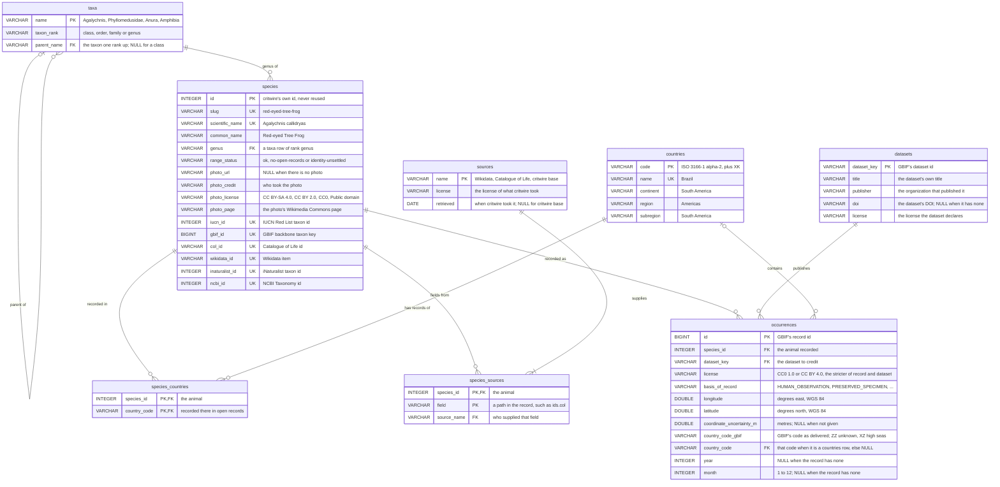

# critwire Learn: a practitioner curriculum (design)

Design for critwire Learn as a practitioner course in database architecture, GIS in SQL, spatial statistics, ETL and Power BI, taught on critwire's open species data and other open data. It starts from a little SQL and everyday GIS, covers the foundations fast, then goes deep. It replaces the course in `plans/002-learn.md` and `plans/003-learn-data-spatial.md` and reuses their engine, schema, data and licensing findings (§1). Every SQL and Python block here is tested (§0). Nothing public changes until the build missions in §9 run.

Written by mission `critwire-learn-curriculum` (plan `plans/2026-10-23-critwire-learn-curriculum.md`); a section marked "(S<n>)" is written by that plan's step S<n>.

## 0. Conventions

Every example in this document is tested. A block is a fenced code block whose first lines are headers. The test runner (the mission's spike, §A) reads the headers, runs the block on the engine they name, and compares what it gets with the result block printed under it. A block that can't run here says why.

### Blocks, engines and statuses

- **Every block has an id and a status.** SQL: `-- q: <id>`, then `-- status: ran` or `-- status: untested: <reason>`. Python writes `#` for `--`; Power BI's M and DAX write `//`. Module blocks are named `<module>-<word>` (`d3-plan`); engine and setup blocks have plain ids (`setup`, `pg-session`). Ids are unique in the document.
- **`ran`** means the block ran on the data named in the log header (below) and gave the result printed under it; Verification runs it again and fails on any difference. **`untested: <reason>`** blocks never run: they need something this server doesn't have (Windows, ArcGIS Pro, a second session). A failing block is fixed, never relabelled `untested`.
- **Engines:**
  - SQL with no `-- engine:` line (or `-- engine: duckdb`) runs in DuckDB-WASM in headless Chromium, on the browser database the `setup` block builds (below), as a page runs it.
  - `-- engine: postgis` runs in PostgreSQL 16 with PostGIS 3.4.2, in schema `learn_curriculum`, after the loader and `pg-session` (below).
  - ```` ```python ```` blocks run in the pinned `uv` environment (§3), each in its own process, isolated (`python -I`), from an empty folder, connected through libpq's `PG*` variables. Their search path starts as `pg_catalog`, so a block that skips the `py-connect` helper fails on its first table name instead of quietly reading another schema.
  - ```` ```m ```` and ```` ```dax ```` blocks (Power BI) never run; their status is always `untested: Power BI is Windows-only`. Each names its inputs (`// input: star/<file>.csv, …`) and the runner checks those files instead: the file exists, its header equals the star manifest's columns, primary keys are unique and filled, every foreign key finds its dimension row, and rows and sha256 equal the manifest's.
- **More headers:**
  - `-- after: <id>, …`: those earlier blocks of the same engine run first, in the same transaction, in the order named; the result is still this block's last statement. An exercise runs after its lesson this way. Python's `# after:` puts the named blocks' code first, in document order, in one process.
  - `-- expect: error <text>`: the last statement must fail with an error containing `<text>` (d1's constraint violations); the block fails if it doesn't.
  - `-- params: [<value>, …]` (DuckDB only): JSON values for the last statement's `?` placeholders, as a page binds a learner's input.
  - `-- needs: raster` (PostGIS): the block uses PostGIS raster, so the run first checks the raster library and its settings (g7, s6). Raster functions anywhere else are refused.
  - `-- boot` (PostGIS): runs once when the runner connects, before every other block, and is committed. It builds fixtures later blocks read (s4's hexagon grids); its tables are listed `lab-made` on the lab ERD (§6.2).
  - `-- tx: own` (PostGIS): the runner doesn't wrap the block. It runs its own `BEGIN` … `COMMIT` or `ROLLBACK`, as typed in psql (d4). Afterwards the runner checks that the block ended its transaction, left the session as it found it, and left `learn_curriculum` unchanged.
  - `# timeout: <seconds>` (Python): when the block is stopped; 60 by default.
  - `-- show: cards` is not a test header: it stays in the SQL learners see, and the page shows the result as animal cards (002 §8).
- **Every other SQL block runs in a transaction the runner rolls back,** so each starts from the same database and the order of modules doesn't matter. Results must be deterministic: rows ordered by a unique key, `random()` only after `setseed()`, no clock; Python prints with explicit formats, never a DataFrame's repr.
- **Result blocks.** The ```` ```text ```` block under a `ran` block starts `-- result: <id> · <n> rows · sha256 <12 hex>`, then the column names, the first 5 rows (cells cut at 60 characters) and how many more. The hash covers the column names and every row, uncut, so the 5 rows shown don't limit what is checked. A Python result starts `-- result: <id> · python · sha256 <12 hex>`, then the block's whole output. Only the runner writes result blocks (`--update`).
- **Not counted:** ```` ```sh ```` and ```` ```powershell ```` fences are commands for the learner's own machine (installing PostgreSQL, Docker or `uv`; loading the lab file). They carry no headers and don't run here; §3 says which were checked another way. ```` ```mermaid ```` fences are the ERDs, checked against their files and the live catalogs (§6).

### Lab objects: the `learn_` rules

The PostGIS labs share a database with other work, on the test server and perhaps on yours, so they follow rules the runner checks before anything runs:
- Lab tables live in schema `learn_curriculum`, which the loader replaces as a whole (§4). Labs never name a database, and every PostGIS lab starts with `pg-session`.
- A role or schema a lab creates is named `learn_…`, and the same block removes it: each `CREATE ROLE learn_x` or `CREATE SCHEMA learn_x` has a later `DROP` in the block, a role that was granted anything gets `DROP OWNED BY` before its `DROP ROLE`, and a `SET ROLE` has a later `RESET ROLE`. Running a block twice, or stopping a module halfway, leaves nothing behind.
- After a block's last statement, before the rollback, the runner looks for `learn_` roles and schemas that weren't there when it connected. Finding one fails the block, because your psql would have kept it.
- Allowed only in PostGIS blocks: roles, `GRANT` and `REVOKE`, default privileges, `SET ROLE` and `CREATE`/`DROP SCHEMA`, all within `learn_` names; `SET` and `SET LOCAL`, which the rollback undoes. Refused everywhere: `ALTER SYSTEM`, `ALTER DATABASE`, `GRANT SET ON PARAMETER`, any role or schema not named `learn_…`, and the name `learn_spatial` (003's spike schema in the test database; the runner also compares its content before and after every run).
- Creating roles needs the CREATEROLE privilege ("The PostGIS setup" below; d5).

### Re-running the tests, and where results live

The tests run on critwire's server from the mission's spike folder, `SP=/srv/critter-ai/agent-state/missions/critwire-learn-curriculum/spike`, which isn't committed; L2 moves it into the repository as `pnpm learn:check` (§9). From the worktree:
- `node $SP/scripts/build-site.ts` writes the spike's web root (the lab files and the loader). Then `node $SP/run-queries.ts plans/004-learn-curriculum.md --check --erd plans/004-learn-erd.mmd --lab-erd plans/004-lab-erd.mmd --star-erd plans/004-star-erd.mmd` runs every block, checks every Power BI input and the three ERDs, and fails on any difference. `--update` instead rewrites the result blocks.
- `$SP/verify.sh` re-runs everything: ports free; build-site; the command above; the lab shapes from their downloads; the loader, twice, as a learner runs it; the `learn_spatial` canary; the ETL spike, offline from the saved GBIF zip; the Moran spike; the star export; the three ERD renders. It ends `verify: ok`.
- **Results** are in this document, under each block, and in the run log, `/srv/critter-ai/agent-state/missions/critwire-learn-curriculum/queries.log`. The log's header records the engine versions (DuckDB-WASM, PostGIS, Python and the `requirements.txt` hash), the canary, and the sha256 of every lab data file, so "ran" names exactly the data it ran on; then come every result, every skipped block and every Power BI input check. The spikes' evidence is in `$SP/out/<spike>/summary.md` (§A), the ERD renders in `$SP/erd/`.

### The browser setup

The browser labs (DuckDB-WASM) start from 002's database plus the lab sample: this `setup` block, the spike's `src/setup.sql`, runs at boot. Its first part is 002's `setup` byte for byte (schema v1); schema v2 adds `datasets` and `occurrences`, read from `/learn/data/datasets.csv` and `/learn/data/occurrences.parquet` (§4). It has no result block.

```sql
-- q: setup
-- status: ran
-- critwire Learn: the learners' tables (schema v1), built on a fresh in-memory database
-- from /v1/species.parquet and /v1/countries.parquet. Every table a foreign key points at is
-- created first, and taxa go in one rank per INSERT, top down: DuckDB declares foreign keys
-- only in CREATE TABLE and checks them statement by statement. Nothing is ever dropped;
-- a fresh database comes from a restart.

CREATE TABLE taxa (
  name        VARCHAR PRIMARY KEY,
  taxon_rank  VARCHAR NOT NULL CHECK (taxon_rank IN ('class', 'order', 'family', 'genus')),
  parent_name VARCHAR REFERENCES taxa (name),
  CHECK ((taxon_rank = 'class') = (parent_name IS NULL))
);

INSERT INTO taxa
SELECT DISTINCT taxonomy.class, 'class', NULL FROM read_parquet('species.parquet');

INSERT INTO taxa
SELECT DISTINCT taxonomy."order", 'order', taxonomy.class FROM read_parquet('species.parquet');

INSERT INTO taxa
SELECT DISTINCT taxonomy.family, 'family', taxonomy."order" FROM read_parquet('species.parquet');

INSERT INTO taxa
SELECT DISTINCT taxonomy.genus, 'genus', taxonomy.family FROM read_parquet('species.parquet');

CREATE TABLE species (
  id              INTEGER PRIMARY KEY,
  slug            VARCHAR NOT NULL UNIQUE,
  scientific_name VARCHAR NOT NULL UNIQUE,
  common_name     VARCHAR NOT NULL,
  genus           VARCHAR NOT NULL REFERENCES taxa (name),
  range_status    VARCHAR NOT NULL CHECK (range_status IN ('ok', 'no-open-records', 'identity-unsettled')),
  photo_url       VARCHAR,
  photo_credit    VARCHAR,
  photo_license   VARCHAR,
  photo_page      VARCHAR,
  iucn_id         INTEGER UNIQUE,
  gbif_id         BIGINT UNIQUE,
  col_id          VARCHAR UNIQUE,
  wikidata_id     VARCHAR UNIQUE,
  inaturalist_id  INTEGER UNIQUE,
  ncbi_id         INTEGER UNIQUE
);

INSERT INTO species
SELECT id, slug, scientificName, commonName, taxonomy.genus, "range".status,
       photo.url, photo.credit, photo.license, photo.page,
       ids.iucn, ids.gbif, ids.col, ids.wikidata, ids.inaturalist, ids.ncbi
FROM read_parquet('species.parquet');

CREATE TABLE sources (
  name      VARCHAR PRIMARY KEY,
  license   VARCHAR NOT NULL,
  retrieved DATE
);

INSERT INTO sources
SELECT DISTINCT s.source, s.license, CAST(s.retrieved AS DATE)
FROM (SELECT unnest(sources) AS s FROM read_parquet('species.parquet'));

CREATE TABLE species_sources (
  species_id  INTEGER NOT NULL REFERENCES species (id),
  field       VARCHAR NOT NULL,
  source_name VARCHAR NOT NULL REFERENCES sources (name),
  PRIMARY KEY (species_id, field)
);

INSERT INTO species_sources
SELECT id, unnest(s.fields), s.source
FROM (SELECT id, unnest(sources) AS s FROM read_parquet('species.parquet'));

CREATE TABLE countries (
  code      VARCHAR PRIMARY KEY,
  name      VARCHAR NOT NULL UNIQUE,
  continent VARCHAR NOT NULL,
  region    VARCHAR NOT NULL,
  subregion VARCHAR NOT NULL
);

INSERT INTO countries
SELECT code, name, continent, region, subregion FROM read_parquet('countries.parquet');

-- Countries with open (CC0 / CC BY) occurrence records, not the native range.
CREATE TABLE species_countries (
  species_id   INTEGER NOT NULL REFERENCES species (id),
  country_code VARCHAR NOT NULL REFERENCES countries (code),
  PRIMARY KEY (species_id, country_code)
);

INSERT INTO species_countries
SELECT id, unnest("range".countriesWithOpenRecords) FROM read_parquet('species.parquet');

CREATE VIEW species_taxonomy AS
SELECT s.id AS species_id, c.name AS class, o.name AS order_name, f.name AS family, g.name AS genus
FROM species AS s
JOIN taxa AS g ON g.name = s.genus
JOIN taxa AS f ON f.name = g.parent_name
JOIN taxa AS o ON o.name = f.parent_name
JOIN taxa AS c ON c.name = o.parent_name;

-- Schema v2 (plans/004-learn-curriculum.md): the lab sample of open GBIF records, from
-- /learn/data/datasets.csv and /learn/data/occurrences.parquet. A record is where someone
-- recorded the animal, not where it lives. country_code_gbif is GBIF's code as delivered
-- (ZZ unknown, XZ international waters); country_code is that code only when it is a
-- countries row, else NULL.

CREATE TABLE datasets (
  dataset_key VARCHAR PRIMARY KEY,
  title       VARCHAR NOT NULL,
  publisher   VARCHAR NOT NULL,
  doi         VARCHAR,
  license     VARCHAR NOT NULL
);

INSERT INTO datasets
SELECT * FROM read_csv('datasets.csv', header = true, columns = {
  'dataset_key': 'VARCHAR', 'title': 'VARCHAR', 'publisher': 'VARCHAR', 'doi': 'VARCHAR', 'license': 'VARCHAR'});

CREATE TABLE occurrences (
  id                       BIGINT PRIMARY KEY,
  species_id               INTEGER NOT NULL REFERENCES species (id),
  dataset_key              VARCHAR NOT NULL REFERENCES datasets (dataset_key),
  license                  VARCHAR NOT NULL CHECK (license IN ('CC0 1.0', 'CC BY 4.0')),
  basis_of_record          VARCHAR NOT NULL CHECK (basis_of_record IN ('HUMAN_OBSERVATION', 'OBSERVATION',
                             'MACHINE_OBSERVATION', 'PRESERVED_SPECIMEN', 'MATERIAL_SAMPLE',
                             'MATERIAL_CITATION', 'OCCURRENCE')),
  longitude                DOUBLE NOT NULL CHECK (longitude BETWEEN -180 AND 180),
  latitude                 DOUBLE NOT NULL CHECK (latitude BETWEEN -90 AND 90),
  coordinate_uncertainty_m DOUBLE,
  country_code_gbif        VARCHAR,
  country_code             VARCHAR REFERENCES countries (code),
  year                     INTEGER,
  month                    INTEGER CHECK (month BETWEEN 1 AND 12)
);

INSERT INTO occurrences
SELECT id, species_id, dataset_key, license, basis_of_record, longitude, latitude,
       coordinate_uncertainty_m, country_code_gbif, country_code, year, month
FROM read_parquet('occurrences.parquet');
```

The row count of every table and of the view (`countries` is A1's draft of `/v1/countries`; `datasets` and `occurrences` are the lab sample, §4):

```sql
-- q: setup-counts
-- status: ran
SELECT (SELECT count(*) FROM taxa)              AS taxa,
       (SELECT count(*) FROM species)           AS species,
       (SELECT count(*) FROM sources)           AS sources,
       (SELECT count(*) FROM species_sources)   AS species_sources,
       (SELECT count(*) FROM countries)         AS countries,
       (SELECT count(*) FROM species_countries) AS species_countries,
       (SELECT count(*) FROM datasets)          AS datasets,
       (SELECT count(*) FROM occurrences)       AS occurrences,
       (SELECT count(*) FROM species_taxonomy)  AS species_taxonomy;
```

```text
-- result: setup-counts · 1 row · sha256 e3323c4c9cd8
taxa | species | sources | species_sources | countries | species_countries | datasets | occurrences | species_taxonomy
143 | 76 | 5 | 591 | 250 | 472 | 400 | 40395 | 76
```

### The PostGIS setup

The PostGIS labs run in schema `learn_curriculum`, which one file builds: `learn_curriculum.sql` (§4). Load it with `psql -X -v ON_ERROR_STOP=1 -d <your database> -f learn_curriculum.sql`; it runs in one transaction, so a failed load leaves the previous schema as it was, and loading again replaces it. Every PostGIS lab starts with this session block. It puts `learn_curriculum` first on the search path, so plain table names find the lab tables, and PostGIS's functions still resolve from `public`. The tests run the same statement when they connect.

```sql
-- q: pg-session
-- status: ran
-- engine: postgis
SET search_path = learn_curriculum, public;
SHOW search_path;
```

```text
-- result: pg-session · 1 row · sha256 791623fd72db
search_path
learn_curriculum, public
```

A quick check that the load worked: the rows in every lab table.

```sql
-- q: pg-smoke
-- status: ran
-- engine: postgis
SELECT 'taxa' AS table_name, count(*) AS n_rows FROM taxa
UNION ALL SELECT 'species', count(*) FROM species
UNION ALL SELECT 'sources', count(*) FROM sources
UNION ALL SELECT 'species_sources', count(*) FROM species_sources
UNION ALL SELECT 'countries', count(*) FROM countries
UNION ALL SELECT 'species_countries', count(*) FROM species_countries
UNION ALL SELECT 'datasets', count(*) FROM datasets
UNION ALL SELECT 'occurrences', count(*) FROM occurrences
UNION ALL SELECT 'country_shapes', count(*) FROM country_shapes
UNION ALL SELECT 'admin1_shapes', count(*) FROM admin1_shapes
UNION ALL SELECT 'biomes', count(*) FROM biomes
UNION ALL SELECT 'ecoregions', count(*) FROM ecoregions
UNION ALL SELECT 'habitat_classes', count(*) FROM habitat_classes
UNION ALL SELECT 'country_habitats', count(*) FROM country_habitats
ORDER BY table_name;
```

```text
-- result: pg-smoke · 14 rows · sha256 444c9131da27
table_name | n_rows
admin1_shapes | 294
biomes | 14
countries | 250
country_habitats | 35
country_shapes | 247
… 9 more rows
```

Labs that create roles or schemas (d1, d5) clean up in the same block, so running a block twice, or stopping halfway through a module, leaves nothing behind. Their names start with `learn_`, and creating roles needs the CREATEROLE privilege (a superuser has it; on your own install, `ALTER ROLE <you> CREATEROLE` as the superuser, once). This check creates a read-only role, reads a table as that role, and removes it again: `DROP OWNED BY` takes away what the role was granted, and only then can `DROP ROLE` remove it.

```sql
-- q: pg-role-smoke
-- status: ran
-- engine: postgis
CREATE ROLE learn_smoke NOLOGIN;
GRANT USAGE ON SCHEMA learn_curriculum TO learn_smoke;
GRANT SELECT ON species TO learn_smoke;
SET ROLE learn_smoke;
SELECT current_user AS role, count(*) AS species FROM species;
RESET ROLE;
DROP OWNED BY learn_smoke;
DROP ROLE learn_smoke;
SELECT count(*) AS learn_smoke_left FROM pg_roles WHERE rolname = 'learn_smoke';
```

```text
-- result: pg-role-smoke · 1 row · sha256 fcfe7fd06dfa
learn_smoke_left
0
```

Most labs run in a transaction the tests roll back. The transaction labs (d4) manage their own, with `BEGIN` and `COMMIT` or `ROLLBACK`, exactly as you type them in `psql`; the tests then check that each one ended its transaction and left the lab tables as they were.

```sql
-- q: pg-tx-smoke
-- status: ran
-- engine: postgis
-- tx: own
BEGIN;
CREATE TABLE tx_smoke (id integer PRIMARY KEY);
INSERT INTO tx_smoke VALUES (1), (2);
ROLLBACK;
SELECT to_regclass('tx_smoke') IS NULL AS rolled_back;
```

```text
-- result: pg-tx-smoke · 1 row · sha256 a90c4cf411fd
rolled_back
true
```

### The Python setup

Python labs run in the `uv` environment (§3) and read the lab database through libpq's `PG*` environment variables, so the same file runs on your machine and on the test server. Every Python lab starts with this helper. It sets the search path when it connects, so plain table names find the lab tables in `learn_curriculum` and PostGIS's functions in `public`. It prints nothing.

```python
# q: py-connect
# status: ran
import psycopg


def connect():
    """A connection to the lab database: plain table names find learn_curriculum's tables, then PostGIS in public."""
    return psycopg.connect(options="-c search_path=learn_curriculum,public")
```

```text
-- result: py-connect · python · sha256 e3b0c44298fc
```

A quick check that the environment works: the search path through the helper, then the versions the labs were tested with.

```python
# q: py-smoke
# status: ran
# after: py-connect
import platform
from importlib.metadata import version

with connect() as conn:
    print("search_path:", conn.execute("SHOW search_path").fetchone()[0])
print("python:", platform.python_version())
for package in ["psycopg", "pandas", "pyarrow", "shapely", "pyproj", "pyogrio", "geopandas", "libpysal", "esda", "pointpats"]:
    print(f"{package}: {version(package)}")
```

```text
-- result: py-smoke · python · sha256 f75ba856b9f7
search_path: learn_curriculum,public
python: 3.12.3
psycopg: 3.3.6
pandas: 3.1.0
pyarrow: 26.0.0
shapely: 2.2.0
pyproj: 3.8.0
pyogrio: 0.13.0
geopandas: 1.2.0
libpysal: 4.15.1
esda: 2.10.0
pointpats: 2.6.0
```

## 1. What carries over

004 builds on two earlier designs, neither of them built (§B): `plans/002-learn.md` (mission A1: the browser engine, the learners' schema and ERD, 16 SQL lessons for beginners aged 16 and up, a cookbook, a game, the countries file) and `plans/003-learn-data-spatial.md` (mission A2: datasets and licenses, the grown schema, a spatial track, the habitat raster, IUCN). Both stay in the repository as records, marked superseded. Their measurements and research are reused as they stand, not redone. What changes is the learner (adults building job skills, not beginners), the course, and where lab data lives. "Kept" means 004 relies on it as written there, and the build missions (§9) build it from there; where 004 differs, §B says why.

### From 002

| Section | Kept | Changed | Dropped |
|---|---|---|---|
| 002 §1 Engine and interface | The whole engine: DuckDB-WASM `1.33.1-dev65.0` (DuckDB v1.5.6), the `eh` bundle in a worker, self-hosted, with the `parquet` extension mirror; the 10 000-row stream cap; Reset and Stop by restarting the worker; one engine start per visit; Q1–Q5's measurements; our own editor rather than the DuckDB shell | The setup also reads `/learn/data/datasets.csv` and `/learn/data/occurrences.parquet`: 3.22 s to a ready database on desktop, against A1's 2.9 s to the first result (§A.1) | — |
| 002 §2 The learners' schema | v1's six tables and the view, byte for byte: 004's `setup` starts with 002's (§0) | v2 adds `datasets` and `occurrences` (Room to grow's), nothing else (§6.1); the other spatial tables go in the lab database (§6.2) | Room to grow's `traits`, `habitats` and `regions` tables (the lab's habitat classes, admin-1 shapes and ecoregions take the last two) |
| 002 §3 Entity relationship diagram | Mermaid sources in the repository, the offline render (`pnpm erd`, no mermaid-cli), the build's stale check, the drift check against the catalog, the Schema dialog, the data dictionary | Three diagrams: schema v2, with 002's entities and lines checked unchanged; the lab database; the Power BI star (§6) | — |
| 002 §4 Lessons: the core path | The SQL of lessons 7 (keys), 9 (many-to-many), 11 (left join), 14 (normalization) and 15 (sources), re-run inside f3, d1 and d2; the exercise-check pattern (`-- after:`) | Rewritten for adults new to the topic, and fast: f1–f4 take 6 h (§2) | The 16-lesson path for ages 16 and up |
| 002 §5 Cookbook | — | c12 "Could they meet?" becomes an idea for the capstone's game feed (c1) | The cookbook page and its recipes |
| 002 §6 The countries file | The whole design: `/v1/countries.{parquet,csv,json}` from Natural Earth (public domain), 250 rows, its attribution entry, the `NA` note; L1 builds it | — | — |
| 002 §7 Demo | — | — | "Name that animal" and `/play/` |
| 002 §8 Site | The page design (cards and `-- show: cards`, the editor, the Schema button), accessibility, light and dark themes, the E2E rules, the playground | New URLs and page types: module pages, lab pages, downloadable lab files (§7) | The cookbook and `/play/` pages |
| 002 §9 Mission B | The reason for splitting the build: each mission well under 60 sessions | Five chained missions, L1–L5 (§9) | Briefs B1 and B2, marked superseded |
| 002 §10 For the owner | Items 1–4 and 6–9, as recommended there; §10 restates the open ones | Item 10 (a real-device check) becomes a Windows check of PostGIS and Power BI: the learners are on desktops (§10). Item 11 (extensions beyond `parquet`) is answered: none (§B) | Item 5 (lesson order): the 16 lessons are gone |

### From 003

| Section | Kept | Changed | Dropped |
|---|---|---|---|
| 003 §1 Growing the data | Every license quote, retrieval date and size A2 measured, cited in §4 by D number | D3, the GBIF sample, comes from the occurrence download API, not `occurrence/search` (below; §B). D2 (admin-0) and D10 (admin-1) at 1:50m; D9 (RESOLVE) simplified to fit the 50 MB cap (§4) | Deferred: D1, D5–D8 and D11–D14 (traits, names, the tree of life: no module needs them); D15 (CHELSA) comes later. D16 (WorldClim) and D17 (WDPA) are never hosted |
| 003 §2 The grown schema and its ERD | `occurrences`, `country_shapes` (with its `\|\|--o\|` line), `habitat_classes` and `country_habitats`, and the designed but unbuilt `ecoregions` and `biomes`, all now in the lab database (§6.2) | `occurrences` gains the country-key contract (raw code beside a nullable foreign key) and a `datasets` table with credits; it is in the browser's schema v2 too. `admin1_shapes` is new | `traits`, `species_traits`, `species_names`, `tree_nodes`, and `setup-grown` (§B) |
| 003 §3 Lessons for the grown data | — | Lessons 22–23's habitat questions return on PostGIS in g7 and s6 | Lessons 17–23 (they teach the deferred tables) |
| 003 §4 The advanced spatial track | "Your own PostGIS": the session block (`pg-session`, now on `learn_curriculum`) and `pg-once` (the raster settings) for g7; spatial lessons 5 (projection), 6 (point value) and 7 (zonal) go into g1 and g7; lesson 4's finding (E1) that GBIF's country codes and the outlines disagree on coasts goes into g3 | Learners load their PostGIS with one psql-only file, not `shp2pgsql` or `ogr2ogr` (§B) | Spatial lessons 1–4 and 8 in the browser: they need DuckDB's `spatial` extension (§B) |
| 003 §5 The habitat raster | The whole recommendation: Jung et al. 2020 v004 by URL, country summaries plus two clips, the provenance gate, the three summary methods and their measured errors | Clips for Costa Rica and Tasmania; L3 builds them | — |
| 003 §6 IUCN | Every conclusion: critwire never stores, caches, proxies or serves IUCN data | The "your own download" lessons become an optional, untested appendix to g3 | — (the draft permission request stays a record, unsent) |
| 003 §7 The build missions | The chain: each brief says what it needs from the one before; each mission releases itself | Five missions, L1–L5 (§9) | Briefs C and D, marked superseded; "what both assume B delivered" never happened (§B) |
| 003 §8 For the owner | Items 2–4 and 7–9, as recommended there | Item 1 (datasets first): admin-0 and the GBIF sample yes, AnAge deferred. Item 6 (publish occurrence records): yes, as a capped sample of a download (§4) | Item 5 (commit the `spatial` extension): no `spatial` in the browser (§B) |

003's own "Disagreements with 002" mostly fall away: lesson 16's move to `my_traits` is moot (no trait tables); habitats stay map classes, never species preferences; regions no longer wait (admin-1, ecoregions and biomes are in the lab); `setup-grown` is gone. Its ERD rule for one-to-one lines on a key that is also the primary key stays, in the lab ERD's check.

**The GBIF sample changes source (003 D3).** 003 drew up to 300 records per species through `occurrence/search`, inside `ingest gbif`, as a subset of what the countries DOI `10.15468/dd.ky9cyt` counts. 004 draws it from the occurrence download API: an asynchronous download with its own DOI and no paging cap, refreshed apart from the countries pipeline, capped at 2,000 records per species, and registered by L1 as its own derived dataset. `ingest gbif`, `contributions.json` and `10.15468/dd.ky9cyt` don't change (§4, §A.1, §B).

## 2. The curriculum map

Seven tracks, 33 modules, about 68 hours. Foundations come first and go fast; then the five areas; then a capstone that uses all of them. Each module answers real questions with the lab data (§4) on one or two tools: **B** the browser (DuckDB-WASM, nothing to install), **PG** your own PostgreSQL with PostGIS, **Py** Python in the `uv` environment, **PBI** Power BI Desktop (§3). Hours include the lab and the exercise. A module's id names its blocks (`d3-plan`) and its page (§7).

The table is in prerequisite order: every module's prerequisites come above it, so working down the table never meets a module that needs a later one. After f3 the tracks branch: GIS in SQL needs only f3 (and d3 for g5), ETL starts from f2, and Power BI waits for d6. **Depth** is what this document holds: `full` modules are written out in §5 (concept, worked example, lab, result, exercise, answer, check, dialects); `outline` modules give the goal, data, key code and expected result, and the build missions (§9) write them in full.

| id | Track | Module | Skill | Questions it answers | Tool | h | Prereqs | Depth |
|---|---|---|---|---|---|---|---|---|
| f1 | Foundations | select | `SELECT`, `WHERE`, `ORDER BY`, `NULL` | Which animals have no photo? Which mammals does critwire list, by common name? Why doesn't `= NULL` find a missing value? | B | 1.0 | — | full |
| f2 | Foundations | aggregate | `GROUP BY`, `HAVING`, `CASE`, `COUNT(DISTINCT …)` | How many records does the sample hold per year, and by basis of record? Which species have more than 500 records? How many datasets contributed? | B | 1.5 | f1 | full |
| f3 | Foundations | join | Inner, left and anti joins; many-to-many; reading an ERD; light spatial in plain SQL (bounding boxes, 10° bins) | Which animals were recorded in Brazil? Which have no records at all? How many records fall in each 10° box? | B | 2.0 | f2 | full |
| f4 | Foundations | window | CTEs, subqueries, window functions | Which dataset contributed most of each species' records, and what share is that? How does each year rank against the others? | B | 1.5 | f3 | full |
| d1 | Database architecture | keys | Entities; natural and surrogate keys; `PRIMARY KEY`, `FOREIGN KEY`, `UNIQUE`, `CHECK`; generated columns | What does a foreign key check, and what doesn't it? Natural or surrogate key for a species? What does a `CHECK` refuse? | B (+ PG) | 2.0 | f3 | full |
| d2 | Database architecture | normalize | 1NF to 3NF from nested JSON; functional dependencies; when to denormalize | Is a license a fact about a record or about a dataset? What goes wrong when a dataset's title is stored on every record? | B | 2.0 | d1 | full |
| d3 | Database architecture | indexes | B-tree, GiST and BRIN indexes; `EXPLAIN` and `EXPLAIN ANALYZE`; planner statistics | Why is this a sequential scan? When does an index help a filter, a join or a spatial test? What does the planner believe about a table? | PG | 2.0 | d1 | full |
| d4 | Database architecture | transactions | ACID, MVCC, isolation levels, locks, savepoints, `ON CONFLICT` | How do I re-run a failed load safely? What does another session see while a load runs? | PG | 2.0 | d3 | full |
| d5 | Database architecture | roles | Schemas, roles, `GRANT` and `REVOKE`, default privileges, least privilege, a taste of row-level security | How do I give a reporting tool read-only access to one schema and nothing else? What do default privileges change? | PG | 1.5 | d4 | full |
| d6 | Database architecture | star | Grain, facts, dimensions, conformed dimensions, unknown members, slowly changing dimensions (types 1 and 2); star vs snowflake; export | What is one record fact's grain? Which dimensions does it share with habitat area per country? Where does a record with no country go? | PG (+ DuckDB) | 2.5 | d2, d4 | full |
| g1 | GIS in SQL | crs | SRIDs, `ST_Transform`, geometry vs geography, Web Mercator's area error | How big is Tasmania in EPSG:3857, in EPSG:3577 and as geography? Why does Web Mercator overstate it? | PG | 1.5 | f3 | outline |
| g2 | GIS in SQL | load-validate | The loader, WKT and WKB, `ST_IsValid`, `ST_MakeValid` | Which shapes are invalid, and why? What does `ST_MakeValid` change? | PG | 1.5 | g1 | outline |
| g3 | GIS in SQL | spatial-join | `ST_Contains`, `ST_Covers`, `ST_Intersects`; point in polygon; records on boundaries | Do GBIF's country codes agree with the country outlines? Which records fall on a coast or in no country? | PG | 2.0 | g2 | outline |
| g4 | GIS in SQL | measure-overlay | Distances on the ellipsoid, `ST_DWithin`, buffers, `ST_Intersection` | How much of each country does each ecoregion cover? Which records lie within 10 km of a border? | PG | 2.0 | g3 | outline |
| g5 | GIS in SQL | spatial-index | GiST, the `&&` operator, nearest neighbours with `<->`, reading spatial plans | Which record is nearest to a point, found fast? When doesn't a spatial index help? | PG | 1.5 | g3, d3 | outline |
| g6 | GIS in SQL | grids | `ST_HexagonGrid` in an equal-area SRID; the modifiable areal unit problem (MAUP) | How many Tasmanian devil records fall in each 5 km hexagon, and in each 10 km one? How does the picture change with the grid? | PG | 1.5 | g4 | outline |
| g7 | GIS in SQL | raster | Value at a point; `ST_Clip`, `ST_ValueCount`; estimated areas and their error | Which habitat classes hold Costa Rica's records? How much of each class does a clip hold, and how good is that estimate? | PG | 2.5 | g6 | outline |
| s1 | Spatial statistics | bias | Datasets, basis of record, telemetry, recording effort; framing results honestly | How much of the jaguar sample is GPS-collar data? Which datasets and years dominate a species' records? What can records say about where an animal lives, and what can't they? | PG + B | 1.5 | g3 | outline |
| s2 | Spatial statistics | point-patterns | Quadrats, the nearest-neighbour index, kernel density, DBSCAN | Are devil records more clustered than chance? Where is record density highest? | PG + Py | 2.5 | s1, g6 | outline |
| s3 | Spatial statistics | weights | Distance-band, k-nearest and contiguity weights; row standardization; islands; ties | Who are a cell's neighbours? What does row standardization do, and what happens to a cell with none? | PG + Py | 2.0 | s2 | outline |
| s4 | Spatial statistics | moran | Global Moran's I, its expectation, variance and z-score in SQL, matched by PySAL; permutation tests | Does record density cluster across Tasmania? Do SQL and PySAL agree? How does the answer change at 10 km? | PG + Py | 2.0 | s3 | outline |
| s5 | Spatial statistics | local | Local Moran's I (LISA) and Getis-Ord Gi*; false discovery rate | Where are the hot and cold spots of recording effort? Which survive a false discovery rate correction? | PG + Py | 2.5 | s4 | outline |
| s6 | Spatial statistics | zonal | Zonal statistics on polygons and rasters; ratios normalized for effort | Do records over-represent some habitats or ecoregions, once effort is accounted for? | PG + Py | 2.0 | s5, g7 | outline |
| e1 | ETL | extract | Search API vs download API (asynchronous, with a DOI); paging, rate limits, retries; files with checksums | How do I get every open Tasmanian devil record, with a DOI to cite? | Py | 2.0 | f2 | outline |
| e2 | ETL | transform-load | Staging tables, types, `COPY`, upserts, geometry; GeoPandas to and from PostGIS | How do I load the download in one transaction, typed and checked, with each record matched to its species? | Py + PG | 2.5 | e1, d4 | outline |
| e3 | ETL | idempotent | Run ids, deterministic outputs, checksums; critwire's own ingest → derive → build as the case study | Can I re-run the pipeline without doubling rows or changing its output? | Py + PG | 2.0 | e2 | outline |
| e4 | ETL | quality-provenance | Data quality checks written as SQL; license filters; provenance tables; citations; derived datasets | Which datasets must I credit, and under which license? Which checks stop a bad load? | Py + PG | 2.0 | e3 | outline |
| e5 | ETL | schedule | cron, systemd timers, Windows Task Scheduler; logs, alerts, incremental loads | How do I refresh weekly, and know when a run broke? | Py | 1.5 | e4 | outline |
| p1 | Power BI | power-query | Power Query: `Web.Contents` on critwire's CSV files; types with an explicit culture; refresh | How do I load the star from critwire.com so that it refreshes, on any locale? | PBI | 1.5 | d6 | outline |
| p2 | Power BI | model | Relationships, cardinality, filter direction, conformed dimensions, factless facts | How do I filter records and habitat areas by the same country? | PBI | 2.0 | p1 | outline |
| p3 | Power BI | dax | Measures: `COUNTROWS`, `DISTINCTCOUNT`, `CALCULATE`, ratios | How many records per 1,000 km² of forest, by country? | PBI | 2.0 | p2 | outline |
| p4 | Power BI | maps-report | Map visuals, honest labels, publishing and scheduled refresh | How do I build a report that maps records and never calls them a range? | PBI | 1.5 | p3 | outline |
| c1 | Capstone | game-feed | ETL into PostGIS → Gi* on hexagons → a Power BI report → a static JSON feed a game reads (encounter weights per hexagon, labelled as records) | What could a player meet here, honestly? | all | 8.0 | s5, e4, p4 | outline |

| Track | Modules | Hours | Depth |
|---|---|---|---|
| Foundations | f1–f4 | 6.0 | full |
| Database architecture | d1–d6 | 12.0 | full |
| GIS in SQL | g1–g7 | 12.5 | outline |
| Spatial statistics | s1–s6 | 12.5 | outline |
| ETL | e1–e5 | 10.0 | outline |
| Power BI | p1–p4 | 7.0 | outline |
| Capstone | c1 | 8.0 | outline |
| **Total** | **33** | **68.0** | 10 full, 23 outline |

**Going fast.** Each foundations module opens with an "Already know this?" exercise; solving it marks the module done, so someone who already writes joins and window functions spends minutes, not six hours, on the first track. The dialect notes in each full module (PostgreSQL, DuckDB, SQL Server) let a SQL Server user map what they know. After foundations, the order within the prerequisites is yours: a GIS specialist might take d1, d3 and d4, then GIS in SQL and spatial statistics, and come back for d5 and d6 before ETL and Power BI.

## 3. Lab environments and setup

Four tools, each set up once. Every lab names the tool it runs on (§2). The file URLs below are where the build missions publish them (§7, §9); they don't exist yet.

| Tool | Modules | Runs on | Tested here | Not tested here |
|---|---|---|---|---|
| **B** browser | f1–f4, d1, d2, s1 | The course page: DuckDB-WASM in your browser | Every block, in headless Chromium, as the page runs it | — |
| **PG** PostGIS | d1, d3–d6, g1–g7, s1–s6, e2–e4, c1 | Your PostgreSQL 16 with PostGIS 3.4 | The loader (twice, with the command below) and every block, in PostgreSQL 16.x with PostGIS 3.4.2 on critwire's server | The Docker and installer commands (Windows) |
| **Py** Python | s2–s6, e1–e5, c1 | The `uv` environment on your computer | Every block, isolated, on the pins below (CPython 3.12.3, Linux aarch64) | The install commands; Windows itself (the pins' Windows wheels were resolved, below) |
| **PBI** Power BI | p1–p4, c1 | Power BI Desktop (Windows) | The files each query reads: header, keys, rows, sha256 (§0) | Power Query, DAX, visuals and refresh (§10 asks for one check on Windows) |
| arcpy (optional) | s4, s5 | ArcGIS Pro's own Python | — | Everything (needs ArcGIS Pro, Windows, licensed) |

### 3.1 Browser

Nothing to install: a current desktop browser opens a module page and its SQL runs there. The engine is 002 §1's, unchanged: DuckDB-WASM's `eh` bundle in a worker, served by critwire itself with its `parquet` extension, results capped at 10 000 rows, Reset and Stop by restarting the worker. The page builds its database from four files, `/v1/species.parquet`, `/v1/countries.parquet`, `/learn/data/datasets.csv` and `/learn/data/occurrences.parquet` (§0's `setup`; about 3.2 s on a desktop, §A.1), so every learner starts from the same tables and a reload starts fresh.

**Light spatial in plain SQL.** The browser has no `ST_` functions: DuckDB's `spatial` extension isn't served (23.6 MB per DuckDB version; §10 item 3). The foundations still use coordinates as numbers: a bounding box is `longitude BETWEEN … AND latitude BETWEEN …`, `floor(longitude / 10)` and `floor(latitude / 10)` bin records into 10° boxes, and the haversine formula gives a great-circle distance. Anything with shapes (outlines, projections, spatial joins and indexes) is PostGIS's.

### 3.2 PostGIS on your own computer

The labs are tested on PostgreSQL 16 with PostGIS 3.4. On Windows, the simplest match is Docker.

**Docker Desktop (recommended).** Install Docker Desktop with its WSL 2 backend (docs.docker.com/desktop/setup/install/windows-install/), then in PowerShell:

```powershell
# PostgreSQL 16 with PostGIS 3.4, the versions the labs are tested on, reachable only from this computer.
docker run -d --name learn-pg -e POSTGRES_PASSWORD=choose-a-password -p 127.0.0.1:5432:5432 -v learn-pg:/var/lib/postgresql/data postgis/postgis:16-3.4
docker exec learn-pg psql -U postgres -c "CREATE DATABASE learn"
docker exec learn-pg psql -U postgres -d learn -c "CREATE EXTENSION postgis" -c "CREATE EXTENSION postgis_raster"
# The lab file: every lab table, in one transaction (about 30 MB).
curl.exe -fLo learn_curriculum.sql https://critwire.com/learn/data/postgis/learn_curriculum.sql
docker cp learn_curriculum.sql learn-pg:/tmp/
docker exec learn-pg psql -X -U postgres -d learn -v ON_ERROR_STOP=1 -f /tmp/learn_curriculum.sql
```

The image tag `16-3.4` is the tested pair; it was last rebuilt in October 2024 (Docker Hub, checked 2026-10-23), so its PostgreSQL 16 minor release is old. That is fine for a lab reachable only from your own computer (the `127.0.0.1:` in `-p`), not for anything else. `16-3.5` and `16-3.6` run the labs too (none uses a function newer than 3.4), but a newer GEOS can change the last digits of some measurements, so a result may differ slightly from the one printed. PowerShell has no `<` redirection, which is why the file is copied in and read with `-f`. On Linux or macOS, the same `docker` commands work in a terminal, with `curl` for `curl.exe`. The image is built for x86-64 only.

**Native install (no Docker).** The EDB installer for PostgreSQL 16 (www.enterprisedb.com/downloads/postgres-postgresql-downloads), then Stack Builder → Spatial Extensions → the PostGIS 3.4 or 3.5 bundle for PostgreSQL 16. If port 5432 is taken (by another PostgreSQL, or an ArcGIS install), pick 5433 in the installer and add `-p 5433` below.

```powershell
$psql = "C:\Program Files\PostgreSQL\16\bin\psql.exe"
& $psql -U postgres -c "CREATE DATABASE learn"
& $psql -U postgres -d learn -c "CREATE EXTENSION postgis" -c "CREATE EXTENSION postgis_raster"
curl.exe -fLo learn_curriculum.sql https://critwire.com/learn/data/postgis/learn_curriculum.sql
& $psql -X -U postgres -d learn -v ON_ERROR_STOP=1 -f learn_curriculum.sql
```

psql on Windows talks to the server in the console's code page unless told otherwise; the lab file sets `client_encoding` to UTF-8 itself, so names like "Côte d'Ivoire" arrive intact either way (tested by loading it under `WIN1252`).

**Loading, and loading again.** The lab file builds schema `learn_curriculum` in one transaction: it drops the schema, recreates it, loads every table, adds the keys and indexes, and checks every table's row count before `COMMIT`. A failed load changes nothing; a second load replaces the schema, including any table you made there, so keep your own work in another schema. Then connect with your SQL client (psql, pgAdmin, DBeaver, VS Code) to database `learn` and run §0's `pg-session` and `pg-smoke` blocks: the 14 row counts there mean your lab matches the tested one.

**Connection settings.** The Python labs, and any lab file you run with psql, find the database through libpq's standard environment variables, so the same file runs on your computer and on the test server. In PowerShell, for one session:

```powershell
$env:PGHOST = "localhost"; $env:PGPORT = "5432"; $env:PGUSER = "postgres"; $env:PGDATABASE = "learn"
# The password goes in %APPDATA%\postgresql\pgpass.conf, one line: localhost:5432:learn:postgres:choose-a-password
```

**Privileges.** The `postgres` user is a superuser and can do everything the labs do. As another user you need:
- `CREATE` on the database, to (re)create `learn_curriculum`, and ownership of that schema once it exists;
- `CREATEROLE`, for the labs that create roles (d1, d5, §0's `pg-role-smoke`): `ALTER ROLE <you> CREATEROLE;` as the superuser, once;
- for the raster labs (g7, s6), the two raster settings their session sets: a superuser session, or, on PostgreSQL 15 and later, 003 §4's `pg-once` grants (`GRANT SET ON PARAMETER`); g7 gives the block.

Every role or schema a lab creates is named `learn_…` and removed by the same block (§0), so the labs never leave anything in your database besides `learn_curriculum`.

### 3.3 Python

The Python labs (s2–s6, e1–e5, c1) run in a virtual environment built by `uv`, which uses the same commands on Windows, Linux and macOS, installs Python itself, and installs exactly the versions below. `--no-build` makes it fail loudly rather than compile a package that has no prebuilt wheel. Windows (PowerShell):

```powershell
powershell -ExecutionPolicy ByPass -c "irm https://astral.sh/uv/0.13.5/install.ps1 | iex"
mkdir $HOME\learn; cd $HOME\learn
curl.exe -fLo requirements.txt https://critwire.com/learn/labs/requirements.txt
uv python install 3.12
uv venv --python 3.12
uv pip sync --no-build requirements.txt
.venv\Scripts\python -c "import geopandas, esda; print(geopandas.__version__, esda.__version__)"
```

Linux and macOS:

```sh
curl -LsSf https://astral.sh/uv/0.13.5/install.sh | sh
mkdir -p ~/learn && cd ~/learn
curl -fLo requirements.txt https://critwire.com/learn/labs/requirements.txt
uv python install 3.12
uv venv --python 3.12
uv pip sync --no-build requirements.txt
.venv/bin/python -c "import geopandas, esda; print(geopandas.__version__, esda.__version__)"
```

A lab is a `.py` file with `# %%` cells: run it whole (`.venv\Scripts\python s4-moran.py`), or cell by cell in VS Code or Jupyter, which ask to add `ipykernel` to the environment the first time; the site also offers each lab as a notebook (`.ipynb`, the same cells; §7).

**The environment.** `requirements.in` names what the labs import, with the lowest versions they need (`geopandas>=1.0`, `shapely>=2.0`, `libpysal>=4.10`, `esda>=2.6`); `requirements.txt` pins every package to one version, compiled for every platform at once with `uv pip compile --universal --python-version 3.12 -o requirements.txt requirements.in`. The 44 pins have prebuilt wheels for Windows x86-64, Linux x86-64 and aarch64, and macOS 14 or later on Apple silicon: resolved with `--no-build` for each platform (`uv pip install --dry-run --python-platform …`). Intel Macs aren't covered (no `pyproj` 3.8.0 wheel). This is the file, verbatim:

```text
# This file was autogenerated by uv via the following command:
#    uv pip compile --universal --python-version 3.12 -o requirements.txt requirements.in
beautifulsoup4==4.15.0
    # via libpysal
certifi==2026.10.19
    # via
    #   pyogrio
    #   pyproj
    #   requests
charset-normalizer==3.5.2
    # via requests
cloudpickle==3.1.2
    # via joblib
contourpy==1.4.0
    # via matplotlib
cycler==0.12.1
    # via matplotlib
esda==2.10.0
    # via -r requirements.in
fonttools==4.67.0
    # via matplotlib
geoalchemy2==0.20.0
    # via -r requirements.in
geopandas==1.2.0
    # via
    #   -r requirements.in
    #   esda
    #   libpysal
    #   pointpats
idna==3.20
    # via requests
jinja2==3.1.6
    # via libpysal
joblib==1.6.0
    # via scikit-learn
kiwisolver==1.5.1
    # via matplotlib
libpysal==4.15.1
    # via
    #   -r requirements.in
    #   esda
    #   pointpats
mapclassify==2.11.0
    # via -r requirements.in
markupsafe==3.0.4
    # via jinja2
matplotlib==3.11.2
    # via
    #   -r requirements.in
    #   pointpats
narwhals==2.27.1
    # via scikit-learn
networkx==3.7
    # via mapclassify
numpy==2.5.4
    # via
    #   -r requirements.in
    #   contourpy
    #   esda
    #   geopandas
    #   libpysal
    #   mapclassify
    #   matplotlib
    #   pandas
    #   pointpats
    #   pyogrio
    #   scikit-learn
    #   scipy
    #   shapely
packaging==26.3
    # via
    #   geoalchemy2
    #   geopandas
    #   libpysal
    #   matplotlib
    #   pyogrio
pandas==3.1.0
    # via
    #   -r requirements.in
    #   esda
    #   geopandas
    #   libpysal
    #   mapclassify
    #   pointpats
pillow==13.0.0
    # via matplotlib
platformdirs==4.13.5
    # via libpysal
pointpats==2.6.0
    # via -r requirements.in
psycopg==3.3.6
    # via -r requirements.in
psycopg-binary==3.3.6 ; implementation_name != 'pypy'
    # via psycopg
pyarrow==26.0.0
    # via -r requirements.in
pyogrio==0.13.0
    # via
    #   -r requirements.in
    #   geopandas
pyparsing==3.3.3
    # via matplotlib
pyproj==3.8.0
    # via
    #   -r requirements.in
    #   geopandas
python-dateutil==3.0.0
    # via
    #   matplotlib
    #   pandas
requests==2.34.2
    # via
    #   -r requirements.in
    #   libpysal
scikit-learn==1.9.1
    # via
    #   esda
    #   libpysal
    #   mapclassify
scipy==1.18.1
    # via
    #   -r requirements.in
    #   esda
    #   libpysal
    #   mapclassify
    #   pointpats
    #   scikit-learn
shapely==2.2.0
    # via
    #   -r requirements.in
    #   esda
    #   geopandas
    #   libpysal
    #   pointpats
six==1.17.0
    # via python-dateutil
soupsieve==3.0.4
    # via beautifulsoup4
sqlalchemy==2.1.6
    # via
    #   -r requirements.in
    #   geoalchemy2
threadpoolctl==3.7.0
    # via scikit-learn
typing-extensions==4.16.0
    # via
    #   beautifulsoup4
    #   psycopg
    #   sqlalchemy
tzdata==2026.5
    # via
    #   pandas
    #   psycopg
    #   python-dateutil
urllib3==2.8.0
    # via requests
```

Every Python lab starts with §0's `py-connect` helper, which connects through the `PG*` settings above and puts `learn_curriculum` first on the search path. To move data to another GIS, write a GeoPackage: one file, read by ArcGIS Pro, QGIS and GDAL alike. This block writes the 5 km hexagons s4 builds (§5.4) to `s4_cells.gpkg` and reads the file back.

```python
# q: gpkg-export
# status: ran
# after: py-connect
import geopandas as gpd
import pyogrio
from sqlalchemy import create_engine

engine = create_engine("postgresql+psycopg://", creator=connect)
cells = gpd.read_postgis("SELECT id, n, y, geom FROM s4_cells WHERE edge_m = 5000 ORDER BY id", engine, geom_col="geom")
cells.to_file("s4_cells.gpkg", layer="s4_cells", driver="GPKG")

info = pyogrio.read_info("s4_cells.gpkg", layer="s4_cells")
back = gpd.read_file("s4_cells.gpkg", layer="s4_cells")
print("layer: s4_cells")
print("crs:", back.crs.to_string())
print("geometry:", info["geometry_type"])
print("fields:", ", ".join(info["fields"]))
print("rows:", len(back), "records:", int(back["n"].sum()))
```

```text
-- result: gpkg-export · python · sha256 d91667382d4a
layer: s4_cells
crs: EPSG:3577
geometry: Polygon
fields: id, n, y
rows: 1094 records: 1972
```

### 3.4 arcpy notes (ArcGIS Pro)

For anyone with ArcGIS Pro (Basic is enough); optional, and never needed by a lab.
- arcpy lives in Pro's own conda environment, `arcgispro-py3`. Don't pip-install into it; if a lab package is needed there, clone the environment in Pro (Settings → Package Manager → Environment Manager) and add it to the clone.
- Keep the `uv` environment for the labs, and pass data between the two as a GeoPackage (the block above). Pro shows a GeoPackage's layers as `main.<name>`.
- Pro Basic's Spatial Statistics toolbox covers s4 and s5: Spatial Autocorrelation (Global Moran's I) and Hot Spot Analysis (Getis-Ord Gi*). Pro reports Moran's z-score under the randomization assumption, so compare it with esda's `z_rand`, not `z_norm` (s4 prints both).

```python
# q: arcpy-moran
# status: untested: ArcGIS Pro (Windows, licensed)
# s4's global Moran's I on the 5 km hexagons, in ArcGIS Pro's Python window. Fixed distance band of 10,000 m
# (twice the edge, as s4), distances between polygon centroids, row-standardized weights.
import arcpy

cells = r"C:\Users\you\learn\s4_cells.gpkg\main.s4_cells"
result = arcpy.stats.SpatialAutocorrelation(
    cells, "y", "NO_REPORT", "FIXED_DISTANCE_BAND", "EUCLIDEAN_DISTANCE", "ROW", "10000 Meters"
)
moran_i, z_score, p_value = (float(result.getOutput(k)) for k in range(3))
print(f"I = {moran_i:.6f}  z = {z_score:.6f}  p = {p_value:.3g}")
# Expected, from s4: I = 0.273296 and z close to esda's z_rand, 15.246590.
```

### 3.5 Power BI Desktop

Power BI Desktop is free and Windows-only (Microsoft Store, or www.microsoft.com/power-platform/products/power-bi/desktop). It reads the star d6 builds, as CSV files under `https://critwire.com/learn/data/star/` (§4): no gateway, no account, no database connection. To check the setup, make a blank query (Home → Get data → Blank query → Advanced editor) and paste this. Power BI asks how to connect to critwire.com the first time: choose **Anonymous**, privacy level **Public**.

```m
// q: pbi-smoke
// status: untested: Power BI is Windows-only
// input: star/dim_country.csv
let
    Source = Web.Contents("https://critwire.com", [RelativePath = "learn/data/star/dim_country.csv"]),
    Rows = Csv.Document(Source, [Delimiter = ",", Encoding = 65001, QuoteStyle = QuoteStyle.Csv]),
    Promoted = Table.PromoteHeaders(Rows, [PromoteAllScalars = true]),
    Typed = Table.TransformColumnTypes(Promoted, {{"country_code", type text}, {"name", type text}, {"continent", type text}, {"region", type text}, {"subregion", type text}}, "en-US")
in
    Typed
```

It should show 251 rows: 250 countries and `ZZ`, d6's unknown member for records in no country; Namibia's code `NA` stays text. Three choices make it refresh anywhere:
- **A fixed base URL**, with the file in `RelativePath`: the Power BI Service can then refresh the published report on a schedule, with anonymous access. A whole URL assembled from text (`"https://critwire.com/learn/data/star/" & file`) is a dynamic data source, which the Service won't refresh.
- **`Encoding = 65001`** (UTF-8) and `QuoteStyle.Csv`: names with accents and commas inside quotes are read as written.
- **The culture `"en-US"`** on the type change: critwire's files write `12.5`, and a computer set to a comma-decimal locale would otherwise misread it.

p1 (§5.6) turns this into one function for all eight tables. **Tested here:** every file a Power BI block names, against the star's manifest (header, unique and filled keys, foreign keys, row count, sha256), in each run (§0). **Not tested:** whether Power BI evaluates the M, the DAX results, the visuals and the refresh: Power BI has no Linux version. §10 asks the owner for one check on Windows.

## 4. Lab data

Every lab reads the same handful of files. critwire's build writes them from snapshots committed in `data/`, as it writes the species files, and publishes them under **`/learn/data/`**, not `/v1`. `/v1` promises "only additions": a file there never loses a column or changes meaning. Lab files will be redrawn and resized as the course changes, so they live outside that promise. The one `/v1` addition is 002's `countries` file (§1). The numbers below were measured in the spike (§A; `SP/out/lab-data/`, `SP/out/etl-postgis/`, `SP/out/loader/`); the build missions (§9) rebuild the files and re-measure.

### 4.1 The datasets

| Dataset | License (quoted in) | Files under `/learn/data/` | Rows | Bytes | Modules | Built by |
|---|---|---|---|---|---|---|
| GBIF open-records sample | per record CC0 1.0 or CC BY 4.0, after the effective-license rule (4.2) (003 D3); the download's DOI, and a derived-dataset DOI of its own | `occurrences.parquet`, `occurrences.csv`, `datasets.csv` | 40,395 records; 400 datasets | 622,971; 4,591,948; 72,797 | f2–f4, d2–d6, g3–g6, s1–s6, e1–e5, p1–p4, c1 | L1 |
| Natural Earth admin-0, 1:50m, v5.1.2 | public domain (003 D2, 002 §6) | `country_shapes.parquet` (GeoParquet) | 247 | 1,206,307 | g1–g7, s1, s6 | L1 |
| Natural Earth admin-1, 1:50m | public domain (003 D10) | `admin1_shapes.parquet` (GeoParquet) | 294, in 9 countries | 870,947 | g4, g6, s2–s5 | L1 |
| RESOLVE Ecoregions 2017, simplified to 0.05° | CC BY 4.0 (003 D9) | `ecoregions.parquet` (GeoParquet), `biomes.csv` | 847; 14 | 6,686,262; 518 | g4, s6 | L1 |
| Countries (Natural Earth attributes) | public domain (002 §6) | `/v1/countries.{parquet,csv,json}` | 250 | a few KB | every module | L1 |
| Jung et al. 2020 habitat map, v004: classes and country summaries | CC BY 4.0 (003 D4, §5) | `habitat_classes.parquet`, `country_habitats.parquet`; L3 adds `occurrence_habitats.parquet` | 75; 35 (A2's stand-ins until L3) | 2,488; 850 | g7, s6, p2–p3 | L3 |
| Jung v004 clips, Costa Rica and Tasmania | CC BY 4.0 (003 D4) | `clips/{cr,tas}.tif` (cloud-optimized GeoTIFF) | 2 rasters | ≈ 3 MB (estimate; A2 measured the Costa Rica clip at 1.42 MB) | g7, s6 | L3 |
| The PostGIS loader | inherits the above | `postgis/learn_curriculum.sql` | 14 tables | 21,330,577 | every PostGIS module | build (L1; grown in L3) |
| The star export | inherits the above; credits in its own manifest | `star/*.csv` (8 files), `star/manifest.json` | §A.3 | 4,576,053; 10,995 | d6, p1–p4 | build (L2: the records fact; L5: the habitat fact) |
| The manifest | | `manifest.json` (4.5) | | 12,006 | every module | build (L1) |

Notes on the shapes (`SP/out/lab-data/summary.md`):
- **GeoParquet 1.0.0**: WKB geometry in a `geom` column, its bounding box, longitude-latitude (CRS84), zstd compression, rows sorted by key. The same inputs write byte-identical files.
- **Admin-1 covers 9 countries only** (AU 9, BR 27, CA 13, CN 31, ID 33, IN 36, RU 85, US 51, ZA 9 rows), as Natural Earth's 1:50m layer does. Tasmania is one row, `AUS-2660`. The key is `adm1_code`; Natural Earth's `iso_3166_2` is dropped, because one value (Jervis Bay's `AU-X02~`) isn't a real code.
- **RESOLVE is simplified feature by feature**, keeping topology, at 0.05° (about 5 km, close to the detail of the 1:50m outlines beside it). The source has 15,164,376 vertices; 0.05° keeps 545,976. The finest tolerance that fits 8 MB was 0.05°: 0.02° gives 9,880,579 bytes. Because each ecoregion is simplified on its own, neighbours no longer share an exact border, and small gaps and overlaps appear between them (g2 and g4 use this).
- **"Rock and Ice"** (`ECO_ID` 0) has no biome or realm in RESOLVE (`N/A`), so its `biome_id` and `realm` are NULL, a nullable foreign key like `occurrences.country_code`. Any other `N/A` fails the build.
- **Invalid shapes are kept on purpose**, for g2: one ring self-intersection in admin-1; 3 nested shells and 7 ring self-intersections in the simplified ecoregions (the source shapefile has 69 self-intersections). The admin-0 shapes are all valid. Every country code in the shapes has a `countries` row.

**How each is built.** One command per step, in the order critwire's ingests already use (ingest → derive → build; `AGENTS.md`):
- **GBIF sample** (L1): `pnpm ingest gbif-sample` submits the download (or reuses the one in `download.json`), waits, fetches the zip to a temporary folder, applies the species rule, the effective license, the country-key contract and the cap (4.2), reads each dataset's and publisher's metadata, and commits `data/raw/gbif-sample/`. `pnpm derive` writes the sample's per-dataset counts. `pnpm gbif:register --target learn-sample` mints its derived-dataset DOI. `pnpm build` writes the three files, the loader's two tables and the manifest.
- **Natural Earth and RESOLVE** (L1): an ingest downloads the pinned sources (Natural Earth's commit `f1890d9f…`; RESOLVE's `Ecoregions2017.zip`, read in place, never extracted), writes the GeoParquet files above and commits them under `data/`. The build copies them and puts the same shapes in the loader.
- **Habitat summaries and clips** (L3): `pnpm ingest habitat` (003 §5) computes the summaries and the class at each sample record from v004, and cuts the two clips; the build publishes them and adds their tables to the loader.
- **Loader, star and manifest**: written by `pnpm build` from the files above; nothing new is committed for them.

### 4.2 The GBIF sample

**Where it comes from: the occurrence download API.** 003 D3 drew a few hundred records per species inside `ingest gbif`, through GBIF's search API: pages of 300, a subset of what the countries DOI (`10.15468/dd.ky9cyt`) counts, and no DOI of its own. The labs need tens of thousands of records, and a source learners can cite and fetch again. GBIF's download API gives both: it runs the query as a job, archives the result under a DOI and has no paging limit. The sample is refreshed on its own; `ingest gbif`, `contributions.json` and the countries DOI stay as they are. The spike's download: key `0041824-260928105237408`, DOI `10.15468/dl.fbpk9w`, ready 16 min 41 s after it was submitted, a 34,725,756-byte zip holding 394,532 records from 454 datasets (§A.1).

**The predicate is critwire's countries rule**, so the sample and the countries field count the same kind of record (`SP/downloads/gbif-request/request.json`):
- `TAXON_KEY in` the 73 `ids.gbif` in `data/species.json`;
- `LICENSE in [CC0_1_0, CC_BY_4_0]`, `HAS_COORDINATE = true`, `HAS_GEOSPATIAL_ISSUE = false`, `OCCURRENCE_STATUS = PRESENT`;
- `BASIS_OF_RECORD in` the 7 values the countries rule keeps (no living or fossil specimens);
- format `SIMPLE_CSV`.

**`checklistKey` is pinned** to the legacy GBIF Backbone (`d7dddbf4-2cf0-4f39-9b2a-bb099caae36c`), at the top of the request and on `TAXON_KEY`. critwire's `ids.gbif` are keys in that backbone. GBIF documents it as the download API's default today, but also calls it obsolete, and the search API's default has already moved to the Catalogue of Life checklist. A pipeline shouldn't depend on a default its provider has said will change, so the request names its taxonomy. GBIF accepted both keys and echoes them in the stored request; `fetch` checks the echo (e1).

**From download to sample** (`SP/out/etl-postgis/summary.md`):

| Stage | Records |
|---|---|
| the download (`totalRecords`; equal to the search count at submission) | 394,532 |
| loaded and typed, every check passed | 394,532 |
| effective license CC0 1.0 or CC BY 4.0 | 381,065 |
| at most 2,000 per species, by ascending `md5` of the `gbifID` text | **40,395** (28,187 CC BY 4.0, 12,208 CC0 1.0) |

- **Species.** A record belongs to the species whose `ids.gbif` is its `speciesKey`, else its `taxonKey`; a record that names no species, or two, fails the run. Four of critwire's keys are synonyms in the backbone (Blanding's turtle, Baird's tapir, Temminck's and giant pangolins): GBIF files their 2,385 records under the accepted name's `speciesKey` and keeps critwire's key in `taxonKey` (e2).
- **Effective license.** A record's license is the more restrictive of its own and its dataset's (CC0 < CC BY < CC BY-NC). 11 datasets declare CC BY-NC 4.0 while GBIF labels their 13,467 records CC0 or CC BY; those records are left out. A record that is CC0 in a CC BY dataset is published as CC BY and credited. §10 asks the owner whether to keep this rule.
- **The cap.** At most 2,000 records per species, chosen by ascending `md5(gbifID)`. Any engine computes the same hash, so DuckDB, PostgreSQL and Python pick the same records, and a refresh changes only what GBIF changed. 71 species have records: 13 reach the cap, 33 have fewer than 100, and the median is 111. The Ili pika has no open record; the Yangtze giant softshell turtle's only record sits in a CC BY-NC dataset. Uncapped, the open records would be 4,791,485 bytes as Parquet and 44,556,230 as CSV; they are never published.
- **Columns** (`occurrences`, the same in every file and both databases): `id` (GBIF's `gbifID`), `species_id`, `dataset_key`, `license` (effective, `CC0 1.0` or `CC BY 4.0`), `basis_of_record`, `longitude`, `latitude`, `coordinate_uncertainty_m`, `country_code_gbif`, `country_code`, `year`, `month`. The PostGIS lab adds `geom`, a stored point generated from the coordinates (SRID 4326, GiST-indexed).

**The country-key contract**, one rule applied once, where the sample is written; no lab re-derives it:
- `country_code_gbif` is GBIF's `countryCode` as delivered, NULL when empty. g3 compares it with the outlines.
- `country_code` is that code when `countries` has it, else NULL: a nullable foreign key to `countries`, in the browser and in PostGIS alike.
- Two values are known not to be countries: `ZZ` (unknown or invalid) and `XZ` (international waters). They give a NULL `country_code`. Any other code with no `countries` row fails the run and names the code, because it means the countries file has a gap (fixed by 002 §6's matching rule).
- The star maps a NULL to one unknown member, `dim_country` `ZZ` "Unknown or outside any country", so its foreign keys are never NULL (d6).
- In the spike's download all 112 codes were `countries` rows, and no `ZZ`, `XZ` or empty code came through (the geospatial-issue filter removes them), so `country_code` is never NULL in this sample. The contract stays for later refreshes.

**Dataset metadata.** For each dataset in the download, `GET https://api.gbif.org/v1/dataset/<key>` gives its title, DOI and license, and once per publisher `GET https://api.gbif.org/v1/organization/<key>` gives the publisher's name: 454 datasets and 233 publishers, read at 2 requests a second or fewer in 5 min 55 s. Every dataset had a title, a publisher and a DOI; none was deleted. A dataset GBIF deletes later keeps its title and records the deletion date; an unknown license fails the ingest. Licenses: CC BY 4.0 311, CC0 1.0 132, CC BY-NC 4.0 11. The 400 datasets left in the sample go into `datasets` (`dataset_key`, `title`, `publisher`, `doi`, `license`: the dataset's declared license). Record counts aren't stored: they are a query (d2), and one dataset (iNaturalist research-grade) holds records under two licenses, which is why `license` belongs on `occurrences`.

**Registration.** The sample is a reduced subset of the download, so GBIF's rules for citing it are those of a derived dataset: L1 registers it as its own, with its per-dataset counts and `originalDownloadDOI` set to the download's DOI. `pnpm gbif:register` gains `--target learn-sample`; its deposit tags are `gbif-learn-<hex12>`. The countries target and its `gbif-dd-*` tags don't change. A plain build refuses a missing or stale sample DOI, as it does for the countries DOI, and the refresh follows `AGENTS.md`'s DOI steps with the new target. GBIF deletes an uncited download after six months (the spike's on 2027-04-23), so L1 makes its own download and registers that one.

**What's committed**, under `data/raw/gbif-sample/`:
- `download.json`: the key, DOI, request, `totalRecords`, the zip's sha256 and every dataset's count in the full download (the spike's: 25,403 bytes);
- `datasets.json`: the metadata above, keys sorted, one `retrieved` time (241,891 bytes);
- `sample.csv`: the capped rows, sorted by `id` (about the size of `occurrences.csv`, 4.6 MB).

The ingest applies the cap, so `data/` is the whole snapshot and `pnpm derive` never needs the zip. The full download and the zip are never committed: GBIF archives the download under its DOI, which is how anyone reproduces the sample.

### 4.3 The loader

`postgis/learn_curriculum.sql` builds the PostGIS lab with nothing but `psql` and PostGIS (§0, §3.2): `psql -X -v ON_ERROR_STOP=1 -d <your database> -f learn_curriculum.sql`. It is one transaction, so a failed load leaves the previous schema as it was:
- `\set ON_ERROR_STOP on`, `BEGIN`, `SET client_encoding = 'UTF8'` (psql on Windows talks in the console's code page and would garble names), then `DROP SCHEMA IF EXISTS learn_curriculum CASCADE`, `CREATE SCHEMA learn_curriculum` and `SET LOCAL search_path = learn_curriculum, public`.
- The tables, then each table's rows as `COPY … FROM stdin (FORMAT csv)`. csv format reads a backslash as plain text; the text format would silently change rows (F10, e2).
- Shapes arrive as base64 text and become geometry afterwards: `ST_Multi(ST_GeomFromWKB(decode(geom, 'base64'), 4326))`, one type per column (MultiPolygon, SRID 4326). Base64 takes a third less room than `bytea`'s hex form: the loader is 21,330,577 bytes instead of 29,598,105, with identical geometries.
- Then primary, unique and foreign keys, GiST indexes and `ANALYZE` on every table.
- Then a check that raises on failure: each table's row count equals the build's, and every geometry has SRID 4326. Shapes may be invalid (g2), so validity isn't checked.
- `COMMIT`. The file references no table outside `learn_curriculum`; only PostGIS's functions come from `public`. Loading it again replaces the schema, tables you made there included, and its first lines say so.

In the spike it loads in 1.6 s, twice in a row, with the same rows each time: `admin1_shapes` 294, `biomes` 14, `countries` 250, `country_habitats` 35, `country_shapes` 247, `datasets` 400, `ecoregions` 847, `habitat_classes` 75, `occurrences` 40,395, `sources` 5, `species` 76, `species_countries` 472, `species_sources` 591, `taxa` 143 (`pg-smoke`, §0). The browser holds the same rows in its eight tables:

```sql
-- q: lab-sizes
-- status: ran
SELECT 'taxa' AS table_name, count(*) AS n_rows FROM taxa
UNION ALL SELECT 'species', count(*) FROM species
UNION ALL SELECT 'sources', count(*) FROM sources
UNION ALL SELECT 'species_sources', count(*) FROM species_sources
UNION ALL SELECT 'countries', count(*) FROM countries
UNION ALL SELECT 'species_countries', count(*) FROM species_countries
UNION ALL SELECT 'datasets', count(*) FROM datasets
UNION ALL SELECT 'occurrences', count(*) FROM occurrences
ORDER BY table_name;
```

```text
-- result: lab-sizes · 8 rows · sha256 792e5293a528
table_name | n_rows
countries | 250
datasets | 400
occurrences | 40395
sources | 5
species | 76
… 3 more rows
```

### 4.4 The cap: 50 MB

The build refuses when `dist/learn/data/` exceeds 50,000,000 bytes, or when the committed lab data (`data/raw/gbif-sample/` and the other lab snapshots) does. The browser engine's `parquet` extension (3.22 MB) is counted apart, under 002 §10 item 3.

| `/learn/data/` | Bytes |
|---|---|
| now (the spike, after L1's files): 10 files and the manifest | 35,397,671 |
| + L2's star (8 CSV files and its manifest) | 39,984,719 |
| + L3's habitat files and clips, about 3.2 MB, and their loader tables, about 0.7 MB for `occurrence_habitats` plus the clips as rasters (estimates) | ≈ 44–48 MB |

The committed lab data in the spike (`SP/data/learn/`: the shapes, the stand-in habitat summaries and the sample files) is 14,055,088 bytes; L1's `data/raw/gbif-sample/` adds about 4.9 MB in place of the sample files.

With hex geometry the loader was 29,598,105 bytes, and the same projection came to about 52–58 MB, over the cap once L3 landed. Base64 brought it back under, with no change to any table. If L3's measured total is still over, the cuts go in this order, and each keeps the browser and PostGIS on the same data: RESOLVE is simplified further, in the file and the loader alike, using the same tolerance probe; then the CSV copy of the sample goes, since every reader also takes Parquet; then the Tasmania clip leaves the loader, and g7 keeps Costa Rica's. The loader and the sample's Parquet are cut last: every PostGIS module needs the one, and every browser module the other.

### 4.5 Credits

`/v1/attribution.json` stays about the species files, plus 002 §6's Natural Earth entry. The lab files are credited in **`/learn/data/manifest.json`**: for each file its columns, rows, bytes, sha256 and `sources[]` (`name`, `license`, `licenseUrl` from `scripts/build/sources.ts` `licenseUrl()`, `citation`, `doi` where there is one, `url`). In the spike's manifest:
- the sample's three files: GBIF's citation of the download, "GBIF.org (23 October 2026) GBIF Occurrence Download https://doi.org/10.15468/dl.fbpk9w", plus `"datasets": "datasets.csv"` for each dataset's credit; from L1 also the sample's derived-dataset DOI;
- the Natural Earth shapes: public domain, credited anyway ("Made with Natural Earth");
- RESOLVE: CC BY 4.0, Dinerstein et al. 2017, BioScience 67(6), doi 10.1093/biosci/bix014;
- the habitat files: CC BY 4.0, Jung et al. 2020 and the map's version (003 §5), doi 10.5281/zenodo.4058819;
- the loader: every source of the tables it holds, critwire's own data included.

One `credits(file)` function writes these entries and the star's (`star/manifest.json`, §A.3); `dim_dataset` carries the `datasets` columns. The build refuses a lab file with no `sources`, a license missing from `LICENSE_URLS`, a CC BY source with no citation, and a dataset in the sample with no title or publisher. The `/learn/data/` index page lists the files, their sources and the dataset table (title, publisher, DOI link, license, records in the sample).

The same check, as a query any lab can run: datasets in the sample that couldn't be credited properly. There are none.

```sql
-- q: lab-credits
-- status: ran
SELECT d.dataset_key, d.title, d.publisher, count(*) AS records
FROM occurrences AS o
JOIN datasets AS d ON d.dataset_key = o.dataset_key
WHERE coalesce(trim(d.title), '') = '' OR coalesce(trim(d.publisher), '') = ''
GROUP BY d.dataset_key, d.title, d.publisher
ORDER BY d.dataset_key;
```

```text
-- result: lab-credits · 0 rows · sha256 3c8b3286886e
dataset_key | title | publisher | records
```

### 4.6 Who can read the files (CORS)

critwire's web server sends `Access-Control-Allow-Origin: *` on `/v1/*` only (F7), and no lab reader needs more: DuckDB-WASM on critwire's own pages reads `/learn/data/` from the same origin, and PostgreSQL, Python and Power BI aren't browsers, so the rule doesn't apply to them. Only a page on another site, reading the lab files in its visitors' browsers, would need CORS on `/learn/data/`. §10 leaves that to the owner: it is one Caddy rule, made from the control room.

## 5. Modules

### 5.1 Foundations

(S16, S17)

### 5.2 Database architecture

(S18–S22)

#### d6 · star

(S23 writes the module around this key code; §A.3 is the spike that tests it.)

**Key code:**

A star schema answers report questions with one join per question: a fact table holds one row per event at a stated grain, and each dimension describes one way to slice it. These blocks are `star.sql`, the one definition of the star: standard SQL with no schema names, so the same text runs in PostGIS (this lab, in `learn_curriculum`) and in DuckDB (critwire's build, which writes the CSV files Power BI reads). Each block creates one table, fills it from the lab tables and reports what it holds. Keys are declared in each `CREATE TABLE`, because DuckDB accepts foreign keys only there.

`dim_species` flattens the taxonomy into columns: a report filters by class or family without walking `taxa` (a star, not a snowflake).

```sql
-- q: d6-star-dim-species
-- status: ran
-- engine: postgis
CREATE TABLE dim_species (
  species_id      INTEGER PRIMARY KEY,
  scientific_name VARCHAR NOT NULL,
  common_name     VARCHAR NOT NULL,
  class           VARCHAR NOT NULL,
  order_name      VARCHAR NOT NULL,
  family          VARCHAR NOT NULL,
  genus           VARCHAR NOT NULL
);
INSERT INTO dim_species
SELECT s.id, s.scientific_name, s.common_name, t.class, t.order_name, t.family, t.genus
FROM species AS s
JOIN species_taxonomy AS t ON t.species_id = s.id;
SELECT count(*) AS species, count(DISTINCT class) AS classes, count(DISTINCT family) AS families
FROM dim_species;
```

```text
-- result: d6-star-dim-species · 1 row · sha256 f55e25393aeb
species | classes | families
76 | 3 | 50
```

`dim_country` is every country plus one **unknown member**, `ZZ`. A record with no country gets `ZZ` in the fact table, so every foreign key is filled and a report's totals still add up; the browser schema's nullable `country_code` becomes this one row.

```sql
-- q: d6-star-dim-country
-- status: ran
-- engine: postgis
CREATE TABLE dim_country (
  country_code VARCHAR PRIMARY KEY,
  name         VARCHAR NOT NULL,
  continent    VARCHAR NOT NULL,
  region       VARCHAR NOT NULL,
  subregion    VARCHAR NOT NULL
);
INSERT INTO dim_country
SELECT code, name, continent, region, subregion FROM countries
UNION ALL
SELECT 'ZZ', 'Unknown or outside any country', 'Unknown', 'Unknown', 'Unknown';
SELECT count(*) AS countries, count(*) FILTER (WHERE country_code = 'ZZ') AS unknown_members
FROM dim_country;
```

```text
-- result: d6-star-dim-country · 1 row · sha256 c47786e15c16
countries | unknown_members
251 | 1
```

`dim_dataset` carries each dataset's credit (title, publisher, DOI, license), so the credits travel with the star into any report built on it.

```sql
-- q: d6-star-dim-dataset
-- status: ran
-- engine: postgis
CREATE TABLE dim_dataset (
  dataset_key VARCHAR PRIMARY KEY,
  title       VARCHAR NOT NULL,
  publisher   VARCHAR NOT NULL,
  doi         VARCHAR,
  license     VARCHAR NOT NULL
);
INSERT INTO dim_dataset
SELECT CAST(dataset_key AS VARCHAR), title, publisher, doi, license
FROM datasets;
SELECT count(*) AS datasets, count(doi) AS with_doi, count(DISTINCT publisher) AS publishers
FROM dim_dataset;
```

```text
-- result: d6-star-dim-dataset · 1 row · sha256 3e8e7544bbbe
datasets | with_doi | publishers
400 | 400 | 217
```

`dim_year` has the years that occur, plus `-1` for a record with no year: the same unknown-member rule.

```sql
-- q: d6-star-dim-year
-- status: ran
-- engine: postgis
CREATE TABLE dim_year (
  year   INTEGER PRIMARY KEY,
  decade INTEGER,
  label  VARCHAR NOT NULL
);
INSERT INTO dim_year
SELECT DISTINCT year, year - year % 10, CAST(year AS VARCHAR)
FROM occurrences
WHERE year IS NOT NULL
UNION ALL
SELECT -1, NULL, 'Unknown';
SELECT count(*) AS years, min(year) FILTER (WHERE year > 0) AS first_year, max(year) AS last_year
FROM dim_year;
```

```text
-- result: d6-star-dim-year · 1 row · sha256 fcdad55612e8
years | first_year | last_year
177 | 1599 | 2026
```

`fact_records`: the grain is **one sample record**. `coalesce` is the one place a missing country or year becomes its unknown member. `basis_of_record` and `license` stay on the fact as plain columns (degenerate dimensions): they have no attributes of their own to describe.

```sql
-- q: d6-star-fact-records
-- status: ran
-- engine: postgis
-- after: d6-star-dim-species, d6-star-dim-country, d6-star-dim-dataset, d6-star-dim-year
CREATE TABLE fact_records (
  record_id                BIGINT PRIMARY KEY,
  species_id               INTEGER NOT NULL REFERENCES dim_species (species_id),
  country_code             VARCHAR NOT NULL REFERENCES dim_country (country_code),
  dataset_key              VARCHAR NOT NULL REFERENCES dim_dataset (dataset_key),
  year                     INTEGER NOT NULL REFERENCES dim_year (year),
  month                    INTEGER,
  basis_of_record          VARCHAR NOT NULL,
  license                  VARCHAR NOT NULL,
  longitude                DOUBLE PRECISION NOT NULL,
  latitude                 DOUBLE PRECISION NOT NULL,
  coordinate_uncertainty_m DOUBLE PRECISION
);
INSERT INTO fact_records
SELECT id, species_id, coalesce(country_code, 'ZZ'), CAST(dataset_key AS VARCHAR), coalesce(year, -1), month,
       basis_of_record, license, longitude, latitude, coordinate_uncertainty_m
FROM occurrences;
SELECT count(*) AS records,
       count(*) FILTER (WHERE country_code = 'ZZ') AS unknown_country,
       count(*) FILTER (WHERE year = -1) AS unknown_year,
       count(coordinate_uncertainty_m) AS with_uncertainty
FROM fact_records;
```

```text
-- result: d6-star-fact-records · 1 row · sha256 808a805569b8
records | unknown_country | unknown_year | with_uncertainty
40395 | 0 | 2289 | 16393
```

`fact_species_country` is a **factless fact**: it has no measure, only the pairs critwire publishes (a country where a species has open records). It shares `dim_species` and `dim_country` with `fact_records`, so one country slicer filters both (conformed dimensions).

```sql
-- q: d6-star-fact-species-country
-- status: ran
-- engine: postgis
-- after: d6-star-dim-species, d6-star-dim-country
CREATE TABLE fact_species_country (
  species_id   INTEGER NOT NULL REFERENCES dim_species (species_id),
  country_code VARCHAR NOT NULL REFERENCES dim_country (country_code),
  PRIMARY KEY (species_id, country_code)
);
INSERT INTO fact_species_country
SELECT species_id, country_code FROM species_countries;
SELECT count(*) AS pairs, count(DISTINCT species_id) AS species, count(DISTINCT country_code) AS countries
FROM fact_species_country;
```

```text
-- result: d6-star-fact-species-country · 1 row · sha256 e67b39a44d4e
pairs | species | countries
472 | 72 | 107
```

The habitat classes have two levels; `dim_habitat_class` flattens them, and a level-1 class is its own parent, so a report can group by `level1_name` with no gaps. The habitat data are stand-ins until L3 loads the habitat summaries.

```sql
-- q: d6-star-dim-habitat-class
-- status: ran
-- engine: postgis
CREATE TABLE dim_habitat_class (
  habitat_code INTEGER PRIMARY KEY,
  name         VARCHAR NOT NULL,
  level1_code  INTEGER NOT NULL,
  level1_name  VARCHAR NOT NULL
);
INSERT INTO dim_habitat_class
SELECT h.code, h.name, coalesce(h.level1_code, h.code), coalesce(p.name, h.name)
FROM habitat_classes AS h
LEFT JOIN habitat_classes AS p ON p.code = h.level1_code;
SELECT count(*) AS classes, count(DISTINCT level1_code) AS level1_classes
FROM dim_habitat_class;
```

```text
-- result: d6-star-dim-habitat-class · 1 row · sha256 37ad5647623e
classes | level1_classes
75 | 13
```

`fact_country_habitat`: the grain is **one country and one habitat class**, with a measure that adds up across classes, `est_area_km2`.

```sql
-- q: d6-star-fact-country-habitat
-- status: ran
-- engine: postgis
-- after: d6-star-dim-country, d6-star-dim-habitat-class
CREATE TABLE fact_country_habitat (
  country_code VARCHAR NOT NULL REFERENCES dim_country (country_code),
  habitat_code INTEGER NOT NULL REFERENCES dim_habitat_class (habitat_code),
  est_area_km2 DECIMAL(12, 2) NOT NULL,
  PRIMARY KEY (country_code, habitat_code)
);
INSERT INTO fact_country_habitat
SELECT country_code, habitat_code, est_area_km2 FROM country_habitats;
SELECT count(*) AS country_classes, count(DISTINCT country_code) AS countries, sum(est_area_km2) AS total_km2
FROM fact_country_habitat;
```

```text
-- result: d6-star-fact-country-habitat · 1 row · sha256 a745d03c7c43
country_classes | countries | total_km2
35 | 2 | 6062.26
```

### 5.3 GIS in SQL

(S24)

### 5.4 Spatial statistics

#### s4 · moran

(S25 writes the outline around this key code; §A.2 is the spike that tests it.)

**Key code:**

Points can't be the units for Moran's I: a record has no value to compare with its neighbours', and many records share one spot. So the records are counted into equal-area hexagons over Tasmania's main island (EPSG:3577, Australian Albers), at two cell sizes, and each cell's value is `y = ln(1 + n)`. Its centroid is kept as two plain numbers, `cx` and `cy`, so SQL and PySAL measure distances from the same coordinates. The neighbour rule is a view: two cells of one grid are neighbours when their centroids are within twice the edge length. This block runs when a PostGIS run starts, and its tables stay until the lab data is loaded again.

```sql
-- q: s4-cells
-- status: ran
-- engine: postgis
-- boot
CREATE TABLE s4_cells AS
WITH island AS (
  SELECT (part).geom
  FROM (SELECT ST_Dump(ST_Transform(geom, 3577)) AS part
        FROM admin1_shapes WHERE country_code = 'AU' AND name = 'Tasmania') AS parts
  ORDER BY ST_Area((part).geom) DESC
  LIMIT 1
), devils AS (
  SELECT ST_Transform(o.geom, 3577) AS geom
  FROM occurrences AS o JOIN species AS s ON s.id = o.species_id
  WHERE s.scientific_name = 'Sarcophilus harrisii'
), grid AS (
  SELECT e.edge_m, h.i, h.j, h.geom
  FROM island, (VALUES (5000), (10000)) AS e (edge_m), ST_HexagonGrid(e.edge_m, island.geom) AS h
  WHERE ST_Intersects(h.geom, island.geom)
)
SELECT row_number() OVER (ORDER BY g.edge_m, g.i, g.j)::integer AS id,
       g.edge_m, g.geom,
       ST_X(ST_Centroid(g.geom)) AS cx,
       ST_Y(ST_Centroid(g.geom)) AS cy,
       count(d.geom)::integer AS n,
       ln(1 + count(d.geom)::float8) AS y
FROM grid AS g LEFT JOIN devils AS d ON ST_Contains(g.geom, d.geom)
GROUP BY g.edge_m, g.i, g.j, g.geom;
ALTER TABLE s4_cells ADD PRIMARY KEY (id);
CREATE VIEW s4_neighbours AS
SELECT a.edge_m, a.id AS i, b.id AS j
FROM s4_cells AS a
JOIN s4_cells AS b
  ON b.edge_m = a.edge_m AND b.id <> a.id
 AND ST_DWithin(ST_Point(a.cx, a.cy, 3577), ST_Point(b.cx, b.cy, 3577), 2 * a.edge_m);
SELECT c.edge_m, count(*) AS cells, sum(c.n) AS records_in_cells,
       (SELECT count(*) FROM occurrences AS o JOIN species AS s ON s.id = o.species_id
        WHERE s.scientific_name = 'Sarcophilus harrisii') - sum(c.n) AS records_in_no_cell,
       max(c.n) AS max_n
FROM s4_cells AS c
GROUP BY c.edge_m
ORDER BY c.edge_m;
```

```text
-- result: s4-cells · 2 rows · sha256 29efe20842eb
edge_m | cells | records_in_cells | records_in_no_cell | max_n
5000 | 1094 | 1972 | 28 | 256
10000 | 296 | 1990 | 10 | 475
```

Before building weights from a distance band, look at the distances. In a hexagon grid with edge `e`, centroids are √3·e apart (the touching cells), then 3·e (the next ring). A threshold of 2·e sits between the two, with no pair near it, so every cell gets exactly its touching cells and a rounding error can't move a pair across. The block also counts duplicate centroids and cells with no neighbour (an "island"), which would break the statistic.

```sql
-- q: s4-geometry
-- status: ran
-- engine: postgis
WITH pairs AS (
  SELECT a.edge_m, ST_Distance(ST_Point(a.cx, a.cy, 3577), ST_Point(b.cx, b.cy, 3577)) AS d_m
  FROM s4_cells AS a
  JOIN s4_cells AS b
    ON b.edge_m = a.edge_m AND b.id > a.id
   AND ST_DWithin(ST_Point(a.cx, a.cy, 3577), ST_Point(b.cx, b.cy, 3577), 4 * a.edge_m)
), classes AS (
  SELECT edge_m, round(d_m::numeric, 2) AS d_m,
         dense_rank() OVER (PARTITION BY edge_m ORDER BY round(d_m::numeric, 2)) AS class
  FROM pairs
)
SELECT c.edge_m,
       2 * c.edge_m AS threshold_m,
       (SELECT min(d_m) FROM classes WHERE edge_m = c.edge_m AND class = 1) AS class_1_m,
       (SELECT min(d_m) FROM classes WHERE edge_m = c.edge_m AND class = 2) AS class_2_m,
       count(*) - count(DISTINCT (c.cx, c.cy)) AS duplicate_centroids,
       count(*) FILTER (WHERE NOT EXISTS (SELECT 1 FROM s4_neighbours AS nb WHERE nb.i = c.id)) AS islands,
       (SELECT count(*) FROM pairs AS p WHERE p.edge_m = c.edge_m AND abs(p.d_m - 2 * p.edge_m) <= 1) AS pairs_near_threshold
FROM s4_cells AS c
GROUP BY c.edge_m
ORDER BY c.edge_m;
```

```text
-- result: s4-geometry · 2 rows · sha256 099b07470829
edge_m | threshold_m | class_1_m | class_2_m | duplicate_centroids | islands | pairs_near_threshold
5000 | 10000 | 8660.25 | 15000.00 | 0 | 0 | 0
10000 | 20000 | 17320.51 | 30000.00 | 0 | 0 | 0
```

Global Moran's I in plain SQL, with row-standardized weights (`w_ij = 1/k_i`, where `k_i` is cell i's number of neighbours) and its expected value, variance and z-score under the normality assumption. These are the formulas PySAL's `esda.Moran` uses (`EI`, `VI_norm`, `z_norm`).

```sql
-- q: s4-moran-sql
-- status: ran
-- engine: postgis
WITH z AS (
  SELECT id, edge_m, y - avg(y) OVER (PARTITION BY edge_m) AS z FROM s4_cells
), w AS (
  SELECT edge_m, i, j, 1 / count(*) OVER (PARTITION BY i)::float8 AS w FROM s4_neighbours
), pairs AS (
  SELECT w.edge_m, w.i, w.j, w.w AS w_ij, t.w AS w_ji
  FROM w JOIN w AS t ON t.i = w.j AND t.j = w.i
), sums AS (
  SELECT p.edge_m,
         sum(p.w_ij * zi.z * zj.z) AS wzz,
         sum(p.w_ij) AS s0,
         sum((p.w_ij + p.w_ji) ^ 2) / 2 AS s1
  FROM pairs AS p JOIN z AS zi ON zi.id = p.i JOIN z AS zj ON zj.id = p.j
  GROUP BY p.edge_m
), s2 AS (
  SELECT edge_m, sum(ws ^ 2) AS s2
  FROM (SELECT edge_m, i, sum(w_ij) + sum(w_ji) AS ws FROM pairs GROUP BY edge_m, i) AS cell
  GROUP BY edge_m
), cells AS (
  SELECT edge_m, count(*)::float8 AS n, sum(z * z) AS zz FROM z GROUP BY edge_m
), moran AS (
  SELECT c.edge_m, c.n,
         c.n / s.s0 * s.wzz / c.zz AS i,
         -1 / (c.n - 1) AS ei,
         (c.n ^ 2 * s.s1 - c.n * s2.s2 + 3 * s.s0 ^ 2) / ((c.n - 1) * (c.n + 1) * s.s0 ^ 2) - (1 / (c.n - 1)) ^ 2 AS var_norm
  FROM cells AS c JOIN sums AS s USING (edge_m) JOIN s2 USING (edge_m)
)
SELECT edge_m, n::integer AS n, i, ei, var_norm, (i - ei) / sqrt(var_norm) AS z
FROM moran
ORDER BY edge_m;
```

```text
-- result: s4-moran-sql · 2 rows · sha256 7cd3a5f317d7
edge_m | n | i | ei | var_norm | z
5000 | 1094 | 0.27329612511604184 | -0.0009149130832570906 | 0.000326399057870225 | 15.177857980449323
10000 | 296 | 0.2035877773186644 | -0.003389830508474576 | 0.0012597916525627741 | 5.831415676740585
```

The same statistic in PySAL, from the same cells. `DistanceBand` builds the binary weights; `transformation="r"` row-standardizes them. `z_rand` is the z-score under the randomization assumption, which ArcGIS reports.

```python
# q: s4-moran-pysal
# status: ran
# after: py-connect
import esda
import numpy as np
from libpysal.weights import DistanceBand

results = {}
with connect() as conn:
    edges = [e for (e,) in conn.execute("SELECT DISTINCT edge_m FROM s4_cells ORDER BY edge_m")]
    for edge_m in edges:
        rows = conn.execute(
            "SELECT id, y, cx, cy FROM s4_cells WHERE edge_m = %s ORDER BY id", (edge_m,)
        ).fetchall()
        ids = [r[0] for r in rows]
        y = np.array([r[1] for r in rows])
        xy = np.array([(r[2], r[3]) for r in rows])
        w = DistanceBand(xy, threshold=2 * edge_m, binary=True, ids=ids)
        assert w.islands == [], f"cells with no neighbour: {w.islands}"
        results[edge_m] = esda.Moran(y, w, transformation="r", permutations=0)

print("edge_m | n | I | E[I] | Var_norm | z_norm | z_rand")
for edge_m, mi in results.items():
    print(f"{edge_m} | {mi.n} | {mi.I:.6f} | {mi.EI:.6f} | {mi.VI_norm:.6e} | {mi.z_norm:.6f} | {mi.z_rand:.6f}")
```

```text
-- result: s4-moran-pysal · python · sha256 30d9b36db807
edge_m | n | I | E[I] | Var_norm | z_norm | z_rand
5000 | 1094 | 0.273296 | -0.000915 | 3.263991e-04 | 15.177858 | 15.246590
10000 | 296 | 0.203588 | -0.003390 | 1.259792e-03 | 5.831416 | 5.847466
```

### 5.5 ETL

(S26)

### 5.6 Power BI

(S26 writes p2–p4 and the outline around p1's key code; §A.3 checks the files it reads.)

#### p1 · power-query

**Key code:**

Power BI reads the star d6 builds, as CSV files critwire publishes under `/learn/data/star/`. `LoadStar` is one function for all eight tables: create it as a blank query (Home → Get data → Blank query → Advanced editor), then add one query per table that calls it, for example `dim_country = LoadStar("dim_country", {{"country_code", type text}, {"name", type text}, {"continent", type text}, {"region", type text}, {"subregion", type text}})`. The base URL is fixed and the file name goes in `RelativePath`, so the Power BI Service can refresh it with anonymous access. The culture `"en-US"` is explicit, so a computer set to a comma-decimal locale still reads `12.5` as twelve and a half. Type `country_code` as text: Namibia's code is `NA`, which some tools read as "not available".

```m
// q: p1-load
// status: untested: Power BI is Windows-only
// input: star/dim_species.csv, star/dim_country.csv, star/dim_dataset.csv, star/dim_year.csv, star/fact_records.csv, star/fact_species_country.csv, star/dim_habitat_class.csv, star/fact_country_habitat.csv
(file as text, types as list) as table =>
let
    Source = Web.Contents("https://critwire.com", [RelativePath = "learn/data/star/" & file & ".csv"]),
    Rows = Csv.Document(Source, [Delimiter = ",", Encoding = 65001, QuoteStyle = QuoteStyle.Csv]),
    Promoted = Table.PromoteHeaders(Rows, [PromoteAllScalars = true]),
    Typed = Table.TransformColumnTypes(Promoted, types, "en-US")
in
    Typed
```

### 5.7 Capstone

(S27)

## 6. ERDs

Three diagrams, one per database a learner meets: the browser's tables (schema v2), the PostGIS lab, and the star that Power BI reads. Each is a Mermaid source under `plans/`, shown here as it is in that file, and each is checked against the database it describes on every run of the tests (§0): a column, key or line in the picture that the database lacks fails, and so does the reverse. The data dictionary under each diagram says the same in words, with where each column comes from; its column, type, key and meaning are the diagram's own, and a test holds them to it.

How to read the lines: `||` exactly one, `|o` zero or one, `o{` zero or more, `|{` one or more. The side with the crow's foot holds the foreign key. PK is the primary key, FK a foreign key, UK a unique key.

The pictures are drawn offline by Mermaid in a headless browser, as SVG (plain text labels, so it shows inside an ``) and PNG. Each SVG records the sha256 of the source it was drawn from, so a build can refuse a picture older than its source (002 §3): `node scripts/erd.ts plans/004-learn-erd.mmd --name schema`, then `--name lab` and `--name star` for the other two.

### 6.1 Schema v2: the browser's tables

`plans/004-learn-erd.mmd`. 002's six tables and their lines are unchanged (the check compares them with `plans/002-learn-erd.mmd` and allows no new line between them); v2 adds the lab sample. A record belongs to one species and one dataset. Its country is optional: `country_code_gbif` keeps GBIF's code as delivered, and `country_code` holds it only when it is a row of `countries`, so GBIF's `ZZ` (unknown) and `XZ` (high seas) never break the foreign key. The view `species_taxonomy (species_id, class, order_name, family, genus)` stores nothing and isn't drawn.



Data dictionary, schema v2:

**taxa**

| Column | Type | Key | Meaning | Source |
|---|---|---|---|---|
| `name` | VARCHAR | PK | Agalychnis, Phyllomedusidae, Anura, Amphibia | critwire `/v1/species.parquet`: taxonomy from Catalogue of Life, else critwire base |
| `taxon_rank` | VARCHAR |  | class, order, family or genus | critwire `/v1/species.parquet`: taxonomy from Catalogue of Life, else critwire base |
| `parent_name` | VARCHAR | FK | the taxon one rank up; NULL for a class | critwire `/v1/species.parquet`: taxonomy from Catalogue of Life, else critwire base |

**species**

| Column | Type | Key | Meaning | Source |
|---|---|---|---|---|
| `id` | INTEGER | PK | critwire's own id, never reused | critwire `/v1/species.parquet`; each field's source is in `species_sources` |
| `slug` | VARCHAR | UK | red-eyed-tree-frog | critwire `/v1/species.parquet`; each field's source is in `species_sources` |
| `scientific_name` | VARCHAR | UK | Agalychnis callidryas | critwire `/v1/species.parquet`; each field's source is in `species_sources` |
| `common_name` | VARCHAR |  | Red-eyed Tree Frog | critwire `/v1/species.parquet`; each field's source is in `species_sources` |
| `genus` | VARCHAR | FK | a taxa row of rank genus | critwire `/v1/species.parquet`; each field's source is in `species_sources` |
| `range_status` | VARCHAR |  | ok, no-open-records or identity-unsettled | critwire `/v1/species.parquet`; each field's source is in `species_sources` |
| `photo_url` | VARCHAR |  | NULL when there is no photo | critwire `/v1/species.parquet`; each field's source is in `species_sources` |
| `photo_credit` | VARCHAR |  | who took the photo | critwire `/v1/species.parquet`; each field's source is in `species_sources` |
| `photo_license` | VARCHAR |  | CC BY-SA 4.0, CC BY 2.0, CC0, Public domain | critwire `/v1/species.parquet`; each field's source is in `species_sources` |
| `photo_page` | VARCHAR |  | the photo's Wikimedia Commons page | critwire `/v1/species.parquet`; each field's source is in `species_sources` |
| `iucn_id` | INTEGER | UK | IUCN Red List taxon id | critwire `/v1/species.parquet`; each field's source is in `species_sources` |
| `gbif_id` | BIGINT | UK | GBIF backbone taxon key | critwire `/v1/species.parquet`; each field's source is in `species_sources` |
| `col_id` | VARCHAR | UK | Catalogue of Life id | critwire `/v1/species.parquet`; each field's source is in `species_sources` |
| `wikidata_id` | VARCHAR | UK | Wikidata item | critwire `/v1/species.parquet`; each field's source is in `species_sources` |
| `inaturalist_id` | INTEGER | UK | iNaturalist taxon id | critwire `/v1/species.parquet`; each field's source is in `species_sources` |
| `ncbi_id` | INTEGER | UK | NCBI Taxonomy id | critwire `/v1/species.parquet`; each field's source is in `species_sources` |

**countries**

| Column | Type | Key | Meaning | Source |
|---|---|---|---|---|
| `code` | VARCHAR | PK | ISO 3166-1 alpha-2, plus XK | critwire `/v1/countries.parquet` (002 §6) |
| `name` | VARCHAR | UK | Brazil | critwire `/v1/countries.parquet` (002 §6) |
| `continent` | VARCHAR |  | South America | critwire `/v1/countries.parquet` (002 §6) |
| `region` | VARCHAR |  | Americas | critwire `/v1/countries.parquet` (002 §6) |
| `subregion` | VARCHAR |  | South America | critwire `/v1/countries.parquet` (002 §6) |

**species_countries**

| Column | Type | Key | Meaning | Source |
|---|---|---|---|---|
| `species_id` | INTEGER | PK, FK | the animal | critwire `/v1/species.parquet`, `range.countriesWithOpenRecords` (GBIF, CC0 and CC BY records) |
| `country_code` | VARCHAR | PK, FK | recorded there in open records | critwire `/v1/species.parquet`, `range.countriesWithOpenRecords` (GBIF, CC0 and CC BY records) |

**sources**

| Column | Type | Key | Meaning | Source |
|---|---|---|---|---|
| `name` | VARCHAR | PK | Wikidata, Catalogue of Life, critwire base | critwire `/v1/species.parquet`, `sources[]` |
| `license` | VARCHAR |  | the license of what critwire took | critwire `/v1/species.parquet`, `sources[]` |
| `retrieved` | DATE |  | when critwire took it; NULL for critwire base | critwire `/v1/species.parquet`, `sources[]` |

**species_sources**

| Column | Type | Key | Meaning | Source |
|---|---|---|---|---|
| `species_id` | INTEGER | PK, FK | the animal | critwire `/v1/species.parquet`, `sources[]` |
| `field` | VARCHAR | PK | a path in the record, such as ids.col | critwire `/v1/species.parquet`, `sources[]` |
| `source_name` | VARCHAR | FK | who supplied that field | critwire `/v1/species.parquet`, `sources[]` |

**datasets**

| Column | Type | Key | Meaning | Source |
|---|---|---|---|---|
| `dataset_key` | VARCHAR | PK | GBIF's dataset id | GBIF registry, the download's datasets (`datasets.csv`) |
| `title` | VARCHAR |  | the dataset's own title | GBIF registry, the download's datasets (`datasets.csv`) |
| `publisher` | VARCHAR |  | the organization that published it | GBIF registry, the download's datasets (`datasets.csv`) |
| `doi` | VARCHAR |  | the dataset's DOI; NULL when it has none | GBIF registry, the download's datasets (`datasets.csv`) |
| `license` | VARCHAR |  | the license the dataset declares | GBIF registry, the download's datasets (`datasets.csv`) |

**occurrences**

| Column | Type | Key | Meaning | Source |
|---|---|---|---|---|
| `id` | BIGINT | PK | GBIF's record id | GBIF download 10.15468/dl.fbpk9w, sampled (§4) |
| `species_id` | INTEGER | FK | the animal recorded | GBIF download 10.15468/dl.fbpk9w, sampled (§4) |
| `dataset_key` | VARCHAR | FK | the dataset to credit | GBIF download 10.15468/dl.fbpk9w, sampled (§4) |
| `license` | VARCHAR |  | CC0 1.0 or CC BY 4.0, the stricter of record and dataset | GBIF record and dataset licenses (§4) |
| `basis_of_record` | VARCHAR |  | HUMAN_OBSERVATION, PRESERVED_SPECIMEN, ... | GBIF download 10.15468/dl.fbpk9w, sampled (§4) |
| `longitude` | DOUBLE |  | degrees east, WGS 84 | GBIF download 10.15468/dl.fbpk9w, sampled (§4) |
| `latitude` | DOUBLE |  | degrees north, WGS 84 | GBIF download 10.15468/dl.fbpk9w, sampled (§4) |
| `coordinate_uncertainty_m` | DOUBLE |  | metres; NULL when not given | GBIF download 10.15468/dl.fbpk9w, sampled (§4) |
| `country_code_gbif` | VARCHAR |  | GBIF's code as delivered; ZZ unknown, XZ high seas | GBIF download 10.15468/dl.fbpk9w, sampled (§4) |
| `country_code` | VARCHAR | FK | that code when it is a countries row, else NULL | `country_code_gbif`, when a `countries` row |
| `year` | INTEGER |  | NULL when the record has none | GBIF download 10.15468/dl.fbpk9w, sampled (§4) |
| `month` | INTEGER |  | 1 to 12; NULL when the record has none | GBIF download 10.15468/dl.fbpk9w, sampled (§4) |
### 6.2 The lab database (PostGIS)

`plans/004-lab-erd.mmd`, schema `learn_curriculum`. The same keyed tables as schema v2 in PostgreSQL types (`text`, `float8`; GBIF's dataset key is a `uuid`), plus the shapes the GIS modules join to: country outlines, admin-1 areas for nine countries, RESOLVE's biomes and ecoregions, and the habitat map's classes. Every shape is `geometry` in WGS 84 (SRID 4326) with a GiST index; a record's point is a generated column, so it can never disagree with its longitude and latitude. Two lists sit beside the diagram, as comments in the source:

- **Lab-made:** tables the lessons create in the lab (s4's hexagon grids, the smoke check's table, the ETL's staging tables, d6's star). They aren't part of the loaded lab, so they aren't drawn; the check excuses them when a lesson's setup has made them.
- **Planned:** `occurrence_habitats` (the habitat class at each record) and `habitat_clips` (small clips of the habitat map, as rasters), which build mission L3 adds. They are drawn so the design is whole; the check excuses them while they don't exist, and fails once they do, so the marker can't go stale.


Data dictionary, the lab: the tables schema v2 lacks, and `occurrences` for its point. The other seven are as in §6.1, in PostgreSQL types.

**occurrences**

| Column | Type | Key | Meaning | Source |
|---|---|---|---|---|
| `id` | bigint | PK | GBIF's record id | GBIF download 10.15468/dl.fbpk9w, sampled (§4) |
| `species_id` | integer | FK | the animal recorded | GBIF download 10.15468/dl.fbpk9w, sampled (§4) |
| `dataset_key` | uuid | FK | the dataset to credit | GBIF download 10.15468/dl.fbpk9w, sampled (§4) |
| `license` | text |  | CC0 1.0 or CC BY 4.0, the stricter of record and dataset | GBIF record and dataset licenses (§4) |
| `basis_of_record` | text |  | HUMAN_OBSERVATION, PRESERVED_SPECIMEN, ... | GBIF download 10.15468/dl.fbpk9w, sampled (§4) |
| `longitude` | float8 |  | degrees east, WGS 84 | GBIF download 10.15468/dl.fbpk9w, sampled (§4) |
| `latitude` | float8 |  | degrees north, WGS 84 | GBIF download 10.15468/dl.fbpk9w, sampled (§4) |
| `coordinate_uncertainty_m` | float8 |  | metres; NULL when not given | GBIF download 10.15468/dl.fbpk9w, sampled (§4) |
| `country_code_gbif` | text |  | GBIF's code as delivered; ZZ unknown, XZ high seas | GBIF download 10.15468/dl.fbpk9w, sampled (§4) |
| `country_code` | text | FK | that code when it is a countries row, else NULL | `country_code_gbif`, when a `countries` row |
| `year` | integer |  | NULL when the record has none | GBIF download 10.15468/dl.fbpk9w, sampled (§4) |
| `month` | integer |  | 1 to 12; NULL when the record has none | GBIF download 10.15468/dl.fbpk9w, sampled (§4) |
| `geom` | geometry |  | Point, generated from longitude and latitude | generated from `longitude`, `latitude` |

**country_shapes**

| Column | Type | Key | Meaning | Source |
|---|---|---|---|---|
| `country_code` | text | PK, FK | the country | Natural Earth admin-0 1:50m (public domain) |
| `geom` | geometry |  | MultiPolygon, Natural Earth admin-0 1:50m | Natural Earth admin-0 1:50m (public domain) |

**admin1_shapes**

| Column | Type | Key | Meaning | Source |
|---|---|---|---|---|
| `adm1_code` | text | PK | Natural Earth's code, such as AUS-2660 | Natural Earth admin-1 1:50m (public domain) |
| `country_code` | text | FK | the country it is part of | Natural Earth admin-1 1:50m (public domain) |
| `name` | text |  | Tasmania | Natural Earth admin-1 1:50m (public domain) |
| `geom` | geometry |  | MultiPolygon, Natural Earth admin-1 1:50m | Natural Earth admin-1 1:50m (public domain) |

**biomes**

| Column | Type | Key | Meaning | Source |
|---|---|---|---|---|
| `biome_id` | integer | PK | RESOLVE biome number, 1 to 14 | RESOLVE Ecoregions 2017 (CC BY 4.0) |
| `name` | text |  | Tropical & Subtropical Moist Broadleaf Forests | RESOLVE Ecoregions 2017 (CC BY 4.0) |

**ecoregions**

| Column | Type | Key | Meaning | Source |
|---|---|---|---|---|
| `eco_id` | integer | PK | RESOLVE ecoregion id | RESOLVE Ecoregions 2017 (CC BY 4.0) |
| `biome_id` | integer | FK | its biome; NULL for Rock and Ice | RESOLVE Ecoregions 2017 (CC BY 4.0) |
| `name` | text |  | Tasmanian temperate forests | RESOLVE Ecoregions 2017 (CC BY 4.0) |
| `realm` | text |  | Australasia; NULL for Rock and Ice | RESOLVE Ecoregions 2017 (CC BY 4.0) |
| `geom` | geometry |  | MultiPolygon, simplified to 0.05 degrees | RESOLVE Ecoregions 2017 (CC BY 4.0) |

**habitat_classes**

| Column | Type | Key | Meaning | Source |
|---|---|---|---|---|
| `code` | integer | PK | Jung v004 class, such as 105 | Jung et al. 2020, v004 legend (CC BY 4.0) |
| `level1_code` | integer | FK | its level-1 class, such as 100; NULL for level 1 | Jung et al. 2020, v004 legend (CC BY 4.0) |
| `name` | text |  | Forest – Subtropical/tropical dry | Jung et al. 2020, v004 legend (CC BY 4.0) |

**country_habitats**

| Column | Type | Key | Meaning | Source |
|---|---|---|---|---|
| `country_code` | text | PK, FK | the country | stand-in from Jung et al. 2020 (CC BY 4.0) until L3 |
| `habitat_code` | integer | PK, FK | the habitat class | stand-in from Jung et al. 2020 (CC BY 4.0) until L3 |
| `est_area_km2` | numeric |  | estimated from the map, never measured | stand-in from Jung et al. 2020 (CC BY 4.0) until L3 |

**occurrence_habitats**

| Column | Type | Key | Meaning | Source |
|---|---|---|---|---|
| `occurrence_id` | bigint | PK, FK | the record | L3: Jung et al. 2020, v004 (CC BY 4.0) |
| `habitat_code` | integer | FK | class of its 1 km cell; NULL if none | L3: Jung et al. 2020, v004 (CC BY 4.0) |

**habitat_clips**

| Column | Type | Key | Meaning | Source |
|---|---|---|---|---|
| `clip` | text | PK | cr or tas | L3: Jung et al. 2020, v004 (CC BY 4.0) |
| `rast` | raster |  | a clip of the habitat map, stored in the database | L3: Jung et al. 2020, v004 (CC BY 4.0) |
### 6.3 The Power BI star

`plans/004-star-erd.mmd`: the eight CSV files `star.sql` writes (d6, §A.3), checked against the star's `manifest.json`. `fact_records` holds one row per sample record; `fact_species_country` has no measure (a factless fact: a row says a species has open records in a country); `fact_country_habitat` is the habitat stand-in. `dim_species` and `dim_country` are shared by the facts (conformed dimensions), so one slicer filters them all. Every fact foreign key is filled: a record with no year points at `dim_year`'s `-1` member, one with no country at `dim_country`'s `ZZ`, so every line is "exactly one" on the dimension's side.


Data dictionary, the star:

**dim_species**

| Column | Type | Key | Meaning | Source |
|---|---|---|---|---|
| `species_id` | INTEGER | PK | critwire's species id | `species` and `species_taxonomy` |
| `scientific_name` | VARCHAR |  | Sarcophilus harrisii | `species` and `species_taxonomy` |
| `common_name` | VARCHAR |  | Tasmanian Devil | `species` and `species_taxonomy` |
| `class` | VARCHAR |  | Mammalia | `species` and `species_taxonomy` |
| `order_name` | VARCHAR |  | Dasyuromorphia | `species` and `species_taxonomy` |
| `family` | VARCHAR |  | Dasyuridae | `species` and `species_taxonomy` |
| `genus` | VARCHAR |  | Sarcophilus | `species` and `species_taxonomy` |

**dim_country**

| Column | Type | Key | Meaning | Source |
|---|---|---|---|---|
| `country_code` | VARCHAR | PK | ISO alpha-2; ZZ the unknown member | `countries`, plus the `ZZ` member |
| `name` | VARCHAR |  | Australia; Unknown or outside any country for ZZ | `countries`, plus the `ZZ` member |
| `continent` | VARCHAR |  | Oceania | `countries`, plus the `ZZ` member |
| `region` | VARCHAR |  | Oceania | `countries`, plus the `ZZ` member |
| `subregion` | VARCHAR |  | Australia and New Zealand | `countries`, plus the `ZZ` member |

**dim_dataset**

| Column | Type | Key | Meaning | Source |
|---|---|---|---|---|
| `dataset_key` | VARCHAR | PK | GBIF's dataset id | `datasets` |
| `title` | VARCHAR |  | the dataset's title, to credit | `datasets` |
| `publisher` | VARCHAR |  | who published it | `datasets` |
| `doi` | VARCHAR |  | its DOI; empty when it has none | `datasets` |
| `license` | VARCHAR |  | the license the dataset declares | `datasets` |

**dim_year**

| Column | Type | Key | Meaning | Source |
|---|---|---|---|---|
| `year` | INTEGER | PK | a year with records; -1 the unknown member | `occurrences.year`, plus the `-1` member |
| `decade` | INTEGER |  | 2010; empty for -1 | computed from `year` |
| `label` | VARCHAR |  | 2016; Unknown for -1 | computed from `year` |

**fact_records**

| Column | Type | Key | Meaning | Source |
|---|---|---|---|---|
| `record_id` | BIGINT | PK | GBIF's record id; grain: one record | `occurrences` |
| `species_id` | INTEGER | FK | the animal | `occurrences` |
| `country_code` | VARCHAR | FK | where; ZZ when unknown | `occurrences` |
| `dataset_key` | VARCHAR | FK | whose record | `occurrences` |
| `year` | INTEGER | FK | when; -1 when unknown | `occurrences` |
| `month` | INTEGER |  | 1 to 12, or empty | `occurrences` |
| `basis_of_record` | VARCHAR |  | degenerate dimension | `occurrences` |
| `license` | VARCHAR |  | degenerate dimension: CC0 1.0 or CC BY 4.0 | `occurrences` |
| `longitude` | DOUBLE |  | for map visuals | `occurrences` |
| `latitude` | DOUBLE |  | for map visuals | `occurrences` |
| `coordinate_uncertainty_m` | DOUBLE |  | metres, or empty | `occurrences` |

**fact_species_country**

| Column | Type | Key | Meaning | Source |
|---|---|---|---|---|
| `species_id` | INTEGER | PK, FK | the animal | `species_countries` |
| `country_code` | VARCHAR | PK, FK | a country with open records of it | `species_countries` |

**dim_habitat_class**

| Column | Type | Key | Meaning | Source |
|---|---|---|---|---|
| `habitat_code` | INTEGER | PK | Jung v004 class | `habitat_classes` |
| `name` | VARCHAR |  | the class | `habitat_classes` |
| `level1_code` | INTEGER |  | its level-1 class; a level-1 class is its own | `habitat_classes` |
| `level1_name` | VARCHAR |  | the level-1 class's name | `habitat_classes`, its level-1 row |

**fact_country_habitat**

| Column | Type | Key | Meaning | Source |
|---|---|---|---|---|
| `country_code` | VARCHAR | PK, FK | the country | `country_habitats` |
| `habitat_code` | INTEGER | PK, FK | the habitat class | `country_habitats` |
| `est_area_km2` | DECIMAL |  | estimated area, km2 | `country_habitats` |

## 7. The site

(S27)

## 8. For the owner only: the vault overlap

(S29)

## 9. Build missions

(S28)

## 10. For the owner: choices

(S29)

## A. The three spikes

Each spike ran on the VPS in the mission's spike folder, `/srv/critter-ai/agent-state/missions/critwire-learn-curriculum/spike/` (`SP` below; never committed). Its `README.md` lists every command in order; `verify.sh` re-runs them all.

### A.1 ETL: a GBIF download into PostGIS (S8, S9)

**Inputs.** The 73 `ids.gbif` in `data/species.json` (legacy GBIF Backbone keys); GBIF's occurrence download API with the owner's account; the lab loader (§0), which provides `countries`.

**The request** (`SP/downloads/gbif-request/request.json`): `TAXON_KEY in` the 73 keys, `LICENSE in [CC0_1_0, CC_BY_4_0]`, `HAS_COORDINATE`, `HAS_GEOSPATIAL_ISSUE = false`, `OCCURRENCE_STATUS = PRESENT`, `BASIS_OF_RECORD in` the 7 values critwire's countries rule allows, format `SIMPLE_CSV`. `checklistKey` is pinned to the legacy backbone at the top level and on `TAXON_KEY`; GBIF accepted it and echoes both in its stored request.

**Commands** (`SP/etl/run.sh <step>`, the spike's Python 3.12 environment, scripts run isolated with `-I`):

| Step | What it does | Result |
|---|---|---|
| `request` | builds the predicate, POSTs it, records the key and the `occurrence/search` count for the same filters | key `0041824-260928105237408`; search count 394,532 |
| `wait` | checks the status at most once a minute (resumable) | SUCCEEDED after 16 min 41 s |
| `fetch` | the zip, its sha256 and size; checks the echoed `checklistKey`s and `totalRecords` against the search count | 34.7 MB zip; DOI `10.15468/dl.fbpk9w`; 394,532 records (Δ 0) from 454 datasets |
| `load` | one transaction: `gbif_staging` (every column `text`) by `COPY … (FORMAT csv, DELIMITER E'\t', QUOTE E'\b', NULL '', HEADER true)` streamed from the zip, then the typed `occurrences_all`, then 10 checks that each roll the load back if any row fails | 394,532 rows in about 15 s; every check 0 |
| `datasets` | each dataset's title, publisher, DOI and license, and each publisher's name, at ≤ 2 requests a second | 454 datasets, 233 publishers, in 6 min |
| `sample` | the lab sample (below) → `occurrences.{parquet,csv}`, `datasets.csv` | 40,395 records, 400 datasets, 71 species |
| `verify` | offline, from the saved zip: `load` twice, then the sample into a temporary folder | same rows and md5 as the first load; every file's sha256 equal |

**What the spike found** (each changes the design, §4 and the modules say how):
- **Synonyms.** 4 of critwire's `ids.gbif` are synonyms in the backbone (Blanding's turtle, Baird's tapir, Temminck's and giant pangolins). GBIF files their 2,385 records under the accepted species' `speciesKey` and keeps our key in `taxonKey`. Rule: the species whose `ids.gbif` is the record's `speciesKey`, else its `taxonKey`; none, or two different species, fails. e2 teaches it.
- **Licenses.** One dataset (iNaturalist research-grade) holds records under two licenses, so `license` belongs on `occurrences`, not `datasets` (d2). 11 datasets declare CC BY-NC 4.0 while GBIF marks their 13,467 records CC0 or CC BY. The sample uses each record's **effective license**, the more restrictive of its own and its dataset's, and publishes only CC0 1.0 and CC BY 4.0 (§10 asks the owner to keep or change this).
- **Text-format `COPY` corrupts this file silently.** Loaded as `FORMAT text`, 9 rows with a backslash in free text change with no error; the csv form above keeps all 97 rows holding `\` or `"` byte for byte (e2).
- **Country codes.** All 112 codes in the download are `countries` rows; no `ZZ`, `XZ` or empty code reached it (the geospatial-issue filter removes them). The country-key contract still applies, for later refreshes.
- **Bias, in numbers.** 45 % of records give no coordinate uncertainty. Australia holds 189,551 of the 394,532 records and Brazil 101,791; one GPS-collar study supplies 134,690 jaguar fixes (s1).

**The sample.** Of 394,532 loaded records, 381,065 have an effective open license; at most 2,000 per species, chosen by ascending `md5` of the `gbifID` text, leaves **40,395 records** from 400 datasets: 28,187 CC BY 4.0 and 12,208 CC0 1.0. 13 species reach the cap; 33 have fewer than 100; the median is 111. Two species have none: the Ili pika (no open records at all) and the Yangtze giant softshell turtle (its one record is in a CC BY-NC dataset).

| File (`/learn/data/`) | Rows | Bytes |
|---|---|---|
| `occurrences.parquet` | 40,395 | 622,971 |
| `occurrences.csv` | 40,395 | 4,591,948 |
| `datasets.csv` | 400 | 72,797 |
| `postgis/learn_curriculum.sql` (all lab tables, with these two) | | 21,330,577 |

Every open record, uncapped, would be 4.8 MB as Parquet and 44.6 MB as CSV; it is never published (§4).

**Browser boot with the sample** (`SP/scripts/boot-time.ts`, desktop, 5 first visits): 3.22 s from navigation to a ready database, against 2.9 s to A1's first lesson result. The two new tables cost about 0.33 s of setup, so the whole setup can stay at boot.

**Evidence:** `SP/out/etl-postgis/` (`summary.md`, `sample.json`, `sample-contributions.json`, the two `verify-load-*.json`) and `SP/out/boot-time/`.

### A.2 Spatial statistics: global Moran's I, SQL = PySAL (S10)

**Question.** Does Moran's I written in plain SQL give exactly what PySAL gives, so s4 can teach both and trust either?

**Inputs.** The lab sample's 2,000 Tasmanian devil records; `admin1_shapes`' Tasmania (its largest part, the main island); s4's four blocks (§5.4), which the spike extracts from this file by id (`SP/scripts/block.ts`), so the lesson and the test are the same code.

**Commands.** `SP/moran/run.sh`: loads the lab data, runs `s4-cells`, gates `s4-geometry`'s distances, runs `s4-moran-sql` and `s4-moran-pysal` (with `py-connect`), then `SP/moran/compare.py` compares neighbour sets pair by pair, then the statistics.

| Grid (edge) | Cells | Records in a cell | Neighbour pairs | I | z (normality) | z (randomization) |
|---|---|---|---|---|---|---|
| 5 km (compared) | 1,094 | 1,972 of 2,000 | 6,246, equal in both | 0.273296 | 15.177858 | 15.246590 |
| 10 km (MAUP, recorded) | 296 | 1,990 of 2,000 | equal in both | 0.203588 | 5.831416 | 5.847466 |

**What the spike found:**
- **SQL = PySAL.** On the 5 km grid, I, E[I], Var_norm and z agree to 6 decimals; the largest difference is 1.1e-12 (in z; the gate is 5e-7). The SQL is esda's `__moments` formulas with row-standardized weights.
- **The distance band is safe only in a gap.** The two smallest centroid distances are 8,660.25 and 15,000.00 m (17,320.51 and 30,000.00 m at 10 km), with no duplicate centroid, no cell without a neighbour and no pair within 1 m of the threshold (2 × edge). s4 checks this before any weight is built.
- **Coincident points.** Two records at one spot are neighbours for `ST_DWithin` but not for libpysal's `DistanceBand`, which drops zero distances (a 3-point test). That is one more reason the units are cells, not points (s4).
- **Scale changes the answer (MAUP).** The same records give I = 0.273 on 5 km cells and 0.204 on 10 km cells; both are strongly clustered. The clustering largely measures where people record devils (roads, atlases), not where devils live: s4 says so.
- 28 records fall in no 5 km cell, and the block reports them: 12 on Maria Island (a population moved there for conservation), 10 off the north coast or at sea, 4 on the Australian mainland and 2 in New Mexico, USA (near Albuquerque). Units drawn over the main island leave them out by design; s1 uses such records to teach that a record is where someone saw the animal.

**Evidence:** `SP/out/moran/` (`summary.md`, `compare.json` at full precision, `raw/`).

### A.3 A star export Power BI reads (S11)

**Question.** Can one `star.sql` build the Power BI star in both PostGIS (d6's lab) and DuckDB (critwire's build), and can the files Power BI reads be checked here, where Power BI can't run?

**Inputs.** The lab tables (the browser schema v2 plus the habitat stand-ins); d6's eight `d6-star-*` blocks (§5.2), which the spike reads from this file by id; p1's `p1-load` (§5.6), whose `// input:` line names the eight files.

**Commands.** `SP/star-export/run.sh`: loads the lab data, then `SP/star-export/export.ts`: runs the blocks in Node DuckDB over the published files and writes each table as CSV ordered by its primary key (the canonical files, with `manifest.json`); runs the same blocks in PostGIS in a transaction it rolls back, `\copy`-ing each table; compares the two by value; checks every file as the Power BI input check does. The runner (`run-queries.ts`) checks `p1-load`'s inputs against the manifest on every run and logs one `-- input:` line per file.

| File | Grain or key | Rows | Bytes |
|---|---|---|---|
| `dim_species.csv` | species | 76 | 6,186 |
| `dim_country.csv` | country, plus `ZZ` | 251 | 11,227 |
| `dim_dataset.csv` | dataset (its credit) | 400 | 72,797 |
| `dim_year.csv` | year, plus `-1` | 177 | 2,670 |
| `fact_records.csv` | one sample record | 40,395 | 4,475,330 |
| `fact_species_country.csv` | species × country (factless) | 472 | 2,818 |
| `dim_habitat_class.csv` | habitat class (stand-in) | 75 | 4,525 |
| `fact_country_habitat.csv` | country × class (stand-in) | 35 | 500 |

`manifest.json` lists, per file: columns and types, primary key and foreign keys (read from DuckDB's catalog, so `star.sql` is their one definition), rows, bytes, sha256, and `sources` (name, license, license URL, citation, DOI). `fact_records`' source is the GBIF download's citation, with `"datasets": "datasets.csv"` for each dataset's credit, which `dim_dataset` also carries.

**What the spike found:**
- **One `star.sql` runs in both engines.** Standard types (`INTEGER`, `VARCHAR`, `DOUBLE PRECISION`, `DECIMAL`), keys declared in `CREATE TABLE` (DuckDB accepts foreign keys only there), `count(*) FILTER (…)` and `%` work in both; the lab's `uuid` dataset key is cast to text so the key has one type.
- **The two exports agree by value.** Seven of the eight files are byte-identical. `fact_records` differs only in how numbers are written: DuckDB writes a whole double as `805.0`, PostgreSQL as `805` (15,421 cells, every one equal in value). DuckDB's file is the published one, so the manifest's sha256 is unambiguous.
- **Unknown members keep every foreign key filled.** 2,289 records have no year and map to `-1`; no record in this sample lacks a country (the download's geospatial filter removed them), but the `ZZ` member stays for refreshes. The earliest year is 1599: a reminder that dates are data to check too (s1, e3).
- **`NA` stays Namibia.** Read as text by DuckDB's `read_csv(all_varchar)` and Python's `csv`, the code survives. p1 types `country_code` as text for the same reason.
- **What can't be tested here:** M evaluation, DAX, visuals and refresh (§10 asks the owner for one check on Windows). What is tested is every byte Power BI would read.

**Evidence:** `SP/out/star-export/` (`summary.md`, `manifest.json`, the eight CSV files, `postgis/`, `check.json`) and the `-- input:` lines in the mission's `queries.log`.

## B. Disagreements with 002 and 003

Where 004 and the earlier designs differ, the build missions follow 004. One paragraph per difference; §1 lists what is kept.

**The learner.** 002 wrote for beginners aged 16 and up, and `AGENTS.md` asks for copy "for grades 6–12". 004 writes for adults new to each topic, starting with a working GIS specialist: foundations fast (6 h), then depth in five job areas (§2). The lessons' SQL that still fits is re-run inside f3, d1 and d2; the path, the cookbook and the game go. §10 gives the replacement for `AGENTS.md`'s copy line, which L1 applies.

**Nothing of Learn was built** (finding F1). 003 §7 assumes missions B1 and B2 delivered `/v1/countries`, the self-hosted engine, `setup.sql`, the ERD pipeline and 16 lessons. Neither ran: `site/` holds only `index.html`, `dist/` has nothing under `/learn/`, and `/v1/countries.*` doesn't exist. So 002's engine (§1), schema (§2), ERD pipeline (§3), countries file (§6) and site (§8) are design to build, not work to build on. L1 and L2 build them first (§9), and the B, C and D briefs are marked superseded.

**The GBIF sample comes from a download, not from search** (003 D3). 003 drew a capped sample through `occurrence/search` inside `ingest gbif`: pages of up to 300 records per species, no DOI of its own, and tied to the countries DOI's refresh. 004 uses the occurrence download API: an asynchronous job with its own DOI (the spike's: `10.15468/dl.fbpk9w`), no paging cap, archived by GBIF, refreshed apart from the countries pipeline. The published sample keeps at most 2,000 records per species, chosen by ascending `md5` of the record id, which gives 40,395 records against 003's 528: enough for spatial statistics. Because it is a subset, L1 registers it as its own GBIF derived dataset (`pnpm gbif:register --target learn-sample`, tags `gbif-learn-*`); `ingest gbif`, `contributions.json` and `10.15468/dd.ky9cyt` are untouched (§4, §A.1).

**The download pins its taxonomy** (F3). 003's requests named no `checklistKey`. GBIF's download documentation says that without one "the obsolete GBIF Backbone Taxonomy will be used", which today is the taxonomy critwire's `ids.gbif` come from. The risk is that default moving, as `occurrence/search`'s already did (to Catalogue of Life XR in 2026-06): our 73 keys would be read against another taxonomy, and `speciesKey` in the output would change, with no error. 004 sets `checklistKey` to the legacy backbone at the top level and on `TAXON_KEY`; GBIF accepted both and echoes them in its stored request, and the ETL checks the echo. e1 teaches pinning a taxonomy rather than trusting a default.

**Records map to species by `speciesKey`, else `taxonKey`** (003 D3's join). 003 joined `species.gbif_id` to a record's taxon key. In the download, 4 of critwire's `ids.gbif` are synonyms (Blanding's turtle, Baird's tapir, Temminck's and giant pangolins): GBIF files their 2,385 records under the accepted species' `speciesKey` and keeps our key in `taxonKey`. The rule: the species whose `ids.gbif` is the record's `speciesKey`, else its `taxonKey`; no match, or two species, fails the load. e2 teaches synonyms with it.

**A record's license is its effective license** (003 D3). 003 kept each record's own license. 11 datasets declare CC BY-NC 4.0 while GBIF marks their 13,467 records CC0 or CC BY (12,733 of them iNaturalist's). "If unclear, don't publish": the sample uses the more restrictive of the record's and the dataset's license, and publishes only effective CC0 1.0 and CC BY 4.0, so those records stay out. `license` stays on `occurrences`, not `datasets`, because one dataset holds records under two licenses (d2). §10 asks the owner to keep this or trust record licenses. critwire's countries pipeline is unchanged.

**A country code with no country** (F11). 003's `occurrences.country_code` was a plain foreign key to `countries`, but GBIF's codes include `ZZ` (unknown) and `XZ` (international waters), and some records have none: the key would reject them at load. 004 keeps GBIF's code as delivered in `country_code_gbif` and puts a nullable foreign key beside it, `country_code`, set only when the code is a `countries` row. `ZZ` and `XZ` are named non-country values; any other unknown code fails the build. The star maps a missing country to one unknown member, `ZZ` (d6). The spike's download had no such code, so the contract guards later refreshes.

**Loading PostGIS needs only psql** (F5). 003 §4 and §6 gave learners `shp2pgsql` and `ogr2ogr` commands, uncounted and untested; this server has no GDAL command-line tools, and not every learner's install will. 004 gives one file, `learn_curriculum.sql`, that `psql` loads in one transaction: tables by `COPY … (FORMAT csv)`, shapes as base64 WKB turned into geometry by `ST_GeomFromWKB`, then keys, indexes and a check that raises on failure. The tests load it with the exact command a learner types, twice (§0, §4). Text-format `COPY` is never used on data we didn't write: it silently altered hex WKB and backslashes in the spike (F10, e2).

**Sizes fit a 50 MB cap** (F6). 003 measured its files for `/v1` with no total in mind: admin-0 at 1:10m (7.35 MB), admin-1 as GeoJSON (40.7 MB), the RESOLVE zip (149 MB), the `spatial` extension (23.6 MB per DuckDB version). Lab data is copied on every deploy and stays in git history, so 004 caps it at 50 MB: Natural Earth at 1:50m, RESOLVE simplified at 0.05° (6.69 MB), the capped sample, no `spatial`. The spike's lab files under `/learn/data/` come to about 43.7 MB; §4 gives the budget.

**Lab data lives under `/learn/data/`, not `/v1`** (F7). 003's grown tables were to be read from `/v1/<table>.parquet`. `/v1` is critwire's data contract and only ever grows, while lab samples are redrawn and resized as the course changes. No lab reader needs `/v1`'s CORS: the course's own pages are same-origin, and PostGIS, Python and Power BI aren't browsers. The one `/v1` addition is 002's countries file. §10 asks whether other sites' pages should be able to read the lab files.

**No `spatial` extension in the browser, and no `setup-grown`** (§10 item 3). 002 §10 item 11 left extensions beyond `parquet` to A2, and 003 §8 item 5 recommended committing `spatial` (23.6 MB per DuckDB version) for its browser spatial lessons. 004 does light spatial work in the browser in plain SQL (bounding boxes, 10° bins, a haversine distance) and teaches GIS in PostGIS, where practitioners use it. That saves 23.6 MB per DuckDB version, at the cost of no `ST_` functions in the browser. 003's second setup, `setup-grown`, kept stand-in tables apart from 002's `setup`; it goes too: schema v2's two tables are additions at the end of the one `setup` (002's part stays byte for byte), and the other spatial tables live in the lab database.
