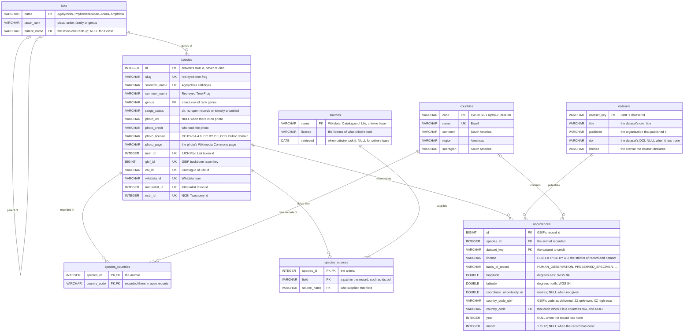

# critwire Learn: a practitioner curriculum (design)

Design for critwire Learn as a practitioner course in database architecture, GIS in SQL, spatial statistics, ETL and Power BI, taught on critwire's open species data and other open data. It starts from a little SQL and everyday GIS, covers the foundations fast, then goes deep. It replaces the course in `plans/002-learn.md` and `plans/003-learn-data-spatial.md` and reuses their engine, schema, data and licensing findings (§1). Every SQL and Python block here is tested (§0). Nothing public changes until the build missions in §9 run.

Written by mission `critwire-learn-curriculum` (plan `plans/2026-10-23-critwire-learn-curriculum.md`); a section marked "(S<n>)" is written by that plan's step S<n>.

## 0. Conventions

How blocks are labelled, which engine runs them and how to re-run them (S13).

### The browser setup

The browser labs (DuckDB-WASM) start from 002's database plus the lab sample: this `setup` block, the spike's `src/setup.sql`, runs at boot. Its first part is 002's `setup` byte for byte (schema v1); schema v2 adds `datasets` and `occurrences`, read from `/learn/data/datasets.csv` and `/learn/data/occurrences.parquet` (§4). It has no result block.

```sql
-- q: setup
-- status: ran
-- critwire Learn: the learners' tables (schema v1), built on a fresh in-memory database
-- from /v1/species.parquet and /v1/countries.parquet. Every table a foreign key points at is
-- created first, and taxa go in one rank per INSERT, top down: DuckDB declares foreign keys
-- only in CREATE TABLE and checks them statement by statement. Nothing is ever dropped;
-- a fresh database comes from a restart.

CREATE TABLE taxa (
  name        VARCHAR PRIMARY KEY,
  taxon_rank  VARCHAR NOT NULL CHECK (taxon_rank IN ('class', 'order', 'family', 'genus')),
  parent_name VARCHAR REFERENCES taxa (name),
  CHECK ((taxon_rank = 'class') = (parent_name IS NULL))
);

INSERT INTO taxa
SELECT DISTINCT taxonomy.class, 'class', NULL FROM read_parquet('species.parquet');

INSERT INTO taxa
SELECT DISTINCT taxonomy."order", 'order', taxonomy.class FROM read_parquet('species.parquet');

INSERT INTO taxa
SELECT DISTINCT taxonomy.family, 'family', taxonomy."order" FROM read_parquet('species.parquet');

INSERT INTO taxa
SELECT DISTINCT taxonomy.genus, 'genus', taxonomy.family FROM read_parquet('species.parquet');

CREATE TABLE species (
  id              INTEGER PRIMARY KEY,
  slug            VARCHAR NOT NULL UNIQUE,
  scientific_name VARCHAR NOT NULL UNIQUE,
  common_name     VARCHAR NOT NULL,
  genus           VARCHAR NOT NULL REFERENCES taxa (name),
  range_status    VARCHAR NOT NULL CHECK (range_status IN ('ok', 'no-open-records', 'identity-unsettled')),
  photo_url       VARCHAR,
  photo_credit    VARCHAR,
  photo_license   VARCHAR,
  photo_page      VARCHAR,
  iucn_id         INTEGER UNIQUE,
  gbif_id         BIGINT UNIQUE,
  col_id          VARCHAR UNIQUE,
  wikidata_id     VARCHAR UNIQUE,
  inaturalist_id  INTEGER UNIQUE,
  ncbi_id         INTEGER UNIQUE
);

INSERT INTO species
SELECT id, slug, scientificName, commonName, taxonomy.genus, "range".status,
       photo.url, photo.credit, photo.license, photo.page,
       ids.iucn, ids.gbif, ids.col, ids.wikidata, ids.inaturalist, ids.ncbi
FROM read_parquet('species.parquet');

CREATE TABLE sources (
  name      VARCHAR PRIMARY KEY,
  license   VARCHAR NOT NULL,
  retrieved DATE
);

INSERT INTO sources
SELECT DISTINCT s.source, s.license, CAST(s.retrieved AS DATE)
FROM (SELECT unnest(sources) AS s FROM read_parquet('species.parquet'));

CREATE TABLE species_sources (
  species_id  INTEGER NOT NULL REFERENCES species (id),
  field       VARCHAR NOT NULL,
  source_name VARCHAR NOT NULL REFERENCES sources (name),
  PRIMARY KEY (species_id, field)
);

INSERT INTO species_sources
SELECT id, unnest(s.fields), s.source
FROM (SELECT id, unnest(sources) AS s FROM read_parquet('species.parquet'));

CREATE TABLE countries (
  code      VARCHAR PRIMARY KEY,
  name      VARCHAR NOT NULL UNIQUE,
  continent VARCHAR NOT NULL,
  region    VARCHAR NOT NULL,
  subregion VARCHAR NOT NULL
);

INSERT INTO countries
SELECT code, name, continent, region, subregion FROM read_parquet('countries.parquet');

-- Countries with open (CC0 / CC BY) occurrence records, not the native range.
CREATE TABLE species_countries (
  species_id   INTEGER NOT NULL REFERENCES species (id),
  country_code VARCHAR NOT NULL REFERENCES countries (code),
  PRIMARY KEY (species_id, country_code)
);

INSERT INTO species_countries
SELECT id, unnest("range".countriesWithOpenRecords) FROM read_parquet('species.parquet');

CREATE VIEW species_taxonomy AS
SELECT s.id AS species_id, c.name AS class, o.name AS order_name, f.name AS family, g.name AS genus
FROM species AS s
JOIN taxa AS g ON g.name = s.genus
JOIN taxa AS f ON f.name = g.parent_name
JOIN taxa AS o ON o.name = f.parent_name
JOIN taxa AS c ON c.name = o.parent_name;

-- Schema v2 (plans/004-learn-curriculum.md): the lab sample of open GBIF records, from
-- /learn/data/datasets.csv and /learn/data/occurrences.parquet. A record is where someone
-- recorded the animal, not where it lives. country_code_gbif is GBIF's code as delivered
-- (ZZ unknown, XZ international waters); country_code is that code only when it is a
-- countries row, else NULL.

CREATE TABLE datasets (
  dataset_key VARCHAR PRIMARY KEY,
  title       VARCHAR NOT NULL,
  publisher   VARCHAR NOT NULL,
  doi         VARCHAR,
  license     VARCHAR NOT NULL
);

INSERT INTO datasets
SELECT * FROM read_csv('datasets.csv', header = true, columns = {
  'dataset_key': 'VARCHAR', 'title': 'VARCHAR', 'publisher': 'VARCHAR', 'doi': 'VARCHAR', 'license': 'VARCHAR'});

CREATE TABLE occurrences (
  id                       BIGINT PRIMARY KEY,
  species_id               INTEGER NOT NULL REFERENCES species (id),
  dataset_key              VARCHAR NOT NULL REFERENCES datasets (dataset_key),
  license                  VARCHAR NOT NULL CHECK (license IN ('CC0 1.0', 'CC BY 4.0')),
  basis_of_record          VARCHAR NOT NULL CHECK (basis_of_record IN ('HUMAN_OBSERVATION', 'OBSERVATION',
                             'MACHINE_OBSERVATION', 'PRESERVED_SPECIMEN', 'MATERIAL_SAMPLE',
                             'MATERIAL_CITATION', 'OCCURRENCE')),
  longitude                DOUBLE NOT NULL CHECK (longitude BETWEEN -180 AND 180),
  latitude                 DOUBLE NOT NULL CHECK (latitude BETWEEN -90 AND 90),
  coordinate_uncertainty_m DOUBLE,
  country_code_gbif        VARCHAR,
  country_code             VARCHAR REFERENCES countries (code),
  year                     INTEGER,
  month                    INTEGER CHECK (month BETWEEN 1 AND 12)
);

INSERT INTO occurrences
SELECT id, species_id, dataset_key, license, basis_of_record, longitude, latitude,
       coordinate_uncertainty_m, country_code_gbif, country_code, year, month
FROM read_parquet('occurrences.parquet');
```

The row count of every table and of the view (`countries` is A1's draft of `/v1/countries`; `datasets` and `occurrences` are the lab sample, §4):

```sql
-- q: setup-counts
-- status: ran
SELECT (SELECT count(*) FROM taxa)              AS taxa,
       (SELECT count(*) FROM species)           AS species,
       (SELECT count(*) FROM sources)           AS sources,
       (SELECT count(*) FROM species_sources)   AS species_sources,
       (SELECT count(*) FROM countries)         AS countries,
       (SELECT count(*) FROM species_countries) AS species_countries,
       (SELECT count(*) FROM datasets)          AS datasets,
       (SELECT count(*) FROM occurrences)       AS occurrences,
       (SELECT count(*) FROM species_taxonomy)  AS species_taxonomy;
```

```text
-- result: setup-counts · 1 row · sha256 e3323c4c9cd8
taxa | species | sources | species_sources | countries | species_countries | datasets | occurrences | species_taxonomy
143 | 76 | 5 | 591 | 250 | 472 | 400 | 40395 | 76
```

### The PostGIS setup

The PostGIS labs run in schema `learn_curriculum`, which one file builds: `learn_curriculum.sql` (§4). Load it with `psql -X -v ON_ERROR_STOP=1 -d <your database> -f learn_curriculum.sql`; it runs in one transaction, so a failed load leaves the previous schema as it was, and loading again replaces it. Every PostGIS lab starts with this session block. It puts `learn_curriculum` first on the search path, so plain table names find the lab tables, and PostGIS's functions still resolve from `public`. The tests run the same statement when they connect.

```sql
-- q: pg-session
-- status: ran
-- engine: postgis
SET search_path = learn_curriculum, public;
SHOW search_path;
```

```text
-- result: pg-session · 1 row · sha256 791623fd72db
search_path
learn_curriculum, public
```

A quick check that the load worked: the rows in every lab table.

```sql
-- q: pg-smoke
-- status: ran
-- engine: postgis
SELECT 'taxa' AS table_name, count(*) AS n_rows FROM taxa
UNION ALL SELECT 'species', count(*) FROM species
UNION ALL SELECT 'sources', count(*) FROM sources
UNION ALL SELECT 'species_sources', count(*) FROM species_sources
UNION ALL SELECT 'countries', count(*) FROM countries
UNION ALL SELECT 'species_countries', count(*) FROM species_countries
UNION ALL SELECT 'datasets', count(*) FROM datasets
UNION ALL SELECT 'occurrences', count(*) FROM occurrences
UNION ALL SELECT 'country_shapes', count(*) FROM country_shapes
UNION ALL SELECT 'admin1_shapes', count(*) FROM admin1_shapes
UNION ALL SELECT 'biomes', count(*) FROM biomes
UNION ALL SELECT 'ecoregions', count(*) FROM ecoregions
UNION ALL SELECT 'habitat_classes', count(*) FROM habitat_classes
UNION ALL SELECT 'country_habitats', count(*) FROM country_habitats
ORDER BY table_name;
```

```text
-- result: pg-smoke · 14 rows · sha256 444c9131da27
table_name | n_rows
admin1_shapes | 294
biomes | 14
countries | 250
country_habitats | 35
country_shapes | 247
… 9 more rows
```

Labs that create roles or schemas (d1, d5) clean up in the same block, so running a block twice, or stopping halfway through a module, leaves nothing behind. Their names start with `learn_`, and creating roles needs the CREATEROLE privilege (a superuser has it; on your own install, `ALTER ROLE <you> CREATEROLE` as the superuser, once). This check creates a read-only role, reads a table as that role, and removes it again: `DROP OWNED BY` takes away what the role was granted, and only then can `DROP ROLE` remove it.

```sql
-- q: pg-role-smoke
-- status: ran
-- engine: postgis
CREATE ROLE learn_smoke NOLOGIN;
GRANT USAGE ON SCHEMA learn_curriculum TO learn_smoke;
GRANT SELECT ON species TO learn_smoke;
SET ROLE learn_smoke;
SELECT current_user AS role, count(*) AS species FROM species;
RESET ROLE;
DROP OWNED BY learn_smoke;
DROP ROLE learn_smoke;
SELECT count(*) AS learn_smoke_left FROM pg_roles WHERE rolname = 'learn_smoke';
```

```text
-- result: pg-role-smoke · 1 row · sha256 fcfe7fd06dfa
learn_smoke_left
0
```

Most labs run in a transaction the tests roll back. The transaction labs (d4) manage their own, with `BEGIN` and `COMMIT` or `ROLLBACK`, exactly as you type them in `psql`; the tests then check that each one ended its transaction and left the lab tables as they were.

```sql
-- q: pg-tx-smoke
-- status: ran
-- engine: postgis
-- tx: own
BEGIN;
CREATE TABLE tx_smoke (id integer PRIMARY KEY);
INSERT INTO tx_smoke VALUES (1), (2);
ROLLBACK;
SELECT to_regclass('tx_smoke') IS NULL AS rolled_back;
```

```text
-- result: pg-tx-smoke · 1 row · sha256 a90c4cf411fd
rolled_back
true
```

### The Python setup

Python labs run in the `uv` environment (§3) and read the lab database through libpq's `PG*` environment variables, so the same file runs on your machine and on the test server. Every Python lab starts with this helper. It sets the search path when it connects, so plain table names find the lab tables in `learn_curriculum` and PostGIS's functions in `public`. It prints nothing.

```python
# q: py-connect
# status: ran
import psycopg


def connect():
    """A connection to the lab database: plain table names find learn_curriculum's tables, then PostGIS in public."""
    return psycopg.connect(options="-c search_path=learn_curriculum,public")
```

```text
-- result: py-connect · python · sha256 e3b0c44298fc
```

A quick check that the environment works: the search path through the helper, then the versions the labs were tested with.

```python
# q: py-smoke
# status: ran
# after: py-connect
import platform
from importlib.metadata import version

with connect() as conn:
    print("search_path:", conn.execute("SHOW search_path").fetchone()[0])
print("python:", platform.python_version())
for package in ["psycopg", "pandas", "pyarrow", "shapely", "pyproj", "pyogrio", "geopandas", "libpysal", "esda", "pointpats"]:
    print(f"{package}: {version(package)}")
```

```text
-- result: py-smoke · python · sha256 f75ba856b9f7
search_path: learn_curriculum,public
python: 3.12.3
psycopg: 3.3.6
pandas: 3.1.0
pyarrow: 26.0.0
shapely: 2.2.0
pyproj: 3.8.0
pyogrio: 0.13.0
geopandas: 1.2.0
libpysal: 4.15.1
esda: 2.10.0
pointpats: 2.6.0
```

## 1. What carries over

(S13)

## 2. The curriculum map

(S14)

## 3. Lab environments and setup

(S14)

## 4. Lab data

(S15)

## 5. Modules

### 5.1 Foundations

(S16, S17)

### 5.2 Database architecture

(S18–S22)

#### d6 · star

(S23 writes the module around this key code; §A.3 is the spike that tests it.)

**Key code:**

A star schema answers report questions with one join per question: a fact table holds one row per event at a stated grain, and each dimension describes one way to slice it. These blocks are `star.sql`, the one definition of the star: standard SQL with no schema names, so the same text runs in PostGIS (this lab, in `learn_curriculum`) and in DuckDB (critwire's build, which writes the CSV files Power BI reads). Each block creates one table, fills it from the lab tables and reports what it holds. Keys are declared in each `CREATE TABLE`, because DuckDB accepts foreign keys only there.

`dim_species` flattens the taxonomy into columns: a report filters by class or family without walking `taxa` (a star, not a snowflake).

```sql
-- q: d6-star-dim-species
-- status: ran
-- engine: postgis
CREATE TABLE dim_species (
  species_id      INTEGER PRIMARY KEY,
  scientific_name VARCHAR NOT NULL,
  common_name     VARCHAR NOT NULL,
  class           VARCHAR NOT NULL,
  order_name      VARCHAR NOT NULL,
  family          VARCHAR NOT NULL,
  genus           VARCHAR NOT NULL
);
INSERT INTO dim_species
SELECT s.id, s.scientific_name, s.common_name, t.class, t.order_name, t.family, t.genus
FROM species AS s
JOIN species_taxonomy AS t ON t.species_id = s.id;
SELECT count(*) AS species, count(DISTINCT class) AS classes, count(DISTINCT family) AS families
FROM dim_species;
```

```text
-- result: d6-star-dim-species · 1 row · sha256 f55e25393aeb
species | classes | families
76 | 3 | 50
```

`dim_country` is every country plus one **unknown member**, `ZZ`. A record with no country gets `ZZ` in the fact table, so every foreign key is filled and a report's totals still add up; the browser schema's nullable `country_code` becomes this one row.

```sql
-- q: d6-star-dim-country
-- status: ran
-- engine: postgis
CREATE TABLE dim_country (
  country_code VARCHAR PRIMARY KEY,
  name         VARCHAR NOT NULL,
  continent    VARCHAR NOT NULL,
  region       VARCHAR NOT NULL,
  subregion    VARCHAR NOT NULL
);
INSERT INTO dim_country
SELECT code, name, continent, region, subregion FROM countries
UNION ALL
SELECT 'ZZ', 'Unknown or outside any country', 'Unknown', 'Unknown', 'Unknown';
SELECT count(*) AS countries, count(*) FILTER (WHERE country_code = 'ZZ') AS unknown_members
FROM dim_country;
```

```text
-- result: d6-star-dim-country · 1 row · sha256 c47786e15c16
countries | unknown_members
251 | 1
```

`dim_dataset` carries each dataset's credit (title, publisher, DOI, license), so the credits travel with the star into any report built on it.

```sql
-- q: d6-star-dim-dataset
-- status: ran
-- engine: postgis
CREATE TABLE dim_dataset (
  dataset_key VARCHAR PRIMARY KEY,
  title       VARCHAR NOT NULL,
  publisher   VARCHAR NOT NULL,
  doi         VARCHAR,
  license     VARCHAR NOT NULL
);
INSERT INTO dim_dataset
SELECT CAST(dataset_key AS VARCHAR), title, publisher, doi, license
FROM datasets;
SELECT count(*) AS datasets, count(doi) AS with_doi, count(DISTINCT publisher) AS publishers
FROM dim_dataset;
```

```text
-- result: d6-star-dim-dataset · 1 row · sha256 3e8e7544bbbe
datasets | with_doi | publishers
400 | 400 | 217
```

`dim_year` has the years that occur, plus `-1` for a record with no year: the same unknown-member rule.

```sql
-- q: d6-star-dim-year
-- status: ran
-- engine: postgis
CREATE TABLE dim_year (
  year   INTEGER PRIMARY KEY,
  decade INTEGER,
  label  VARCHAR NOT NULL
);
INSERT INTO dim_year
SELECT DISTINCT year, year - year % 10, CAST(year AS VARCHAR)
FROM occurrences
WHERE year IS NOT NULL
UNION ALL
SELECT -1, NULL, 'Unknown';
SELECT count(*) AS years, min(year) FILTER (WHERE year > 0) AS first_year, max(year) AS last_year
FROM dim_year;
```

```text
-- result: d6-star-dim-year · 1 row · sha256 fcdad55612e8
years | first_year | last_year
177 | 1599 | 2026
```

`fact_records`: the grain is **one sample record**. `coalesce` is the one place a missing country or year becomes its unknown member. `basis_of_record` and `license` stay on the fact as plain columns (degenerate dimensions): they have no attributes of their own to describe.

```sql
-- q: d6-star-fact-records
-- status: ran
-- engine: postgis
-- after: d6-star-dim-species, d6-star-dim-country, d6-star-dim-dataset, d6-star-dim-year
CREATE TABLE fact_records (
  record_id                BIGINT PRIMARY KEY,
  species_id               INTEGER NOT NULL REFERENCES dim_species (species_id),
  country_code             VARCHAR NOT NULL REFERENCES dim_country (country_code),
  dataset_key              VARCHAR NOT NULL REFERENCES dim_dataset (dataset_key),
  year                     INTEGER NOT NULL REFERENCES dim_year (year),
  month                    INTEGER,
  basis_of_record          VARCHAR NOT NULL,
  license                  VARCHAR NOT NULL,
  longitude                DOUBLE PRECISION NOT NULL,
  latitude                 DOUBLE PRECISION NOT NULL,
  coordinate_uncertainty_m DOUBLE PRECISION
);
INSERT INTO fact_records
SELECT id, species_id, coalesce(country_code, 'ZZ'), CAST(dataset_key AS VARCHAR), coalesce(year, -1), month,
       basis_of_record, license, longitude, latitude, coordinate_uncertainty_m
FROM occurrences;
SELECT count(*) AS records,
       count(*) FILTER (WHERE country_code = 'ZZ') AS unknown_country,
       count(*) FILTER (WHERE year = -1) AS unknown_year,
       count(coordinate_uncertainty_m) AS with_uncertainty
FROM fact_records;
```

```text
-- result: d6-star-fact-records · 1 row · sha256 808a805569b8
records | unknown_country | unknown_year | with_uncertainty
40395 | 0 | 2289 | 16393
```

`fact_species_country` is a **factless fact**: it has no measure, only the pairs critwire publishes (a country where a species has open records). It shares `dim_species` and `dim_country` with `fact_records`, so one country slicer filters both (conformed dimensions).

```sql
-- q: d6-star-fact-species-country
-- status: ran
-- engine: postgis
-- after: d6-star-dim-species, d6-star-dim-country
CREATE TABLE fact_species_country (
  species_id   INTEGER NOT NULL REFERENCES dim_species (species_id),
  country_code VARCHAR NOT NULL REFERENCES dim_country (country_code),
  PRIMARY KEY (species_id, country_code)
);
INSERT INTO fact_species_country
SELECT species_id, country_code FROM species_countries;
SELECT count(*) AS pairs, count(DISTINCT species_id) AS species, count(DISTINCT country_code) AS countries
FROM fact_species_country;
```

```text
-- result: d6-star-fact-species-country · 1 row · sha256 e67b39a44d4e
pairs | species | countries
472 | 72 | 107
```

The habitat classes have two levels; `dim_habitat_class` flattens them, and a level-1 class is its own parent, so a report can group by `level1_name` with no gaps. The habitat data are stand-ins until L3 loads the habitat summaries.

```sql
-- q: d6-star-dim-habitat-class
-- status: ran
-- engine: postgis
CREATE TABLE dim_habitat_class (
  habitat_code INTEGER PRIMARY KEY,
  name         VARCHAR NOT NULL,
  level1_code  INTEGER NOT NULL,
  level1_name  VARCHAR NOT NULL
);
INSERT INTO dim_habitat_class
SELECT h.code, h.name, coalesce(h.level1_code, h.code), coalesce(p.name, h.name)
FROM habitat_classes AS h
LEFT JOIN habitat_classes AS p ON p.code = h.level1_code;
SELECT count(*) AS classes, count(DISTINCT level1_code) AS level1_classes
FROM dim_habitat_class;
```

```text
-- result: d6-star-dim-habitat-class · 1 row · sha256 37ad5647623e
classes | level1_classes
75 | 13
```

`fact_country_habitat`: the grain is **one country and one habitat class**, with a measure that adds up across classes, `est_area_km2`.

```sql
-- q: d6-star-fact-country-habitat
-- status: ran
-- engine: postgis
-- after: d6-star-dim-country, d6-star-dim-habitat-class
CREATE TABLE fact_country_habitat (
  country_code VARCHAR NOT NULL REFERENCES dim_country (country_code),
  habitat_code INTEGER NOT NULL REFERENCES dim_habitat_class (habitat_code),
  est_area_km2 DECIMAL(12, 2) NOT NULL,
  PRIMARY KEY (country_code, habitat_code)
);
INSERT INTO fact_country_habitat
SELECT country_code, habitat_code, est_area_km2 FROM country_habitats;
SELECT count(*) AS country_classes, count(DISTINCT country_code) AS countries, sum(est_area_km2) AS total_km2
FROM fact_country_habitat;
```

```text
-- result: d6-star-fact-country-habitat · 1 row · sha256 a745d03c7c43
country_classes | countries | total_km2
35 | 2 | 6062.26
```

### 5.3 GIS in SQL

(S24)

### 5.4 Spatial statistics

#### s4 · moran

(S25 writes the outline around this key code; §A.2 is the spike that tests it.)

**Key code:**

Points can't be the units for Moran's I: a record has no value to compare with its neighbours', and many records share one spot. So the records are counted into equal-area hexagons over Tasmania's main island (EPSG:3577, Australian Albers), at two cell sizes, and each cell's value is `y = ln(1 + n)`. Its centroid is kept as two plain numbers, `cx` and `cy`, so SQL and PySAL measure distances from the same coordinates. The neighbour rule is a view: two cells of one grid are neighbours when their centroids are within twice the edge length. This block runs when a PostGIS run starts, and its tables stay until the lab data is loaded again.

```sql
-- q: s4-cells
-- status: ran
-- engine: postgis
-- boot
CREATE TABLE s4_cells AS
WITH island AS (
  SELECT (part).geom
  FROM (SELECT ST_Dump(ST_Transform(geom, 3577)) AS part
        FROM admin1_shapes WHERE country_code = 'AU' AND name = 'Tasmania') AS parts
  ORDER BY ST_Area((part).geom) DESC
  LIMIT 1
), devils AS (
  SELECT ST_Transform(o.geom, 3577) AS geom
  FROM occurrences AS o JOIN species AS s ON s.id = o.species_id
  WHERE s.scientific_name = 'Sarcophilus harrisii'
), grid AS (
  SELECT e.edge_m, h.i, h.j, h.geom
  FROM island, (VALUES (5000), (10000)) AS e (edge_m), ST_HexagonGrid(e.edge_m, island.geom) AS h
  WHERE ST_Intersects(h.geom, island.geom)
)
SELECT row_number() OVER (ORDER BY g.edge_m, g.i, g.j)::integer AS id,
       g.edge_m, g.geom,
       ST_X(ST_Centroid(g.geom)) AS cx,
       ST_Y(ST_Centroid(g.geom)) AS cy,
       count(d.geom)::integer AS n,
       ln(1 + count(d.geom)::float8) AS y
FROM grid AS g LEFT JOIN devils AS d ON ST_Contains(g.geom, d.geom)
GROUP BY g.edge_m, g.i, g.j, g.geom;
ALTER TABLE s4_cells ADD PRIMARY KEY (id);
CREATE VIEW s4_neighbours AS
SELECT a.edge_m, a.id AS i, b.id AS j
FROM s4_cells AS a
JOIN s4_cells AS b
  ON b.edge_m = a.edge_m AND b.id <> a.id
 AND ST_DWithin(ST_Point(a.cx, a.cy, 3577), ST_Point(b.cx, b.cy, 3577), 2 * a.edge_m);
SELECT c.edge_m, count(*) AS cells, sum(c.n) AS records_in_cells,
       (SELECT count(*) FROM occurrences AS o JOIN species AS s ON s.id = o.species_id
        WHERE s.scientific_name = 'Sarcophilus harrisii') - sum(c.n) AS records_in_no_cell,
       max(c.n) AS max_n
FROM s4_cells AS c
GROUP BY c.edge_m
ORDER BY c.edge_m;
```

```text
-- result: s4-cells · 2 rows · sha256 29efe20842eb
edge_m | cells | records_in_cells | records_in_no_cell | max_n
5000 | 1094 | 1972 | 28 | 256
10000 | 296 | 1990 | 10 | 475
```

Before building weights from a distance band, look at the distances. In a hexagon grid with edge `e`, centroids are √3·e apart (the touching cells), then 3·e (the next ring). A threshold of 2·e sits between the two, with no pair near it, so every cell gets exactly its touching cells and a rounding error can't move a pair across. The block also counts duplicate centroids and cells with no neighbour (an "island"), which would break the statistic.

```sql
-- q: s4-geometry
-- status: ran
-- engine: postgis
WITH pairs AS (
  SELECT a.edge_m, ST_Distance(ST_Point(a.cx, a.cy, 3577), ST_Point(b.cx, b.cy, 3577)) AS d_m
  FROM s4_cells AS a
  JOIN s4_cells AS b
    ON b.edge_m = a.edge_m AND b.id > a.id
   AND ST_DWithin(ST_Point(a.cx, a.cy, 3577), ST_Point(b.cx, b.cy, 3577), 4 * a.edge_m)
), classes AS (
  SELECT edge_m, round(d_m::numeric, 2) AS d_m,
         dense_rank() OVER (PARTITION BY edge_m ORDER BY round(d_m::numeric, 2)) AS class
  FROM pairs
)
SELECT c.edge_m,
       2 * c.edge_m AS threshold_m,
       (SELECT min(d_m) FROM classes WHERE edge_m = c.edge_m AND class = 1) AS class_1_m,
       (SELECT min(d_m) FROM classes WHERE edge_m = c.edge_m AND class = 2) AS class_2_m,
       count(*) - count(DISTINCT (c.cx, c.cy)) AS duplicate_centroids,
       count(*) FILTER (WHERE NOT EXISTS (SELECT 1 FROM s4_neighbours AS nb WHERE nb.i = c.id)) AS islands,
       (SELECT count(*) FROM pairs AS p WHERE p.edge_m = c.edge_m AND abs(p.d_m - 2 * p.edge_m) <= 1) AS pairs_near_threshold
FROM s4_cells AS c
GROUP BY c.edge_m
ORDER BY c.edge_m;
```

```text
-- result: s4-geometry · 2 rows · sha256 099b07470829
edge_m | threshold_m | class_1_m | class_2_m | duplicate_centroids | islands | pairs_near_threshold
5000 | 10000 | 8660.25 | 15000.00 | 0 | 0 | 0
10000 | 20000 | 17320.51 | 30000.00 | 0 | 0 | 0
```

Global Moran's I in plain SQL, with row-standardized weights (`w_ij = 1/k_i`, where `k_i` is cell i's number of neighbours) and its expected value, variance and z-score under the normality assumption. These are the formulas PySAL's `esda.Moran` uses (`EI`, `VI_norm`, `z_norm`).

```sql
-- q: s4-moran-sql
-- status: ran
-- engine: postgis
WITH z AS (
  SELECT id, edge_m, y - avg(y) OVER (PARTITION BY edge_m) AS z FROM s4_cells
), w AS (
  SELECT edge_m, i, j, 1 / count(*) OVER (PARTITION BY i)::float8 AS w FROM s4_neighbours
), pairs AS (
  SELECT w.edge_m, w.i, w.j, w.w AS w_ij, t.w AS w_ji
  FROM w JOIN w AS t ON t.i = w.j AND t.j = w.i
), sums AS (
  SELECT p.edge_m,
         sum(p.w_ij * zi.z * zj.z) AS wzz,
         sum(p.w_ij) AS s0,
         sum((p.w_ij + p.w_ji) ^ 2) / 2 AS s1
  FROM pairs AS p JOIN z AS zi ON zi.id = p.i JOIN z AS zj ON zj.id = p.j
  GROUP BY p.edge_m
), s2 AS (
  SELECT edge_m, sum(ws ^ 2) AS s2
  FROM (SELECT edge_m, i, sum(w_ij) + sum(w_ji) AS ws FROM pairs GROUP BY edge_m, i) AS cell
  GROUP BY edge_m
), cells AS (
  SELECT edge_m, count(*)::float8 AS n, sum(z * z) AS zz FROM z GROUP BY edge_m
), moran AS (
  SELECT c.edge_m, c.n,
         c.n / s.s0 * s.wzz / c.zz AS i,
         -1 / (c.n - 1) AS ei,
         (c.n ^ 2 * s.s1 - c.n * s2.s2 + 3 * s.s0 ^ 2) / ((c.n - 1) * (c.n + 1) * s.s0 ^ 2) - (1 / (c.n - 1)) ^ 2 AS var_norm
  FROM cells AS c JOIN sums AS s USING (edge_m) JOIN s2 USING (edge_m)
)
SELECT edge_m, n::integer AS n, i, ei, var_norm, (i - ei) / sqrt(var_norm) AS z
FROM moran
ORDER BY edge_m;
```

```text
-- result: s4-moran-sql · 2 rows · sha256 7cd3a5f317d7
edge_m | n | i | ei | var_norm | z
5000 | 1094 | 0.27329612511604184 | -0.0009149130832570906 | 0.000326399057870225 | 15.177857980449323
10000 | 296 | 0.2035877773186644 | -0.003389830508474576 | 0.0012597916525627741 | 5.831415676740585
```

The same statistic in PySAL, from the same cells. `DistanceBand` builds the binary weights; `transformation="r"` row-standardizes them. `z_rand` is the z-score under the randomization assumption, which ArcGIS reports.

```python
# q: s4-moran-pysal
# status: ran
# after: py-connect
import esda
import numpy as np
from libpysal.weights import DistanceBand

results = {}
with connect() as conn:
    edges = [e for (e,) in conn.execute("SELECT DISTINCT edge_m FROM s4_cells ORDER BY edge_m")]
    for edge_m in edges:
        rows = conn.execute(
            "SELECT id, y, cx, cy FROM s4_cells WHERE edge_m = %s ORDER BY id", (edge_m,)
        ).fetchall()
        ids = [r[0] for r in rows]
        y = np.array([r[1] for r in rows])
        xy = np.array([(r[2], r[3]) for r in rows])
        w = DistanceBand(xy, threshold=2 * edge_m, binary=True, ids=ids)
        assert w.islands == [], f"cells with no neighbour: {w.islands}"
        results[edge_m] = esda.Moran(y, w, transformation="r", permutations=0)

print("edge_m | n | I | E[I] | Var_norm | z_norm | z_rand")
for edge_m, mi in results.items():
    print(f"{edge_m} | {mi.n} | {mi.I:.6f} | {mi.EI:.6f} | {mi.VI_norm:.6e} | {mi.z_norm:.6f} | {mi.z_rand:.6f}")
```

```text
-- result: s4-moran-pysal · python · sha256 30d9b36db807
edge_m | n | I | E[I] | Var_norm | z_norm | z_rand
5000 | 1094 | 0.273296 | -0.000915 | 3.263991e-04 | 15.177858 | 15.246590
10000 | 296 | 0.203588 | -0.003390 | 1.259792e-03 | 5.831416 | 5.847466
```

### 5.5 ETL

(S26)

### 5.6 Power BI

(S26 writes p2–p4 and the outline around p1's key code; §A.3 checks the files it reads.)

#### p1 · power-query

**Key code:**

Power BI reads the star d6 builds, as CSV files critwire publishes under `/learn/data/star/`. `LoadStar` is one function for all eight tables: create it as a blank query (Home → Get data → Blank query → Advanced editor), then add one query per table that calls it, for example `dim_country = LoadStar("dim_country", {{"country_code", type text}, {"name", type text}, {"continent", type text}, {"region", type text}, {"subregion", type text}})`. The base URL is fixed and the file name goes in `RelativePath`, so the Power BI Service can refresh it with anonymous access. The culture `"en-US"` is explicit, so a computer set to a comma-decimal locale still reads `12.5` as twelve and a half. Type `country_code` as text: Namibia's code is `NA`, which some tools read as "not available".

```m
// q: p1-load
// status: untested: Power BI is Windows-only
// input: star/dim_species.csv, star/dim_country.csv, star/dim_dataset.csv, star/dim_year.csv, star/fact_records.csv, star/fact_species_country.csv, star/dim_habitat_class.csv, star/fact_country_habitat.csv
(file as text, types as list) as table =>
let
    Source = Web.Contents("https://critwire.com", [RelativePath = "learn/data/star/" & file & ".csv"]),
    Rows = Csv.Document(Source, [Delimiter = ",", Encoding = 65001, QuoteStyle = QuoteStyle.Csv]),
    Promoted = Table.PromoteHeaders(Rows, [PromoteAllScalars = true]),
    Typed = Table.TransformColumnTypes(Promoted, types, "en-US")
in
    Typed
```

### 5.7 Capstone

(S27)

## 6. ERDs

Three diagrams, one per database a learner meets: the browser's tables (schema v2), the PostGIS lab, and the star that Power BI reads. Each is a Mermaid source under `plans/`, shown here as it is in that file, and each is checked against the database it describes on every run of the tests (§0): a column, key or line in the picture that the database lacks fails, and so does the reverse. The data dictionary under each diagram says the same in words, with where each column comes from; its column, type, key and meaning are the diagram's own, and a test holds them to it.

How to read the lines: `||` exactly one, `|o` zero or one, `o{` zero or more, `|{` one or more. The side with the crow's foot holds the foreign key. PK is the primary key, FK a foreign key, UK a unique key.

The pictures are drawn offline by Mermaid in a headless browser, as SVG (plain text labels, so it shows inside an ``) and PNG. Each SVG records the sha256 of the source it was drawn from, so a build can refuse a picture older than its source (002 §3): `node scripts/erd.ts plans/004-learn-erd.mmd --name schema`, then `--name lab` and `--name star` for the other two.

### 6.1 Schema v2: the browser's tables

`plans/004-learn-erd.mmd`. 002's six tables and their lines are unchanged (the check compares them with `plans/002-learn-erd.mmd` and allows no new line between them); v2 adds the lab sample. A record belongs to one species and one dataset. Its country is optional: `country_code_gbif` keeps GBIF's code as delivered, and `country_code` holds it only when it is a row of `countries`, so GBIF's `ZZ` (unknown) and `XZ` (high seas) never break the foreign key. The view `species_taxonomy (species_id, class, order_name, family, genus)` stores nothing and isn't drawn.



Data dictionary, schema v2:

**taxa**

| Column | Type | Key | Meaning | Source |
|---|---|---|---|---|
| `name` | VARCHAR | PK | Agalychnis, Phyllomedusidae, Anura, Amphibia | critwire `/v1/species.parquet`: taxonomy from Catalogue of Life, else critwire base |
| `taxon_rank` | VARCHAR |  | class, order, family or genus | critwire `/v1/species.parquet`: taxonomy from Catalogue of Life, else critwire base |
| `parent_name` | VARCHAR | FK | the taxon one rank up; NULL for a class | critwire `/v1/species.parquet`: taxonomy from Catalogue of Life, else critwire base |

**species**

| Column | Type | Key | Meaning | Source |
|---|---|---|---|---|
| `id` | INTEGER | PK | critwire's own id, never reused | critwire `/v1/species.parquet`; each field's source is in `species_sources` |
| `slug` | VARCHAR | UK | red-eyed-tree-frog | critwire `/v1/species.parquet`; each field's source is in `species_sources` |
| `scientific_name` | VARCHAR | UK | Agalychnis callidryas | critwire `/v1/species.parquet`; each field's source is in `species_sources` |
| `common_name` | VARCHAR |  | Red-eyed Tree Frog | critwire `/v1/species.parquet`; each field's source is in `species_sources` |
| `genus` | VARCHAR | FK | a taxa row of rank genus | critwire `/v1/species.parquet`; each field's source is in `species_sources` |
| `range_status` | VARCHAR |  | ok, no-open-records or identity-unsettled | critwire `/v1/species.parquet`; each field's source is in `species_sources` |
| `photo_url` | VARCHAR |  | NULL when there is no photo | critwire `/v1/species.parquet`; each field's source is in `species_sources` |
| `photo_credit` | VARCHAR |  | who took the photo | critwire `/v1/species.parquet`; each field's source is in `species_sources` |
| `photo_license` | VARCHAR |  | CC BY-SA 4.0, CC BY 2.0, CC0, Public domain | critwire `/v1/species.parquet`; each field's source is in `species_sources` |
| `photo_page` | VARCHAR |  | the photo's Wikimedia Commons page | critwire `/v1/species.parquet`; each field's source is in `species_sources` |
| `iucn_id` | INTEGER | UK | IUCN Red List taxon id | critwire `/v1/species.parquet`; each field's source is in `species_sources` |
| `gbif_id` | BIGINT | UK | GBIF backbone taxon key | critwire `/v1/species.parquet`; each field's source is in `species_sources` |
| `col_id` | VARCHAR | UK | Catalogue of Life id | critwire `/v1/species.parquet`; each field's source is in `species_sources` |
| `wikidata_id` | VARCHAR | UK | Wikidata item | critwire `/v1/species.parquet`; each field's source is in `species_sources` |
| `inaturalist_id` | INTEGER | UK | iNaturalist taxon id | critwire `/v1/species.parquet`; each field's source is in `species_sources` |
| `ncbi_id` | INTEGER | UK | NCBI Taxonomy id | critwire `/v1/species.parquet`; each field's source is in `species_sources` |

**countries**

| Column | Type | Key | Meaning | Source |
|---|---|---|---|---|
| `code` | VARCHAR | PK | ISO 3166-1 alpha-2, plus XK | critwire `/v1/countries.parquet` (002 §6) |
| `name` | VARCHAR | UK | Brazil | critwire `/v1/countries.parquet` (002 §6) |
| `continent` | VARCHAR |  | South America | critwire `/v1/countries.parquet` (002 §6) |
| `region` | VARCHAR |  | Americas | critwire `/v1/countries.parquet` (002 §6) |
| `subregion` | VARCHAR |  | South America | critwire `/v1/countries.parquet` (002 §6) |

**species_countries**

| Column | Type | Key | Meaning | Source |
|---|---|---|---|---|
| `species_id` | INTEGER | PK, FK | the animal | critwire `/v1/species.parquet`, `range.countriesWithOpenRecords` (GBIF, CC0 and CC BY records) |
| `country_code` | VARCHAR | PK, FK | recorded there in open records | critwire `/v1/species.parquet`, `range.countriesWithOpenRecords` (GBIF, CC0 and CC BY records) |

**sources**

| Column | Type | Key | Meaning | Source |
|---|---|---|---|---|
| `name` | VARCHAR | PK | Wikidata, Catalogue of Life, critwire base | critwire `/v1/species.parquet`, `sources[]` |
| `license` | VARCHAR |  | the license of what critwire took | critwire `/v1/species.parquet`, `sources[]` |
| `retrieved` | DATE |  | when critwire took it; NULL for critwire base | critwire `/v1/species.parquet`, `sources[]` |

**species_sources**

| Column | Type | Key | Meaning | Source |
|---|---|---|---|---|
| `species_id` | INTEGER | PK, FK | the animal | critwire `/v1/species.parquet`, `sources[]` |
| `field` | VARCHAR | PK | a path in the record, such as ids.col | critwire `/v1/species.parquet`, `sources[]` |
| `source_name` | VARCHAR | FK | who supplied that field | critwire `/v1/species.parquet`, `sources[]` |

**datasets**

| Column | Type | Key | Meaning | Source |
|---|---|---|---|---|
| `dataset_key` | VARCHAR | PK | GBIF's dataset id | GBIF registry, the download's datasets (`datasets.csv`) |
| `title` | VARCHAR |  | the dataset's own title | GBIF registry, the download's datasets (`datasets.csv`) |
| `publisher` | VARCHAR |  | the organization that published it | GBIF registry, the download's datasets (`datasets.csv`) |
| `doi` | VARCHAR |  | the dataset's DOI; NULL when it has none | GBIF registry, the download's datasets (`datasets.csv`) |
| `license` | VARCHAR |  | the license the dataset declares | GBIF registry, the download's datasets (`datasets.csv`) |

**occurrences**

| Column | Type | Key | Meaning | Source |
|---|---|---|---|---|
| `id` | BIGINT | PK | GBIF's record id | GBIF download 10.15468/dl.fbpk9w, sampled (§4) |
| `species_id` | INTEGER | FK | the animal recorded | GBIF download 10.15468/dl.fbpk9w, sampled (§4) |
| `dataset_key` | VARCHAR | FK | the dataset to credit | GBIF download 10.15468/dl.fbpk9w, sampled (§4) |
| `license` | VARCHAR |  | CC0 1.0 or CC BY 4.0, the stricter of record and dataset | GBIF record and dataset licenses (§4) |
| `basis_of_record` | VARCHAR |  | HUMAN_OBSERVATION, PRESERVED_SPECIMEN, ... | GBIF download 10.15468/dl.fbpk9w, sampled (§4) |
| `longitude` | DOUBLE |  | degrees east, WGS 84 | GBIF download 10.15468/dl.fbpk9w, sampled (§4) |
| `latitude` | DOUBLE |  | degrees north, WGS 84 | GBIF download 10.15468/dl.fbpk9w, sampled (§4) |
| `coordinate_uncertainty_m` | DOUBLE |  | metres; NULL when not given | GBIF download 10.15468/dl.fbpk9w, sampled (§4) |
| `country_code_gbif` | VARCHAR |  | GBIF's code as delivered; ZZ unknown, XZ high seas | GBIF download 10.15468/dl.fbpk9w, sampled (§4) |
| `country_code` | VARCHAR | FK | that code when it is a countries row, else NULL | `country_code_gbif`, when a `countries` row |
| `year` | INTEGER |  | NULL when the record has none | GBIF download 10.15468/dl.fbpk9w, sampled (§4) |
| `month` | INTEGER |  | 1 to 12; NULL when the record has none | GBIF download 10.15468/dl.fbpk9w, sampled (§4) |
### 6.2 The lab database (PostGIS)

`plans/004-lab-erd.mmd`, schema `learn_curriculum`. The same keyed tables as schema v2 in PostgreSQL types (`text`, `float8`; GBIF's dataset key is a `uuid`), plus the shapes the GIS modules join to: country outlines, admin-1 areas for nine countries, RESOLVE's biomes and ecoregions, and the habitat map's classes. Every shape is `geometry` in WGS 84 (SRID 4326) with a GiST index; a record's point is a generated column, so it can never disagree with its longitude and latitude. Two lists sit beside the diagram, as comments in the source:

- **Lab-made:** tables the lessons create in the lab (s4's hexagon grids, the smoke check's table, the ETL's staging tables, d6's star). They aren't part of the loaded lab, so they aren't drawn; the check excuses them when a lesson's setup has made them.
- **Planned:** `occurrence_habitats` (the habitat class at each record) and `habitat_clips` (small clips of the habitat map, as rasters), which build mission L3 adds. They are drawn so the design is whole; the check excuses them while they don't exist, and fails once they do, so the marker can't go stale.

```mermaid
%% critwire Learn: the lab database, PostGIS schema learn_curriculum (plans/004-learn-curriculum.md §3, §4, §6), in PostgreSQL types.
%% Tables only; the view species_taxonomy is listed beside it. Shapes are geometry in WGS 84 (SRID 4326), each with a GiST index.
%% Tables the lessons make in the lab (s4's grids, the smoke check's, the ETL's staging, d6's star): beside the diagram, not in it.
%% lab-made: s4_cells, tx_smoke, gbif_staging, occurrences_all, dim_species, dim_country, dim_dataset, dim_year, dim_habitat_class, fact_records, fact_species_country, fact_country_habitat
%% Drawn, but built by build mission L3 (the habitat map), so not in the lab yet:
%% planned: occurrence_habitats, habitat_clips
%% Keys: PK primary key, FK foreign key, UK unique. Lines: || exactly one, |o or o| zero or one, |{ one or more, o{ zero or more.
erDiagram
    taxa {
        text name PK "Agalychnis, Phyllomedusidae, Anura, Amphibia"
        text taxon_rank "class, order, family or genus"
        text parent_name FK "the taxon one rank up; NULL for a class"
    }
    species {
        integer id PK "critwire's own id, never reused"
        text slug UK "red-eyed-tree-frog"
        text scientific_name UK "Agalychnis callidryas"
        text common_name "Red-eyed Tree Frog"
        text genus FK "a taxa row of rank genus"
        text range_status "ok, no-open-records or identity-unsettled"
        text photo_url "NULL when there is no photo"
        text photo_credit "who took the photo"
        text photo_license "CC BY-SA 4.0, CC BY 2.0, CC0, Public domain"
        text photo_page "the photo's Wikimedia Commons page"
        integer iucn_id UK "IUCN Red List taxon id"
        bigint gbif_id UK "GBIF backbone taxon key"
        text col_id UK "Catalogue of Life id"
        text wikidata_id UK "Wikidata item"
        integer inaturalist_id UK "iNaturalist taxon id"
        integer ncbi_id UK "NCBI Taxonomy id"
    }
    countries {
        text code PK "ISO 3166-1 alpha-2, plus XK"
        text name UK "Brazil"
        text continent "South America"
        text region "Americas"
        text subregion "South America"
    }
    species_countries {
        integer species_id PK, FK "the animal"
        text country_code PK, FK "recorded there in open records"
    }
    sources {
        text name PK "Wikidata, Catalogue of Life, critwire base"
        text license "the license of what critwire took"
        date retrieved "when critwire took it; NULL for critwire base"
    }
    species_sources {
        integer species_id PK, FK "the animal"
        text field PK "a path in the record, such as ids.col"
        text source_name FK "who supplied that field"
    }
    datasets {
        uuid dataset_key PK "GBIF's dataset id"
        text title "the dataset's own title"
        text publisher "the organization that published it"
        text doi "the dataset's DOI; NULL when it has none"
        text license "the license the dataset declares"
    }
    occurrences {
        bigint id PK "GBIF's record id"
        integer species_id FK "the animal recorded"
        uuid dataset_key FK "the dataset to credit"
        text license "CC0 1.0 or CC BY 4.0, the stricter of record and dataset"
        text basis_of_record "HUMAN_OBSERVATION, PRESERVED_SPECIMEN, ..."
        float8 longitude "degrees east, WGS 84"
        float8 latitude "degrees north, WGS 84"
        float8 coordinate_uncertainty_m "metres; NULL when not given"
        text country_code_gbif "GBIF's code as delivered; ZZ unknown, XZ high seas"
        text country_code FK "that code when it is a countries row, else NULL"
        integer year "NULL when the record has none"
        integer month "1 to 12; NULL when the record has none"
        geometry geom "Point, generated from longitude and latitude"
    }
    country_shapes {
        text country_code PK, FK "the country"
        geometry geom "MultiPolygon, Natural Earth admin-0 1:50m"
    }
    admin1_shapes {
        text adm1_code PK "Natural Earth's code, such as AUS-2660"
        text country_code FK "the country it is part of"
        text name "Tasmania"
        geometry geom "MultiPolygon, Natural Earth admin-1 1:50m"
    }
    biomes {
        integer biome_id PK "RESOLVE biome number, 1 to 14"
        text name "Tropical & Subtropical Moist Broadleaf Forests"
    }
    ecoregions {
        integer eco_id PK "RESOLVE ecoregion id"
        integer biome_id FK "its biome; NULL for Rock and Ice"
        text name "Tasmanian temperate forests"
        text realm "Australasia; NULL for Rock and Ice"
        geometry geom "MultiPolygon, simplified to 0.05 degrees"
    }
    habitat_classes {
        integer code PK "Jung v004 class, such as 105"
        integer level1_code FK "its level-1 class, such as 100; NULL for level 1"
        text name "Forest – Subtropical/tropical dry"
    }
    country_habitats {
        text country_code PK, FK "the country"
        integer habitat_code PK, FK "the habitat class"
        numeric est_area_km2 "estimated from the map, never measured"
    }
    occurrence_habitats {
        bigint occurrence_id PK, FK "the record"
        integer habitat_code FK "class of its 1 km cell; NULL if none"
    }
    habitat_clips {
        text clip PK "cr or tas"
        raster rast "a clip of the habitat map, stored in the database"
    }

    taxa |o--o{ taxa : "parent of"
    taxa ||--o{ species : "genus of"
    species ||--o{ species_countries : "recorded in"
    countries ||--o{ species_countries : "has records of"
    species ||--o{ species_sources : "fields from"
    sources ||--|{ species_sources : "supplies"
    species ||--o{ occurrences : "recorded as"
    datasets ||--o{ occurrences : "publishes"
    countries |o--o{ occurrences : "contains"
    countries ||--o| country_shapes : "outlined by"
    countries ||--o{ admin1_shapes : "divided into"
    biomes |o--o{ ecoregions : "groups"
    habitat_classes |o--o{ habitat_classes : "level 1 of"
    countries ||--o{ country_habitats : "estimated to hold"
    habitat_classes ||--o{ country_habitats : "estimated in"
    occurrences ||--o| occurrence_habitats : "habitat at"
    habitat_classes |o--o{ occurrence_habitats : "class at"
```



Data dictionary, the lab: the tables schema v2 lacks, and `occurrences` for its point. The other seven are as in §6.1, in PostgreSQL types.

**occurrences**

| Column | Type | Key | Meaning | Source |
|---|---|---|---|---|
| `id` | bigint | PK | GBIF's record id | GBIF download 10.15468/dl.fbpk9w, sampled (§4) |
| `species_id` | integer | FK | the animal recorded | GBIF download 10.15468/dl.fbpk9w, sampled (§4) |
| `dataset_key` | uuid | FK | the dataset to credit | GBIF download 10.15468/dl.fbpk9w, sampled (§4) |
| `license` | text |  | CC0 1.0 or CC BY 4.0, the stricter of record and dataset | GBIF record and dataset licenses (§4) |
| `basis_of_record` | text |  | HUMAN_OBSERVATION, PRESERVED_SPECIMEN, ... | GBIF download 10.15468/dl.fbpk9w, sampled (§4) |
| `longitude` | float8 |  | degrees east, WGS 84 | GBIF download 10.15468/dl.fbpk9w, sampled (§4) |
| `latitude` | float8 |  | degrees north, WGS 84 | GBIF download 10.15468/dl.fbpk9w, sampled (§4) |
| `coordinate_uncertainty_m` | float8 |  | metres; NULL when not given | GBIF download 10.15468/dl.fbpk9w, sampled (§4) |
| `country_code_gbif` | text |  | GBIF's code as delivered; ZZ unknown, XZ high seas | GBIF download 10.15468/dl.fbpk9w, sampled (§4) |
| `country_code` | text | FK | that code when it is a countries row, else NULL | `country_code_gbif`, when a `countries` row |
| `year` | integer |  | NULL when the record has none | GBIF download 10.15468/dl.fbpk9w, sampled (§4) |
| `month` | integer |  | 1 to 12; NULL when the record has none | GBIF download 10.15468/dl.fbpk9w, sampled (§4) |
| `geom` | geometry |  | Point, generated from longitude and latitude | generated from `longitude`, `latitude` |

**country_shapes**

| Column | Type | Key | Meaning | Source |
|---|---|---|---|---|
| `country_code` | text | PK, FK | the country | Natural Earth admin-0 1:50m (public domain) |
| `geom` | geometry |  | MultiPolygon, Natural Earth admin-0 1:50m | Natural Earth admin-0 1:50m (public domain) |

**admin1_shapes**

| Column | Type | Key | Meaning | Source |
|---|---|---|---|---|
| `adm1_code` | text | PK | Natural Earth's code, such as AUS-2660 | Natural Earth admin-1 1:50m (public domain) |
| `country_code` | text | FK | the country it is part of | Natural Earth admin-1 1:50m (public domain) |
| `name` | text |  | Tasmania | Natural Earth admin-1 1:50m (public domain) |
| `geom` | geometry |  | MultiPolygon, Natural Earth admin-1 1:50m | Natural Earth admin-1 1:50m (public domain) |

**biomes**

| Column | Type | Key | Meaning | Source |
|---|---|---|---|---|
| `biome_id` | integer | PK | RESOLVE biome number, 1 to 14 | RESOLVE Ecoregions 2017 (CC BY 4.0) |
| `name` | text |  | Tropical & Subtropical Moist Broadleaf Forests | RESOLVE Ecoregions 2017 (CC BY 4.0) |

**ecoregions**

| Column | Type | Key | Meaning | Source |
|---|---|---|---|---|
| `eco_id` | integer | PK | RESOLVE ecoregion id | RESOLVE Ecoregions 2017 (CC BY 4.0) |
| `biome_id` | integer | FK | its biome; NULL for Rock and Ice | RESOLVE Ecoregions 2017 (CC BY 4.0) |
| `name` | text |  | Tasmanian temperate forests | RESOLVE Ecoregions 2017 (CC BY 4.0) |
| `realm` | text |  | Australasia; NULL for Rock and Ice | RESOLVE Ecoregions 2017 (CC BY 4.0) |
| `geom` | geometry |  | MultiPolygon, simplified to 0.05 degrees | RESOLVE Ecoregions 2017 (CC BY 4.0) |

**habitat_classes**

| Column | Type | Key | Meaning | Source |
|---|---|---|---|---|
| `code` | integer | PK | Jung v004 class, such as 105 | Jung et al. 2020, v004 legend (CC BY 4.0) |
| `level1_code` | integer | FK | its level-1 class, such as 100; NULL for level 1 | Jung et al. 2020, v004 legend (CC BY 4.0) |
| `name` | text |  | Forest – Subtropical/tropical dry | Jung et al. 2020, v004 legend (CC BY 4.0) |

**country_habitats**

| Column | Type | Key | Meaning | Source |
|---|---|---|---|---|
| `country_code` | text | PK, FK | the country | stand-in from Jung et al. 2020 (CC BY 4.0) until L3 |
| `habitat_code` | integer | PK, FK | the habitat class | stand-in from Jung et al. 2020 (CC BY 4.0) until L3 |
| `est_area_km2` | numeric |  | estimated from the map, never measured | stand-in from Jung et al. 2020 (CC BY 4.0) until L3 |

**occurrence_habitats**

| Column | Type | Key | Meaning | Source |
|---|---|---|---|---|
| `occurrence_id` | bigint | PK, FK | the record | L3: Jung et al. 2020, v004 (CC BY 4.0) |
| `habitat_code` | integer | FK | class of its 1 km cell; NULL if none | L3: Jung et al. 2020, v004 (CC BY 4.0) |

**habitat_clips**

| Column | Type | Key | Meaning | Source |
|---|---|---|---|---|
| `clip` | text | PK | cr or tas | L3: Jung et al. 2020, v004 (CC BY 4.0) |
| `rast` | raster |  | a clip of the habitat map, stored in the database | L3: Jung et al. 2020, v004 (CC BY 4.0) |
### 6.3 The Power BI star

`plans/004-star-erd.mmd`: the eight CSV files `star.sql` writes (d6, §A.3), checked against the star's `manifest.json`. `fact_records` holds one row per sample record; `fact_species_country` has no measure (a factless fact: a row says a species has open records in a country); `fact_country_habitat` is the habitat stand-in. `dim_species` and `dim_country` are shared by the facts (conformed dimensions), so one slicer filters them all. Every fact foreign key is filled: a record with no year points at `dim_year`'s `-1` member, one with no country at `dim_country`'s `ZZ`, so every line is "exactly one" on the dimension's side.

```mermaid
%% critwire Learn: the Power BI star (plans/004-learn-curriculum.md §5.2 d6, §5.6, §6): the CSV files star.sql writes, in DuckDB types.
%% Every fact foreign key is filled: a record with no year points at dim_year -1, one with no country at dim_country ZZ.
%% fact_records and fact_species_country share dim_species and dim_country (conformed dimensions); fact_species_country has no measure (factless).
%% Keys: PK primary key, FK foreign key, UK unique. Lines: || exactly one, |o or o| zero or one, |{ one or more, o{ zero or more.
erDiagram
    dim_species {
        INTEGER species_id PK "critwire's species id"
        VARCHAR scientific_name "Sarcophilus harrisii"
        VARCHAR common_name "Tasmanian Devil"
        VARCHAR class "Mammalia"
        VARCHAR order_name "Dasyuromorphia"
        VARCHAR family "Dasyuridae"
        VARCHAR genus "Sarcophilus"
    }
    dim_country {
        VARCHAR country_code PK "ISO alpha-2; ZZ the unknown member"
        VARCHAR name "Australia; Unknown or outside any country for ZZ"
        VARCHAR continent "Oceania"
        VARCHAR region "Oceania"
        VARCHAR subregion "Australia and New Zealand"
    }
    dim_dataset {
        VARCHAR dataset_key PK "GBIF's dataset id"
        VARCHAR title "the dataset's title, to credit"
        VARCHAR publisher "who published it"
        VARCHAR doi "its DOI; empty when it has none"
        VARCHAR license "the license the dataset declares"
    }
    dim_year {
        INTEGER year PK "a year with records; -1 the unknown member"
        INTEGER decade "2010; empty for -1"
        VARCHAR label "2016; Unknown for -1"
    }
    fact_records {
        BIGINT record_id PK "GBIF's record id; grain: one record"
        INTEGER species_id FK "the animal"
        VARCHAR country_code FK "where; ZZ when unknown"
        VARCHAR dataset_key FK "whose record"
        INTEGER year FK "when; -1 when unknown"
        INTEGER month "1 to 12, or empty"
        VARCHAR basis_of_record "degenerate dimension"
        VARCHAR license "degenerate dimension: CC0 1.0 or CC BY 4.0"
        DOUBLE longitude "for map visuals"
        DOUBLE latitude "for map visuals"
        DOUBLE coordinate_uncertainty_m "metres, or empty"
    }
    fact_species_country {
        INTEGER species_id PK, FK "the animal"
        VARCHAR country_code PK, FK "a country with open records of it"
    }
    dim_habitat_class {
        INTEGER habitat_code PK "Jung v004 class"
        VARCHAR name "the class"
        INTEGER level1_code "its level-1 class; a level-1 class is its own"
        VARCHAR level1_name "the level-1 class's name"
    }
    fact_country_habitat {
        VARCHAR country_code PK, FK "the country"
        INTEGER habitat_code PK, FK "the habitat class"
        DECIMAL est_area_km2 "estimated area, km2"
    }

    dim_species ||--o{ fact_records : "recorded as"
    dim_country ||--o{ fact_records : "where"
    dim_dataset ||--o{ fact_records : "published"
    dim_year ||--o{ fact_records : "when"
    dim_species ||--o{ fact_species_country : "recorded in"
    dim_country ||--o{ fact_species_country : "has records of"
    dim_country ||--o{ fact_country_habitat : "estimated to hold"
    dim_habitat_class ||--o{ fact_country_habitat : "estimated in"
```



Data dictionary, the star:

**dim_species**

| Column | Type | Key | Meaning | Source |
|---|---|---|---|---|
| `species_id` | INTEGER | PK | critwire's species id | `species` and `species_taxonomy` |
| `scientific_name` | VARCHAR |  | Sarcophilus harrisii | `species` and `species_taxonomy` |
| `common_name` | VARCHAR |  | Tasmanian Devil | `species` and `species_taxonomy` |
| `class` | VARCHAR |  | Mammalia | `species` and `species_taxonomy` |
| `order_name` | VARCHAR |  | Dasyuromorphia | `species` and `species_taxonomy` |
| `family` | VARCHAR |  | Dasyuridae | `species` and `species_taxonomy` |
| `genus` | VARCHAR |  | Sarcophilus | `species` and `species_taxonomy` |

**dim_country**

| Column | Type | Key | Meaning | Source |
|---|---|---|---|---|
| `country_code` | VARCHAR | PK | ISO alpha-2; ZZ the unknown member | `countries`, plus the `ZZ` member |
| `name` | VARCHAR |  | Australia; Unknown or outside any country for ZZ | `countries`, plus the `ZZ` member |
| `continent` | VARCHAR |  | Oceania | `countries`, plus the `ZZ` member |
| `region` | VARCHAR |  | Oceania | `countries`, plus the `ZZ` member |
| `subregion` | VARCHAR |  | Australia and New Zealand | `countries`, plus the `ZZ` member |

**dim_dataset**

| Column | Type | Key | Meaning | Source |
|---|---|---|---|---|
| `dataset_key` | VARCHAR | PK | GBIF's dataset id | `datasets` |
| `title` | VARCHAR |  | the dataset's title, to credit | `datasets` |
| `publisher` | VARCHAR |  | who published it | `datasets` |
| `doi` | VARCHAR |  | its DOI; empty when it has none | `datasets` |
| `license` | VARCHAR |  | the license the dataset declares | `datasets` |

**dim_year**

| Column | Type | Key | Meaning | Source |
|---|---|---|---|---|
| `year` | INTEGER | PK | a year with records; -1 the unknown member | `occurrences.year`, plus the `-1` member |
| `decade` | INTEGER |  | 2010; empty for -1 | computed from `year` |
| `label` | VARCHAR |  | 2016; Unknown for -1 | computed from `year` |

**fact_records**

| Column | Type | Key | Meaning | Source |
|---|---|---|---|---|
| `record_id` | BIGINT | PK | GBIF's record id; grain: one record | `occurrences` |
| `species_id` | INTEGER | FK | the animal | `occurrences` |
| `country_code` | VARCHAR | FK | where; ZZ when unknown | `occurrences` |
| `dataset_key` | VARCHAR | FK | whose record | `occurrences` |
| `year` | INTEGER | FK | when; -1 when unknown | `occurrences` |
| `month` | INTEGER |  | 1 to 12, or empty | `occurrences` |
| `basis_of_record` | VARCHAR |  | degenerate dimension | `occurrences` |
| `license` | VARCHAR |  | degenerate dimension: CC0 1.0 or CC BY 4.0 | `occurrences` |
| `longitude` | DOUBLE |  | for map visuals | `occurrences` |
| `latitude` | DOUBLE |  | for map visuals | `occurrences` |
| `coordinate_uncertainty_m` | DOUBLE |  | metres, or empty | `occurrences` |

**fact_species_country**

| Column | Type | Key | Meaning | Source |
|---|---|---|---|---|
| `species_id` | INTEGER | PK, FK | the animal | `species_countries` |
| `country_code` | VARCHAR | PK, FK | a country with open records of it | `species_countries` |

**dim_habitat_class**

| Column | Type | Key | Meaning | Source |
|---|---|---|---|---|
| `habitat_code` | INTEGER | PK | Jung v004 class | `habitat_classes` |
| `name` | VARCHAR |  | the class | `habitat_classes` |
| `level1_code` | INTEGER |  | its level-1 class; a level-1 class is its own | `habitat_classes` |
| `level1_name` | VARCHAR |  | the level-1 class's name | `habitat_classes`, its level-1 row |

**fact_country_habitat**

| Column | Type | Key | Meaning | Source |
|---|---|---|---|---|
| `country_code` | VARCHAR | PK, FK | the country | `country_habitats` |
| `habitat_code` | INTEGER | PK, FK | the habitat class | `country_habitats` |
| `est_area_km2` | DECIMAL |  | estimated area, km2 | `country_habitats` |

## 7. The site

(S27)

## 8. For the owner only: the vault overlap

(S29)

## 9. Build missions

(S28)

## 10. For the owner: choices

(S29)

## A. The three spikes

Each spike ran on the VPS in the mission's spike folder, `/srv/critter-ai/agent-state/missions/critwire-learn-curriculum/spike/` (`SP` below; never committed). Its `README.md` lists every command in order; `verify.sh` re-runs them all.

### A.1 ETL: a GBIF download into PostGIS (S8, S9)

**Inputs.** The 73 `ids.gbif` in `data/species.json` (legacy GBIF Backbone keys); GBIF's occurrence download API with the owner's account; the lab loader (§0), which provides `countries`.

**The request** (`SP/downloads/gbif-request/request.json`): `TAXON_KEY in` the 73 keys, `LICENSE in [CC0_1_0, CC_BY_4_0]`, `HAS_COORDINATE`, `HAS_GEOSPATIAL_ISSUE = false`, `OCCURRENCE_STATUS = PRESENT`, `BASIS_OF_RECORD in` the 7 values critwire's countries rule allows, format `SIMPLE_CSV`. `checklistKey` is pinned to the legacy backbone at the top level and on `TAXON_KEY`; GBIF accepted it and echoes both in its stored request.

**Commands** (`SP/etl/run.sh <step>`, the spike's Python 3.12 environment, scripts run isolated with `-I`):

| Step | What it does | Result |
|---|---|---|
| `request` | builds the predicate, POSTs it, records the key and the `occurrence/search` count for the same filters | key `0041824-260928105237408`; search count 394,532 |
| `wait` | checks the status at most once a minute (resumable) | SUCCEEDED after 16 min 41 s |
| `fetch` | the zip, its sha256 and size; checks the echoed `checklistKey`s and `totalRecords` against the search count | 34.7 MB zip; DOI `10.15468/dl.fbpk9w`; 394,532 records (Δ 0) from 454 datasets |
| `load` | one transaction: `gbif_staging` (every column `text`) by `COPY … (FORMAT csv, DELIMITER E'\t', QUOTE E'\b', NULL '', HEADER true)` streamed from the zip, then the typed `occurrences_all`, then 10 checks that each roll the load back if any row fails | 394,532 rows in about 15 s; every check 0 |
| `datasets` | each dataset's title, publisher, DOI and license, and each publisher's name, at ≤ 2 requests a second | 454 datasets, 233 publishers, in 6 min |
| `sample` | the lab sample (below) → `occurrences.{parquet,csv}`, `datasets.csv` | 40,395 records, 400 datasets, 71 species |
| `verify` | offline, from the saved zip: `load` twice, then the sample into a temporary folder | same rows and md5 as the first load; every file's sha256 equal |

**What the spike found** (each changes the design, §4 and the modules say how):
- **Synonyms.** 4 of critwire's `ids.gbif` are synonyms in the backbone (Blanding's turtle, Baird's tapir, Temminck's and giant pangolins). GBIF files their 2,385 records under the accepted species' `speciesKey` and keeps our key in `taxonKey`. Rule: the species whose `ids.gbif` is the record's `speciesKey`, else its `taxonKey`; none, or two different species, fails. e2 teaches it.
- **Licenses.** One dataset (iNaturalist research-grade) holds records under two licenses, so `license` belongs on `occurrences`, not `datasets` (d2). 11 datasets declare CC BY-NC 4.0 while GBIF marks their 13,467 records CC0 or CC BY. The sample uses each record's **effective license**, the more restrictive of its own and its dataset's, and publishes only CC0 1.0 and CC BY 4.0 (§10 asks the owner to keep or change this).
- **Text-format `COPY` corrupts this file silently.** Loaded as `FORMAT text`, 9 rows with a backslash in free text change with no error; the csv form above keeps all 97 rows holding `\` or `"` byte for byte (e2).
- **Country codes.** All 112 codes in the download are `countries` rows; no `ZZ`, `XZ` or empty code reached it (the geospatial-issue filter removes them). The country-key contract still applies, for later refreshes.
- **Bias, in numbers.** 45 % of records give no coordinate uncertainty. Australia holds 189,551 of the 394,532 records and Brazil 101,791; one GPS-collar study supplies 134,690 jaguar fixes (s1).

**The sample.** Of 394,532 loaded records, 381,065 have an effective open license; at most 2,000 per species, chosen by ascending `md5` of the `gbifID` text, leaves **40,395 records** from 400 datasets: 28,187 CC BY 4.0 and 12,208 CC0 1.0. 13 species reach the cap; 33 have fewer than 100; the median is 111. Two species have none: the Ili pika (no open records at all) and the Yangtze giant softshell turtle (its one record is in a CC BY-NC dataset).

| File (`/learn/data/`) | Rows | Bytes |
|---|---|---|
| `occurrences.parquet` | 40,395 | 622,971 |
| `occurrences.csv` | 40,395 | 4,591,948 |
| `datasets.csv` | 400 | 72,797 |
| `postgis/learn_curriculum.sql` (all lab tables, with these two) | | 29,597,960 |

Every open record, uncapped, would be 4.8 MB as Parquet and 44.6 MB as CSV; it is never published (§4).

**Browser boot with the sample** (`SP/scripts/boot-time.ts`, desktop, 5 first visits): 3.22 s from navigation to a ready database, against 2.9 s to A1's first lesson result. The two new tables cost about 0.33 s of setup, so the whole setup can stay at boot.

**Evidence:** `SP/out/etl-postgis/` (`summary.md`, `sample.json`, `sample-contributions.json`, the two `verify-load-*.json`) and `SP/out/boot-time/`.

### A.2 Spatial statistics: global Moran's I, SQL = PySAL (S10)

**Question.** Does Moran's I written in plain SQL give exactly what PySAL gives, so s4 can teach both and trust either?

**Inputs.** The lab sample's 2,000 Tasmanian devil records; `admin1_shapes`' Tasmania (its largest part, the main island); s4's four blocks (§5.4), which the spike extracts from this file by id (`SP/scripts/block.ts`), so the lesson and the test are the same code.

**Commands.** `SP/moran/run.sh`: loads the lab data, runs `s4-cells`, gates `s4-geometry`'s distances, runs `s4-moran-sql` and `s4-moran-pysal` (with `py-connect`), then `SP/moran/compare.py` compares neighbour sets pair by pair, then the statistics.

| Grid (edge) | Cells | Records in a cell | Neighbour pairs | I | z (normality) | z (randomization) |
|---|---|---|---|---|---|---|
| 5 km (compared) | 1,094 | 1,972 of 2,000 | 6,246, equal in both | 0.273296 | 15.177858 | 15.246590 |
| 10 km (MAUP, recorded) | 296 | 1,990 of 2,000 | equal in both | 0.203588 | 5.831416 | 5.847466 |

**What the spike found:**
- **SQL = PySAL.** On the 5 km grid, I, E[I], Var_norm and z agree to 6 decimals; the largest difference is 1.1e-12 (in z; the gate is 5e-7). The SQL is esda's `__moments` formulas with row-standardized weights.
- **The distance band is safe only in a gap.** The two smallest centroid distances are 8,660.25 and 15,000.00 m (17,320.51 and 30,000.00 m at 10 km), with no duplicate centroid, no cell without a neighbour and no pair within 1 m of the threshold (2 × edge). s4 checks this before any weight is built.
- **Coincident points.** Two records at one spot are neighbours for `ST_DWithin` but not for libpysal's `DistanceBand`, which drops zero distances (a 3-point test). That is one more reason the units are cells, not points (s4).
- **Scale changes the answer (MAUP).** The same records give I = 0.273 on 5 km cells and 0.204 on 10 km cells; both are strongly clustered. The clustering largely measures where people record devils (roads, atlases), not where devils live: s4 says so.
- 28 records fall in no 5 km cell, and the block reports them: 12 on Maria Island (a population moved there for conservation), 10 off the north coast or at sea, 4 on the Australian mainland and 2 in New Mexico, USA (near Albuquerque). Units drawn over the main island leave them out by design; s1 uses such records to teach that a record is where someone saw the animal.

**Evidence:** `SP/out/moran/` (`summary.md`, `compare.json` at full precision, `raw/`).

### A.3 A star export Power BI reads (S11)

**Question.** Can one `star.sql` build the Power BI star in both PostGIS (d6's lab) and DuckDB (critwire's build), and can the files Power BI reads be checked here, where Power BI can't run?

**Inputs.** The lab tables (the browser schema v2 plus the habitat stand-ins); d6's eight `d6-star-*` blocks (§5.2), which the spike reads from this file by id; p1's `p1-load` (§5.6), whose `// input:` line names the eight files.

**Commands.** `SP/star-export/run.sh`: loads the lab data, then `SP/star-export/export.ts`: runs the blocks in Node DuckDB over the published files and writes each table as CSV ordered by its primary key (the canonical files, with `manifest.json`); runs the same blocks in PostGIS in a transaction it rolls back, `\copy`-ing each table; compares the two by value; checks every file as the Power BI input check does. The runner (`run-queries.ts`) checks `p1-load`'s inputs against the manifest on every run and logs one `-- input:` line per file.

| File | Grain or key | Rows | Bytes |
|---|---|---|---|
| `dim_species.csv` | species | 76 | 6,186 |
| `dim_country.csv` | country, plus `ZZ` | 251 | 11,227 |
| `dim_dataset.csv` | dataset (its credit) | 400 | 72,797 |
| `dim_year.csv` | year, plus `-1` | 177 | 2,670 |
| `fact_records.csv` | one sample record | 40,395 | 4,475,330 |
| `fact_species_country.csv` | species × country (factless) | 472 | 2,818 |
| `dim_habitat_class.csv` | habitat class (stand-in) | 75 | 4,525 |
| `fact_country_habitat.csv` | country × class (stand-in) | 35 | 500 |

`manifest.json` lists, per file: columns and types, primary key and foreign keys (read from DuckDB's catalog, so `star.sql` is their one definition), rows, bytes, sha256, and `sources` (name, license, license URL, citation, DOI). `fact_records`' source is the GBIF download's citation, with `"datasets": "datasets.csv"` for each dataset's credit, which `dim_dataset` also carries.

**What the spike found:**
- **One `star.sql` runs in both engines.** Standard types (`INTEGER`, `VARCHAR`, `DOUBLE PRECISION`, `DECIMAL`), keys declared in `CREATE TABLE` (DuckDB accepts foreign keys only there), `count(*) FILTER (…)` and `%` work in both; the lab's `uuid` dataset key is cast to text so the key has one type.
- **The two exports agree by value.** Seven of the eight files are byte-identical. `fact_records` differs only in how numbers are written: DuckDB writes a whole double as `805.0`, PostgreSQL as `805` (15,421 cells, every one equal in value). DuckDB's file is the published one, so the manifest's sha256 is unambiguous.
- **Unknown members keep every foreign key filled.** 2,289 records have no year and map to `-1`; no record in this sample lacks a country (the download's geospatial filter removed them), but the `ZZ` member stays for refreshes. The earliest year is 1599: a reminder that dates are data to check too (s1, e3).
- **`NA` stays Namibia.** Read as text by DuckDB's `read_csv(all_varchar)` and Python's `csv`, the code survives. p1 types `country_code` as text for the same reason.
- **What can't be tested here:** M evaluation, DAX, visuals and refresh (§10 asks the owner for one check on Windows). What is tested is every byte Power BI would read.

**Evidence:** `SP/out/star-export/` (`summary.md`, `manifest.json`, the eight CSV files, `postgis/`, `check.json`) and the `-- input:` lines in the mission's `queries.log`.

## B. Disagreements with 002 and 003

(S13)
